# MoNoon Engine

MoNoon은 C#으로 2D 데스크톱 게임을 만드는 엔진과 에디터입니다. Unity를 대신하려고 만들고 있으며, 목표는 **작은 배포 용량, 빠른 시작, 낮은 프레임당 비용**입니다. 씬 편집기에서 오브젝트를 배치하고 컴포넌트로 동작을 만든 뒤, **Play**를 누르면 그 자리에서 게임을 조작할 수 있습니다. 게임은 macOS arm64, Windows x64, Linux x64용 Release 또는 Native AOT로 빌드합니다.

**[쇼케이스](#쇼케이스)** · [게임 샘플](#게임-샘플) · [시작하기](#시작하기) · [사용자 매뉴얼](docs/manual/README.md) · [개발 로드맵](docs/roadmap.md)

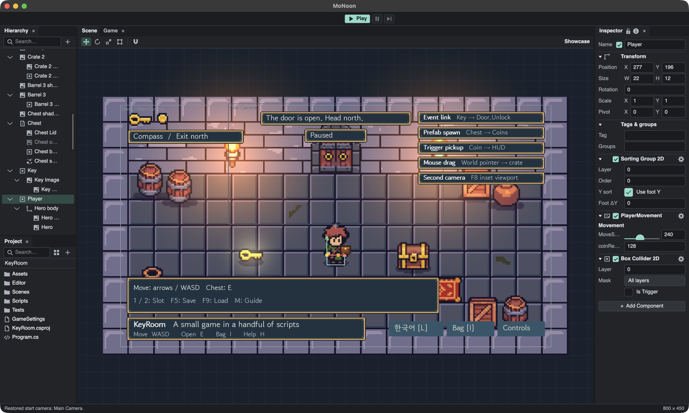

## 설계 원칙

- **배포본에는 게임에 필요한 것만 들어갑니다.** 에디터, 임포터, Inspector, SkiaSharp는 배포본에 없습니다. 텍스트, 오디오, 물리, 타일맵, 파티클, 조명, 스켈레톤, 트윈 가운데 게임이 쓰지 않는 기능은 기능 스위치로 Native AOT 빌드에서 잘려 나갑니다.
- **런타임 리플렉션 대신 빌드 때 코드를 만듭니다.** 게임 스크립트는 Roslyn으로 읽어 생성·필드 값 적용 코드를 함께 컴파일하므로, Native AOT trim에서 깨지지 않고 시작 비용도 들지 않습니다.
- **렌더링은 BRUTAL의 SDL3 바인딩 하나입니다.** 같은 텍스처를 쓰는 스프라이트는 묶어서 제출하고, 글자는 배포한 TTF에서 SDL_ttf로 실행 중에 그립니다. 에디터의 Play도 같은 경로로 그립니다.
- **시뮬레이션은 결정적입니다.** 이동과 충돌은 1/60초 고정 틱으로 계산하고, JIT과 Native AOT에서 결과 비트가 달라질 수 있는 수학 API는 검사로 막습니다. 같은 입력을 창 없이 재생하면 Release와 Native AOT가 바이트 단위로 같은 저장 파일을 만듭니다.

## 숫자로 보는 엔진

| 항목 | 값 | 근거 |
| --- | --- | --- |
| KeyRoom Native AOT 배포본 | 앱 14.7 MB, 첫 프레임 51 ms | [빌드 크기 기준값](engine/tests/results/build-size/baseline.tsv) (macOS arm64) |
| 탄막 샘플의 SDL 제출 | 프레임당 중앙값 2,719회 → 10회 (같은 텍스처 묶음 제출) | [BarrageLab 측정](engine/tests/results/sprite-pools/README.md) |
| 스크립트 등록·필드 값 적용 | 런타임 리플렉션 없이 빌드 때 생성한 C# 코드 | [스크립팅 구현 기록](docs/history/runtime.md#스크립팅) |
| 자동 검사 | 엔진 검사 970개, 샘플 하네스 73개 | [로컬 회귀 검사](docs/manual/build.md#로컬-회귀-검사) |

## 구조

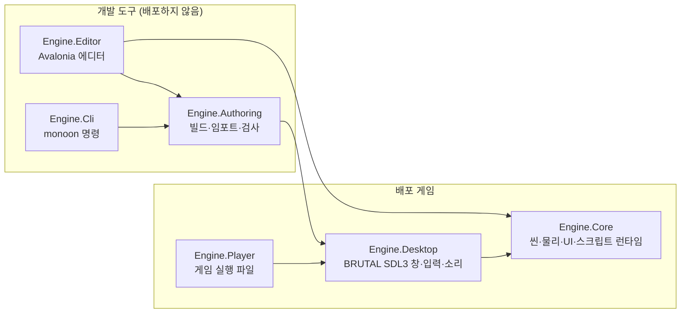

- **Engine.Core**는 에디터의 Play와 배포 게임이 함께 쓰는 런타임입니다. 씬과 컴포넌트, Box2D 물리, 타일맵, 게임 UI, 애니메이터, 저장을 담습니다. 에디터나 빌드 도구를 참조하지 않습니다. [게임 루프](engine/src/Engine.Core/GameLoop.cs)
- **Engine.Editor**는 Avalonia로 만든 편집기입니다. 씬 편집과 Play, Inspector, 애니메이션 타임라인, 타일 브러시, 파티클 패널이 있습니다. [에디터와 프로젝트](docs/manual/editor.md)
- **Engine.Authoring**과 **monoon 명령**은 Release·Native AOT 빌드, 에셋 임포트, 회귀 검사를 맡습니다. [빌드와 배포](docs/manual/build.md)
- **검증**은 엔진 검사와 샘플별 하네스로 합니다. 하네스는 에디터 Play, Release, Native AOT에서 같은 입력을 재생해 결과를 비교합니다. 아래 쇼케이스 화면도 같은 입력 재생으로 만듭니다. [입력 리플레이](engine/tests/InventoryLab.Replay/README.md)

## 시작하기

.NET 10 SDK가 필요합니다. macOS arm64에서 처음 빌드할 때는 Xcode Command Line Tools와 CMake 3.24 이상도 필요합니다. Linux에서는 X11 데스크톱에서 실행하세요.

```sh
git clone https://github.com/colorsockss/monoon.git
cd monoon
dotnet run --project engine/src/Engine.Editor -- samples/KeyRoom
```

1. **Play**를 누르고 방향키나 WASD로 왼쪽의 노란 열쇠를 주우세요.
2. 위쪽 벽의 열린 문으로 걸어 들어가세요.
3. **Stop**을 누르면 편집 화면으로 돌아옵니다. **Hierarchy → Player**를 선택하면 **Inspector**에서 이동 속도를 바꿀 수 있습니다.

## 쇼케이스

샘플마다 엔진 기능을 하나씩 보여 주는 쇼케이스 씬이 있습니다. 쇼케이스는 샘플이면서 회귀 검사 대상입니다.

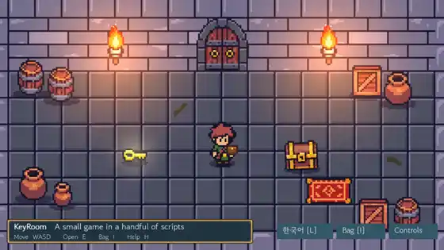

KeyRoom 쇼케이스: 열쇠를 주우면 문이 열리고(이벤트 연결), 상자에서 동전 프리팹이 나오고, 마우스로 상자를 끌고, 보조 카메라를 켜고, 저장한 뒤 다음 방으로 넘어가 물리로 상자를 밀어 발판을 누릅니다.

아래 이미지를 누르면 그 기능을 설명하는 매뉴얼 장으로 가고, 거기서 쇼케이스가 움직이는 화면으로 재생됩니다. 화면은 사람이 녹화한 것이 아니라 입력 기록을 창 없이 재생해 프레임을 저장한 것이라, 엔진이 바뀌면 같은 명령으로 다시 만듭니다. [촬영 도구](showcase-src/film.py) · [촬영 입력](showcase-src/shots/)

| | | |
| --- | --- | --- |
| [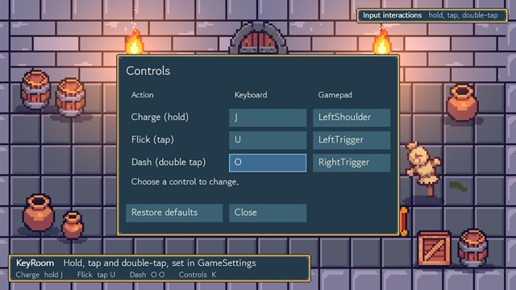](docs/manual/input-actions.md)<br>**입력 액션** · 홀드·탭·두 번 탭, 실행 중 키 재설정<br>[입력 액션](docs/manual/input-actions.md) | [](docs/manual/tilemaps.md)<br>**타일맵** · 직교·등각·육각 격자, 실행 중 `SetTile`<br>[타일맵과 타일셋](docs/manual/tilemaps.md) | [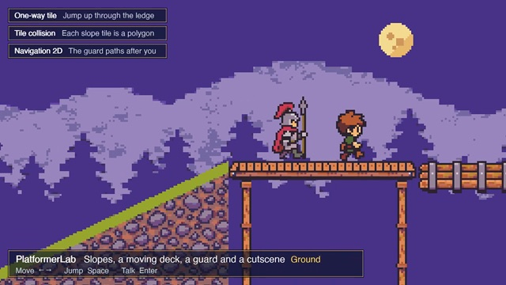](docs/manual/platformer-physics.md)<br>**플랫포머** · 경사·단방향 발판, 길찾는 경비병, 움직이는 발판, 컷신<br>[플랫포머 물리](docs/manual/platformer-physics.md) |
| [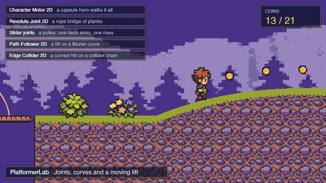](docs/manual/platformer-physics.md)<br>**관절과 경로** · 흔들다리·도르래·곡선 경로 승강대<br>[플랫포머 물리](docs/manual/platformer-physics.md) | [](docs/manual/effects.md)<br>**2D 조명** · 밤, 횃불, 그림자, 스프라이트 셰이더<br>[파티클·셰이더·조명](docs/manual/effects.md) | [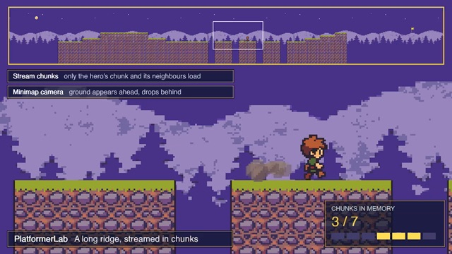](docs/manual/tilemaps.md)<br>**청크 스트리밍** · 7청크 능선 중 근처 3청크만 메모리에<br>[타일맵과 타일셋](docs/manual/tilemaps.md) |
| [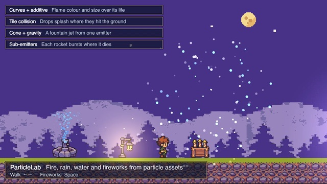](docs/manual/effects.md)<br>**파티클** · 모닥불·비·분수·불꽃놀이, 입자 10,240개<br>[파티클·셰이더·조명](docs/manual/effects.md) | [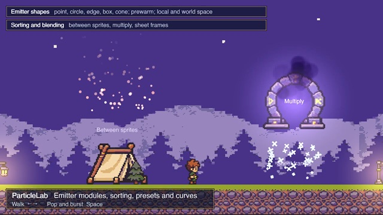](docs/manual/effects.md)<br>**파티클 모듈** · 방출 형태, 정렬·블렌딩, 프리셋, 곡선, 노이즈<br>[파티클·셰이더·조명](docs/manual/effects.md) | [](docs/manual/sprite-pools.md)<br>**스프라이트 풀** · 탄막 수천 발, 묶음 제출, 프리팹 풀<br>[스프라이트 풀](docs/manual/sprite-pools.md) |
| [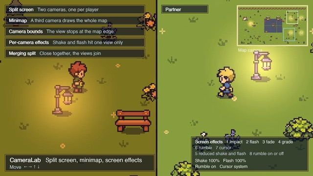](docs/manual/cameras.md)<br>**카메라** · 합쳐졌다 갈라지는 분할 화면, 미니맵, 카메라별 화면 효과<br>[Camera 2D](docs/manual/cameras.md) | [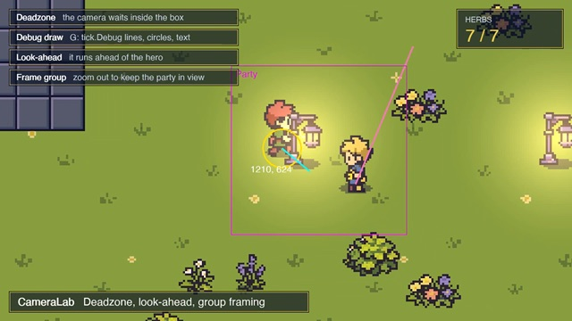](docs/manual/cameras.md#데드존-앞보기-여러-대상-담기)<br>**프레이밍** · 데드존, 앞보기, 일행 담기, 디버그 그리기<br>[Camera 2D](docs/manual/cameras.md#데드존-앞보기-여러-대상-담기) | [](docs/manual/sprites.md)<br>**애니메이터** · 8방향 걷기, 조건 전환, 클립 이벤트, Any State<br>[스프라이트와 애니메이션](docs/manual/sprites.md) |
| [](docs/manual/sprites.md)<br>**스프라이트** · 발 기준 Y 정렬, 9-slice, 궤적, Aseprite 임포트<br>[스프라이트와 애니메이션](docs/manual/sprites.md) | [](docs/manual/inventory.md)<br>**대화·의뢰·저장** · 선택지 대화, 의뢰 추적, 쌓이는 가방, 손상 저장 복구<br>[인벤토리](docs/manual/inventory.md) | [](docs/manual/game-ui.md)<br>**게임 UI** · 끌어 놓는 가방 칸, 1,000행 가상 목록과 정렬<br>[게임 화면 UI](docs/manual/game-ui.md) |
| [](docs/manual/game-ui.md)<br>**접근성** · 세 언어, 글자 크기 200%, 고대비, 흔들림 줄이기<br>[게임 화면 UI](docs/manual/game-ui.md) | [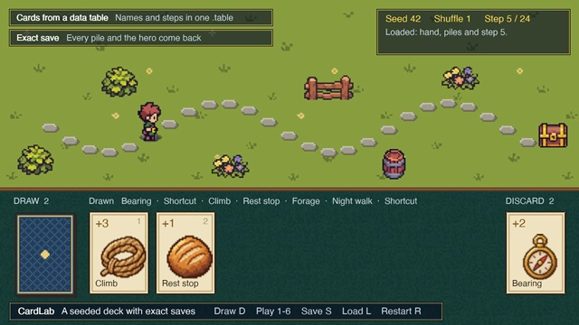](docs/manual/decks.md)<br>**카드 덱** · 데이터 테이블 카드, 정확한 저장, 시드 셔플<br>[카드 덱](docs/manual/decks.md) | [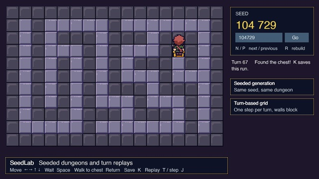](docs/manual/generation.md)<br>**절차 생성** · 시드 미로, 턴 기록과 리플레이<br>[절차 생성과 시드](docs/manual/generation.md) |
| [](docs/manual/navigation.md)<br>**군중 길찾기** · 200명이 문이 열리면 길을 다시 찾음<br>[내비게이션과 AI](docs/manual/navigation.md) | [](docs/manual/navigation.md)<br>**지형 비용** · 비가 오면 진흙, 다리가 놓이면 새 경로<br>[내비게이션과 AI](docs/manual/navigation.md) | [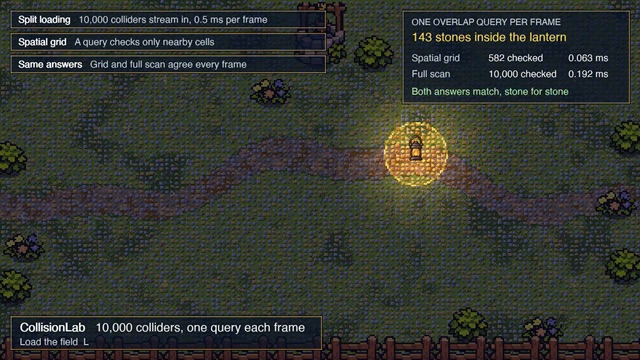](docs/manual/collision.md)<br>**공간 질의** · 충돌체 1만 개 분할 로딩, 공간 격자 대 전체 검사<br>[충돌 도형과 공간 질의](docs/manual/collision.md) |
| [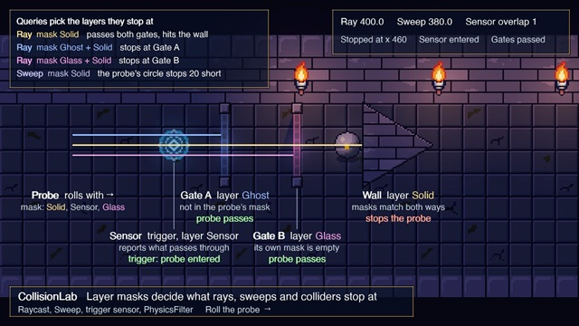](docs/manual/collision.md#스크립트에서-탐색하기)<br>**레이·스윕·마스크** · 광선과 원 스윕, 센서, 레이어 마스크<br>[충돌 도형과 공간 질의](docs/manual/collision.md#스크립트에서-탐색하기) | | |

소리가 핵심인 AudioLab·RhythmLab과 창 설정을 다루는 DisplayLab은 영상이 없습니다. [사용자 매뉴얼](docs/manual/README.md)에서 직접 실행해 볼 수 있습니다.

## 게임 샘플

쇼케이스의 기능을 함께 써서 처음부터 끝까지 플레이할 수 있게 만든 작은 게임입니다.

| 게임 샘플 | 장르 | 플레이 방법 |
| --- | --- | --- |
| [LedgeRun](samples/LedgeRun/) | 직교 타일맵 횡스크롤 플랫포머 | [LedgeRun](docs/manual/ledgerun.md) |
| [IsoBand](samples/IsoBand/) | 등각 타일맵 용병단 액션 RPG | [IsoBand](docs/manual/isoband.md) |
| [HexRealm](samples/HexRealm/) | 육각 타일맵 턴제 전략 | [HexRealm](docs/manual/hexrealm.md) |

## 문서

- [사용자 매뉴얼](docs/manual/README.md): 에디터 사용법과 기능별 안내
- [개발자 가이드와 빌드 방법](docs/development.md)
- [구현 기록](docs/history/README.md): 기능이 어떻게, 왜 그렇게 만들어졌는지
- [개발 로드맵](docs/roadmap.md)
