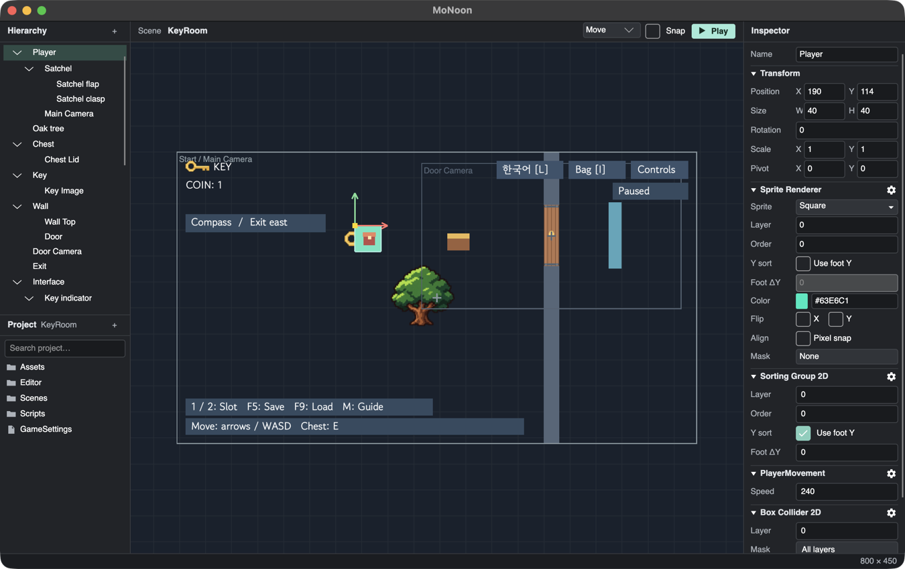

# MoNoon Engine

MoNoon은 C#으로 2D 데스크톱 게임을 만드는 엔진입니다. 씬 편집기에서 오브젝트를 배치하고 컴포넌트로 동작을 만듭니다. **Play**를 누르면 그 자리에서 게임을 조작할 수 있습니다.

macOS arm64, Windows x64, Linux x64를 지원합니다. 게임은 Release 또는 Native AOT로 빌드할 수 있습니다.



## 샘플로 보는 엔진 기능

| 샘플 | 직접 해볼 수 있는 일 | 구현과 검증 |
| --- | --- | --- |
| [KeyRoom](samples/KeyRoom/) | 왼쪽에서 열쇠를 주우면 북쪽 문이 열립니다. 문을 지나 두 번째 방으로 이동합니다. 가방·조작 안내·언어 전환·상자 프리팹도 한 방에서 봅니다. | [문을 여는 C# 코드](samples/KeyRoom/Scripts/DoorLock.cs) · [이벤트 검증](engine/tests/results/game-events/README.md) |
| [PlatformerLab](samples/PlatformerLab/) | 경사 타일을 오르고, 한쪽 통과 발판을 뛰어오르고, 움직이는 발판을 타고, 경비병의 길찾기와 컷신을 봅니다. 흔들다리·도르래·곡선 경로 발판, 조명, 타일 스트리밍은 다른 쇼케이스 씬에 있습니다. | [발판과 스켈레탈 애니메이션](docs/manual/rig-animation.md) · [플랫폼 물리](docs/manual/platformer-physics.md) |
| [InventoryLab](samples/InventoryLab/) | 약초상과 대화해 의뢰를 받고 보상을 수령합니다. 최신 저장이 손상되면 직전 저장에서 이어갑니다. | [게임 스크립트 API](docs/manual/api.md) · [세 운영체제에서 확인한 저장 복구](engine/tests/results/slot-recovery/README.md) |

위 샘플은 기능마다 쇼케이스 씬으로 엔진 기능을 하나씩 보여 줍니다. 아래 게임 샘플은 그 기능을 함께 써서 처음부터 끝까지 플레이할 수 있게 만든 작은 게임입니다.

| 게임 샘플 | 장르 | 플레이 방법 |
| --- | --- | --- |
| [LedgeRun](samples/LedgeRun/) | 직교 타일맵 횡스크롤 플랫포머 | [LedgeRun](docs/manual/ledgerun.md) |
| [IsoBand](samples/IsoBand/) | 등각 타일맵 용병단 액션 RPG | [IsoBand](docs/manual/isoband.md) |
| [HexRealm](samples/HexRealm/) | 육각 타일맵 턴제 전략 | [HexRealm](docs/manual/hexrealm.md) |

## 엔진은 어떻게 동작하나요?

- **편집 도구**는 Avalonia로 만들었습니다. 애니메이션 타임라인에서 프레임 순서와 시간을 바꿀 수 있습니다. 타일맵은 씬에서 브러시로 칠합니다. [애니메이션 편집기](docs/manual/sprites.md) · [타일맵 편집기](docs/manual/tilemaps.md)
- **게임 로직**은 에디터의 Play와 배포 게임이 공유합니다. 이동과 충돌은 1/60초 간격으로 계산합니다. 같은 입력을 창 없이 재생해 빌드별 저장 결과를 비교할 수 있습니다. [게임 루프](engine/src/Engine.Core/GameLoop.cs) · [입력 리플레이](engine/tests/InventoryLab.Replay/README.md)
- **배포 게임**은 BRUTAL의 SDL3 바인딩으로 화면을 그립니다. 같은 텍스처를 쓰는 스프라이트는 묶어서 제출합니다. macOS 탄막 샘플에서 프레임당 SDL 제출 횟수의 중앙값이 2,719회에서 10회로 줄었습니다. [BRUTAL](https://github.com/ahwootech/BRUTAL) · [BarrageLab 측정 조건과 원본 데이터](engine/tests/results/sprite-pools/README.md)

## KeyRoom 실행하기

.NET 10 SDK가 필요합니다. macOS arm64에서 처음 빌드할 때는 Xcode Command Line Tools와 CMake 3.24 이상도 필요합니다. Linux에서는 X11 데스크톱에서 실행하세요.

```sh
git clone https://github.com/colorsockss/monoon.git
cd monoon
dotnet run --project engine/src/Engine.Editor -- samples/KeyRoom
```

1. **Play**를 누르고 방향키나 WASD로 왼쪽의 노란 열쇠를 주우세요.
2. 위쪽 벽의 열린 문으로 걸어 들어가세요.
3. **Stop**을 누르면 편집 화면으로 돌아옵니다. **Hierarchy → Player**를 선택하면 **Inspector**에서 이동 속도를 바꿀 수 있습니다.

[사용자 매뉴얼](docs/manual/README.md) · [개발자 가이드와 빌드 방법](docs/development.md) · [개발 로드맵](docs/roadmap.md)
