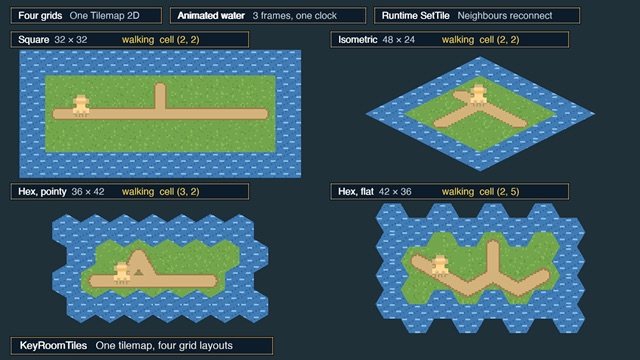
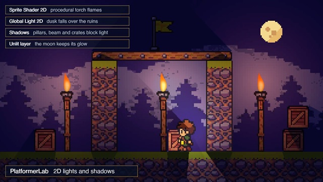
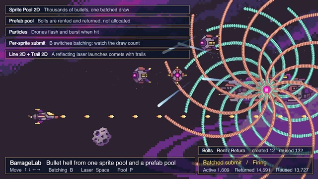
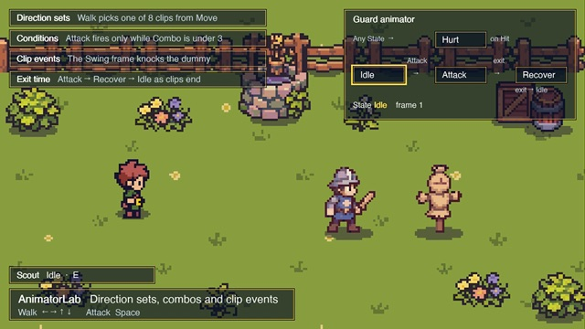
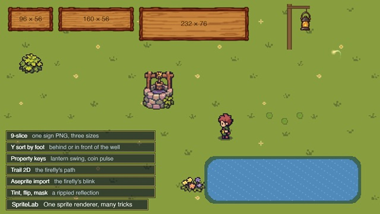
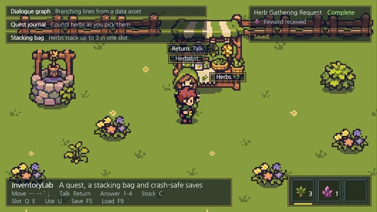
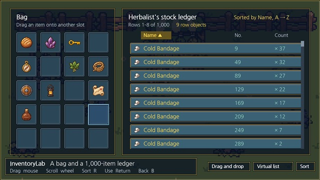
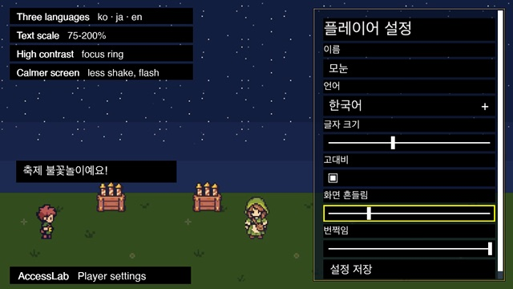
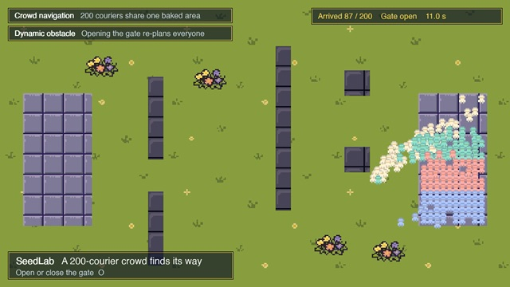
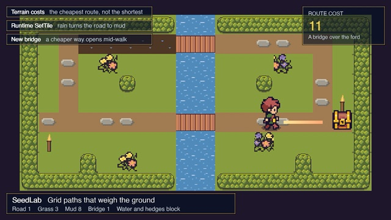

# MoNoon Engine

MoNoon은 C#으로 2D 데스크톱 게임을 만드는 엔진입니다. Unity를 대신할 엔진으로 만들고 있고, 목표는 **작은 배포 용량과 빠른 실행**입니다. 씬 편집기에서 오브젝트를 배치하고 컴포넌트로 동작을 만든 뒤, **Play**를 누르면 그 자리에서 게임을 조작할 수 있습니다.

macOS arm64, Windows x64, Linux x64를 지원합니다. 게임은 Release 또는 Native AOT로 빌드할 수 있습니다.

{{KeyRoom}}

KeyRoom 쇼케이스: 열쇠를 주우면 문이 열리고(이벤트 연결), 상자에서 동전 프리팹이 나오고, 마우스로 상자를 끌고, 보조 카메라를 켜고, 저장한 뒤 다음 방으로 넘어가 물리로 상자를 밀어 발판을 누릅니다.

## 숫자로 보는 엔진

| 항목 | 값 | 근거 |
| --- | --- | --- |
| KeyRoom Native AOT 배포본 | 앱 14.7 MB, 첫 프레임 51 ms | [빌드 크기 기준값](engine/tests/results/build-size/baseline.tsv) (macOS arm64) |
| 탄막 샘플의 SDL 제출 | 프레임당 중앙값 2,719회 → 10회 (같은 텍스처 묶음 제출) | [BarrageLab 측정](engine/tests/results/sprite-pools/README.md) |
| 스크립트 등록·필드 값 적용 | 런타임 리플렉션 없이 빌드 때 생성한 C# 코드 | [스크립팅 구현 기록](docs/history/runtime.md#스크립팅) |
| 자동 검사 | 엔진 검사 970개, 샘플 하네스 73개 | [로컬 회귀 검사](docs/manual/build.md#로컬-회귀-검사) |

아래 영상은 모두 사람이 녹화한 것이 아니라, 입력 기록을 창 없이 재생해 프레임을 저장한 것입니다. 같은 입력이면 같은 프레임이 나오므로, 엔진이 바뀔 때마다 같은 명령으로 다시 찍습니다. [촬영 도구](showcase-src/film.py) · [촬영 입력](showcase-src/shots/)

## 기능 쇼케이스

샘플마다 쇼케이스 씬이 하나 이상 있고, 쇼케이스가 곧 샘플이자 회귀 검사 대상입니다. 이미지를 누르면 영상이 재생됩니다.

| | | |
| --- | --- | --- |
| []({{KeyRoom-Moves}})<br>**입력 액션** · 홀드·탭·두 번 탭, 실행 중 키 재설정<br>[입력 액션](docs/manual/input-actions.md) | []({{KeyRoomTiles}})<br>**타일맵** · 직교·등각·육각 격자, 실행 중 `SetTile`<br>[타일맵과 타일셋](docs/manual/tilemaps.md) | []({{PlatformerLab}})<br>**플랫포머** · 경사·단방향 발판, 길찾는 경비병, 움직이는 발판, 컷신<br>[플랫포머 물리](docs/manual/platformer-physics.md) |
| []({{PlatformerLab-Course}})<br>**관절과 경로** · 흔들다리·도르래·곡선 경로 승강대<br>[플랫포머 물리](docs/manual/platformer-physics.md) | []({{PlatformerLab-Lights}})<br>**2D 조명** · 밤, 횃불, 그림자, 스프라이트 셰이더<br>[파티클·셰이더·조명](docs/manual/effects.md) | []({{PlatformerLab-Stream}})<br>**청크 스트리밍** · 7청크 능선 중 근처 3청크만 메모리에<br>[타일맵과 타일셋](docs/manual/tilemaps.md) |
| []({{ParticleLab}})<br>**파티클** · 모닥불·비·분수·불꽃놀이, 입자 10,240개<br>[파티클·셰이더·조명](docs/manual/effects.md) | []({{ParticleLab-Workshop}})<br>**파티클 모듈** · 방출 형태, 정렬·블렌딩, 프리셋, 곡선, 노이즈<br>[파티클·셰이더·조명](docs/manual/effects.md) | []({{BarrageLab}})<br>**스프라이트 풀** · 탄막 수천 발, 묶음 제출, 프리팹 풀<br>[스프라이트 풀](docs/manual/sprite-pools.md) |
| []({{CameraLab}})<br>**카메라** · 합쳐졌다 갈라지는 분할 화면, 미니맵, 카메라별 화면 효과<br>[Camera 2D](docs/manual/cameras.md) | []({{CameraLab-Framing}})<br>**프레이밍** · 데드존, 앞보기, 일행 담기, 디버그 그리기<br>[Camera 2D](docs/manual/cameras.md#데드존-앞보기-여러-대상-담기) | []({{AnimatorLab}})<br>**애니메이터** · 8방향 걷기, 조건 전환, 클립 이벤트, Any State<br>[스프라이트와 애니메이션](docs/manual/sprites.md) |
| []({{SpriteLab}})<br>**스프라이트** · 발 기준 Y 정렬, 9-slice, 궤적, Aseprite 임포트<br>[스프라이트와 애니메이션](docs/manual/sprites.md) | []({{InventoryLab}})<br>**대화·의뢰·저장** · 선택지 대화, 의뢰 추적, 쌓이는 가방, 손상 저장 복구<br>[인벤토리](docs/manual/inventory.md) | []({{InventoryLab-BagLedger}})<br>**게임 UI** · 끌어 놓는 가방 칸, 1,000행 가상 목록과 정렬<br>[게임 화면 UI](docs/manual/game-ui.md) |
| []({{AccessLab}})<br>**접근성** · 세 언어, 글자 크기 200%, 고대비, 흔들림 줄이기<br>[게임 화면 UI](docs/manual/game-ui.md) | []({{CardLab}})<br>**카드 덱** · 데이터 테이블 카드, 정확한 저장, 시드 셔플<br>[카드 덱](docs/manual/decks.md) | []({{SeedLab}})<br>**절차 생성** · 시드 미로, 턴 기록과 리플레이<br>[절차 생성과 시드](docs/manual/generation.md) |
| []({{SeedLab-Crowd}})<br>**군중 길찾기** · 200명이 문이 열리면 길을 다시 찾음<br>[내비게이션과 AI](docs/manual/navigation.md) | []({{SeedLab-Route}})<br>**지형 비용** · 비가 오면 진흙, 다리가 놓이면 새 경로<br>[내비게이션과 AI](docs/manual/navigation.md) | []({{CollisionLab}})<br>**공간 질의** · 충돌체 1만 개 분할 로딩, 공간 격자 대 전체 검사<br>[충돌 도형과 공간 질의](docs/manual/collision.md) |
| []({{CollisionLab-Casts}})<br>**레이·스윕·마스크** · 광선과 원 스윕, 센서, 레이어 마스크<br>[충돌 도형과 공간 질의](docs/manual/collision.md#스크립트에서-탐색하기) | | |

소리가 핵심인 AudioLab·RhythmLab과 창 설정을 다루는 DisplayLab은 영상이 없습니다. [사용자 매뉴얼](docs/manual/README.md)에서 직접 실행해 볼 수 있습니다.

## 게임 샘플

쇼케이스의 기능을 함께 써서 처음부터 끝까지 플레이할 수 있게 만든 작은 게임입니다.

| 게임 샘플 | 장르 | 플레이 방법 |
| --- | --- | --- |
| [LedgeRun](samples/LedgeRun/) | 직교 타일맵 횡스크롤 플랫포머 | [LedgeRun](docs/manual/ledgerun.md) |
| [IsoBand](samples/IsoBand/) | 등각 타일맵 용병단 액션 RPG | [IsoBand](docs/manual/isoband.md) |
| [HexRealm](samples/HexRealm/) | 육각 타일맵 턴제 전략 | [HexRealm](docs/manual/hexrealm.md) |

## 엔진은 어떻게 동작하나요?


- **편집 도구**는 Avalonia로 만들었습니다. 애니메이션 타임라인에서 프레임 순서와 시간을 바꿀 수 있습니다. 타일맵은 씬에서 브러시로 칠합니다. [애니메이션 편집기](docs/manual/sprites.md) · [타일맵 편집기](docs/manual/tilemaps.md)
- **게임 로직**은 에디터의 Play와 배포 게임이 공유합니다. 이동과 충돌은 1/60초 간격으로 계산합니다. 같은 입력을 창 없이 재생해 Release와 Native AOT의 저장 결과를 바이트 단위로 비교합니다. [게임 루프](engine/src/Engine.Core/GameLoop.cs) · [입력 리플레이](engine/tests/InventoryLab.Replay/README.md)
- **배포 게임**은 BRUTAL의 SDL3 바인딩으로 화면을 그리고, 글자는 SDL_ttf로 실행 중에 그립니다. 같은 텍스처를 쓰는 스프라이트는 묶어서 제출합니다. 에디터 전용 코드와 SkiaSharp는 배포본에 들어가지 않습니다. [BRUTAL](https://github.com/ahwootech/BRUTAL) · [BarrageLab 측정 조건과 원본 데이터](engine/tests/results/sprite-pools/README.md)
- **게임 스크립트**는 빌드 때 Roslyn으로 읽어 생성·필드 값 적용 코드를 만들어 함께 컴파일합니다. 런타임 리플렉션이 없어 Native AOT trim에 안전하고, 게임이 쓰지 않는 엔진 기능은 기능 스위치로 배포본에서 빠집니다. [스크립팅 구현 기록](docs/history/runtime.md#스크립팅) · [프로젝트 C# 스크립팅](docs/manual/scripting.md)

## KeyRoom 실행하기

.NET 10 SDK가 필요합니다. macOS arm64에서 처음 빌드할 때는 Xcode Command Line Tools와 CMake 3.24 이상도 필요합니다. Linux에서는 X11 데스크톱에서 실행하세요.

```sh
git clone https://github.com/colorsockss/monoon.git
cd monoon
dotnet run --project engine/src/Engine.Editor -- samples/KeyRoom
```

1. **Play**를 누르고 방향키나 WASD로 왼쪽의 노란 열쇠를 주우세요.
2. 위쪽 벽의 열린 문으로 걸어 들어가세요.
3. **Stop**을 누르면 편집 화면으로 돌아옵니다. **Hierarchy → Player**를 선택하면 **Inspector**에서 이동 속도를 바꿀 수 있습니다.

[사용자 매뉴얼](docs/manual/README.md) · [개발자 가이드와 빌드 방법](docs/development.md) · [개발 로드맵](docs/roadmap.md)
