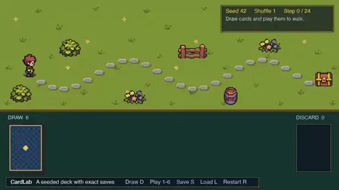

# 덱 패키지와 CardLab

[CardLab](../../samples/CardLab/)을 열고 **Play**를 누른다(`Scenes/ShowcaseTrail.scene`). 여정 카드 여섯 장이 시드 42로 섞인다. 카드를 사용할 때마다 적힌 칸 수만큼 주인공이 길의 돌을 따라 걷는다.



*CardLab 쇼케이스. 데이터 테이블의 카드를 뽑아 쓰고, 저장한 손패와 더미를 그대로 불러오고, 같은 시드로 다시 시작하면 같은 순서로 뽑힌다.*

| 조작 | 동작 |
| --- | --- |
| **D** | 덱 맨 위 카드를 손패 끝에 추가한다. 덱이 비면 버린 카드만 다시 섞어서 한 장 뽑는다. 모든 카드가 손에 있으면 하나를 사용한 뒤 다시 뽑을 수 있다. |
| **1~6** | 해당 위치의 카드를 사용해 버린 더미로 보낸다. 남은 손패는 순서를 유지한다. |
| **R / N** | R은 현재 시드로 여정을 처음부터 시작한다. N은 다음 시드로 새 여정을 시작한다. 씬의 **Deck → DeckSource → InitialSeed**에서 시작 시드를 정할 수 있다. |
| **S / L** | S로 슬롯 1에 저장한다. 에디터 Play나 게임을 다시 시작하고 L을 누르면 남은 덱 순서, 손패, 버린 카드, 셔플 차수와 주인공 위치가 복원된다. |

시드 42에서 **D**를 세 번 누르면 Bearing, Shortcut, Climb 순서로 나온다. **2**를 누르면 Shortcut을 사용해 3칸 걷고, 손에는 Bearing과 Climb이 남는다. 여기서 **S**로 저장하고 다시 열어 **L**을 누르면 손패와 남은 덱이 그대로 돌아온다.

## 내 프로젝트에 넣기

1. **Project → Import Package…**에서 [Decks.monopackage](../../packages/Decks.monopackage)를 선택한다.
2. **Assets/Decks/Deck.prefab**을 Scene에 배치한다. **DeckSource**의 **Catalog**와 **InitialSeed**를 Inspector에서 지정한다. 카드 표에서 행 키는 카드 ID, **label**은 표시 이름, **copies**는 시작 덱에 포함할 장수다. 같은 카드를 여러 장 넣을 수 있다. CardLab의 **steps** 열은 샘플의 이동 규칙에 쓰인다. [샘플 카드 표](../../samples/CardLab/Assets/Showcase/ShowcaseTrail.table)
3. 게임 스크립트에서 `ComponentReference<DeckSource>` 필드를 선언하고 프리팹 인스턴스를 연결한다. **OnEnable**에서 `Source.Resolve(life.Objects).Deck`으로 런타임 덱을 얻는다. 네임스페이스는 `MoNoon.Decks`다.

```csharp
if (deck.TryDraw(out var drawnId))
    ShowDrawnCard(drawnId);

if (deck.TryPlay(handIndex, out var playedId))
    ApplyCardEffect(playedId);
```

`Hand`는 뽑은 순서대로 읽으며 첫 번째 카드의 인덱스는 0이다. `TryPlay`가 성공하면 카드 ID로 게임별 효과를 적용한다. `Capture()`를 게임 저장 슬롯에 쓰고 `Restore(data)`로 불러온다. YAML의 **draw**는 다음에 뽑을 카드부터, **discard**는 먼저 버린 카드부터 기록한다. 복원 시 카드 ID별 총장수를 현재 카탈로그와 대조한다.

각 셔플은 시드와 셔플 차수로 만든 `SeededRandom` 스트림으로 Fisher–Yates 알고리즘을 실행한다. 같은 카드 표와 시드에서 같은 순서로 카드를 뽑고 사용하면, 저장을 거쳐도 이후 셔플이 재현된다. [덱 코드](../../samples/CardLab/Scripts/Decks/CardDeck.cs) · [Mac 실행 결과](../../engine/tests/results/decks/README.md)
