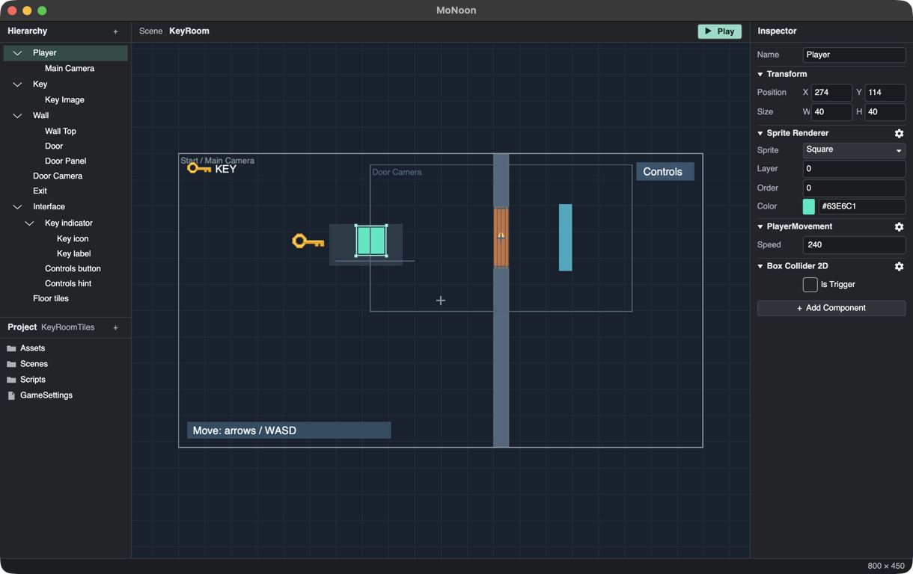

# 에디터와 프로젝트

[매뉴얼 목차](README.md)

## 데스크톱 배포 에디터

| 플랫폼 | 열기 |
| --- | --- |
| macOS arm64 | `MoNoon.app`을 연다. |
| Windows x64 | `MoNoon-win-x64.zip`을 풀고 `editor\MoNoon.exe`를 실행한다. |
| Linux x64 | X11 데스크톱에서 `tar -xzf MoNoon-linux-x64.tar.gz`로 푼 뒤 `./editor/MoNoon`을 실행한다. |

Windows·Linux 에디터 패키지에는 .NET 런타임과 프로젝트의 C# 스크립트를 컴파일하는 Roslyn이 들어 있다. 게임을 내보낼 때 쓰는 `player-templates/`는 추출한 `editor/`와 같은 상위 폴더에 둘 수 있다. 별도 위치를 쓰면 `MONOON_PLAYERS_DIR`에 그 절대 경로를 지정한다. Native AOT 게임을 빌드할 때는 대상 OS의 .NET SDK와 네이티브 빌드 도구도 필요하다.

**KeyRoom으로 편집해 보기**

1. 쓰기 가능한 폴더에 `KeyRoom-sample.zip`을 푼다. **File → Open Project…**에서 `GameSettings`가 들어 있는 `KeyRoom` 폴더를 고른다. 명령줄에서는 에디터의 첫 인자로 프로젝트 폴더 경로를 넘길 수 있다.
2. **Play**를 누르고 이동하지 않은 채 **I**를 누른다. 가방에 `Quest / Find Brass key`가 보인다. **Stop**을 누른다.
3. Hierarchy에서 **Player**를 선택한다. **Inspector → Transform → Position X**를 `274`에서 `190`으로 바꾸고 Enter를 누른다. **File → Save Scene**으로 저장한 뒤 에디터를 닫고 같은 프로젝트를 다시 연다.
4. X가 `190`인지 확인하고 **Play → I**를 누른다. 플레이어가 열쇠 위에서 시작해 가방에 `Quest complete / Brass key`가 표시된다. 게임 진행을 저장하려면 가방을 닫고 **F5**를 누른다. 시작 배치를 되돌리려면 편집 모드에서 X를 `274`로 저장한다.

저장소 루트에서 배포본을 생성한다. Mac 앱은 Apple Silicon Mac에서 첫 번째 명령으로 만든다. 두 x64 에디터에는 Python 3과 .NET 10 SDK가 필요하며 샘플 ZIP은 Python 3만으로 만들 수 있다. 에디터 배포본은 `editor/`, 샘플 ZIP은 `samples/dist/`에 생긴다.

```sh
engine/scripts/build-editor-mac.sh
python3 engine/scripts/package-editor.py win-x64
python3 engine/scripts/package-editor.py linux-x64
python3 engine/scripts/package-editor.py keyroom
```

## 네 패널에서 하는 일



| 패널 | 조작 |
| --- | --- |
| Hierarchy | 이름을 눌러 선택하고 삼각형으로 자식을 펼친다. 빈 곳의 우클릭 메뉴는 루트, 항목의 우클릭 메뉴는 해당 오브젝트 아래에 항목을 만든다. |
| Scene | 스프라이트를 드래그해 배치한다. 빈 영역을 드래그해 이동하고 스크롤로 포인터 주변을 확대·축소한다. 타일 편집 중에는 우클릭 드래그로 이동한다. **Scene → Frame Camera**로 카메라 프레임을 다시 찾는다. |
| Inspector | 이름과 Transform을 편집한다. 자식은 **Local pos.**, UI는 **Offset**으로 표시된다. 컴포넌트 제목을 눌러 접고 편다. 헤더 오른쪽 톱니바퀴에서 **Remove**를 선택한다. |
| Project | 실제 프로젝트 폴더를 한 단계씩 탐색한다. 폴더를 더블클릭해 들어가고 패널 제목 옆의 **↑**로 돌아간다. 제목 옆에는 현재 폴더 이름이 표시되고, 이름에 포인터를 올리면 전체 경로를 볼 수 있다. 파일을 더블클릭하면 종류에 맞는 편집기가 열린다. 검색 필드와 **+**에서 [에셋 검색·임포트, 참조 확인, 데이터·테이블 편집](project-assets.md)을 할 수 있다. |

## 오브젝트와 프리팹

- Hierarchy의 **+**는 Square 스프라이트 오브젝트를 만든다. 우클릭 메뉴에서 **Create Empty Object**, **Create Empty Child**, **Add Square**, **Add Child Square**도 사용할 수 있다.
- 오브젝트를 새 부모 위에 드롭하면 현재 월드 위치를 유지하면서 부모가 바뀐다. Hierarchy의 빈 영역에 놓으면 루트로 돌아간다. 부모를 이동하면 자식도 따라간다.
- 우클릭 **Duplicate**는 선택한 오브젝트, 하위 트리, 컴포넌트 설정을 복제한다. 트리 내부를 가리키는 오브젝트 참조도 복제본에 연결된다. 한 번의 Undo로 전체 복제를 되돌릴 수 있다.
- **Delete Object**로 부모를 지우면 직계 자식은 한 단계 위로 이동한다. 실수로 삭제했을 때는 **Edit → Undo**를 사용한다.
- 재사용할 오브젝트를 Hierarchy에서 Project 파일 목록으로 끌면 현재 폴더에 `.prefab`이 생긴다. 이 파일을 Scene으로 드래그해 인스턴스를 배치한다. 인스턴스 루트의 **Apply to Prefab**으로 수정한 하위 트리를 원본에 반영한다. 공통 설정이 바뀌어야 하는 다른 인스턴스도 확인하고 씬을 저장한다.

## 다중 선택과 기즈모

Hierarchy에서 첫 오브젝트를 클릭하고 마지막 오브젝트를 **Shift+클릭**하면 펼쳐진 행을 범위 선택한다. **Cmd+클릭**(Windows·Linux는 **Ctrl+클릭**)으로 한 개씩 추가하거나 뺄 수 있다. Scene에서는 **Shift+클릭**으로 개별 선택을 전환한다. Inspector 제목에 선택 개수가 표시된다. 여러 월드 오브젝트를 함께 이동·회전·스케일하려면 Scene 기즈모를 사용한다.

| 도구 | 조작 | Snap을 켰을 때 |
| --- | --- | --- |
| Move (W) | 빨간 X축 또는 초록 Y축을 끌어 한 축만 이동한다. 중앙을 끌면 두 축으로 이동한다. | 시작 위치에서 16단위씩 이동 |
| Rotate (E) | 원 위에서 눌러 선택 중심을 기준으로 돌린다. | 시작 각도에서 15°씩 회전 |
| Scale (R) | 축 끝 사각형을 끌면 한 축, 중앙을 오른쪽 위로 끌면 두 축을 함께 확대한다. | 시작 배율의 10%씩 변화 |

도구는 Scene 상단에서도 고를 수 있다. 단축키는 Scene에 포커스를 두고 사용한다. 단일 오브젝트는 자신의 피벗, 그룹은 선택 영역의 중심을 사용한다. 부모와 자식을 함께 골라도 자식의 로컬 변환은 유지된다. 드래그 도중 **Esc**로 취소하고, 드래그를 마친 뒤 **Cmd+Z**로 그룹 전체를 한 번에 되돌린다. 화면 UI는 앵커·레이아웃의 오프셋으로 편집한다.

### Inspector에서 충돌 마스크 함께 편집하기

1. KeyRoom의 Project 패널에서 `Scenes/WallWorkshop.scene`을 열고 Hierarchy에서 **Wall 01**을 클릭한 뒤 **Wall 10**을 **Shift+클릭**한다.
2. **Inspector · 10 selected**에 공통 컴포넌트가 표시된다. 모든 벽에서 같은 값은 그대로 보이고 서로 다른 값은 **Mixed**로 보인다. 예제에서 너비는 76, 높이는 28이며 충돌 레이어와 마스크는 혼합 상태다.
3. **Box Collider 2D → Mask**에서 **None**을 고르면 10개 마스크가 모두 0이 된다. **All layers**는 32개 비트를 전부 켠다. 개별 레이어의 **✓**는 모든 벽이 켰다는 뜻이고, **−**는 일부 벽만 켰다는 뜻이다. 혼합된 레이어를 클릭하면 그 비트를 전부 켜고, 모두 켜진 레이어를 클릭하면 그 비트를 전부 끈다. 각 벽의 다른 비트는 유지된다.
4. **Edit → Undo** 또는 **Cmd+Z**(Windows·Linux는 **Ctrl+Z**)를 한 번 누른다. 벽 10개가 선택된 채 원래 마스크로 돌아간다. 벽 하나를 선택하고 **Overrides…**를 열면 그 인스턴스의 개별 설정을 볼 수 있다.


## 프리팹의 원본과 인스턴스 편집

1. 오브젝트를 선택해 **Scene → Create Prefab**으로 에셋을 만든다. 선택한 오브젝트가 첫 인스턴스가 된다. Project의 프리팹을 Scene으로 끌어 같은 원본의 인스턴스를 추가한다.
2. 인스턴스의 이름·변환·컴포넌트 속성을 바꾸면 오버라이드가 생긴다. 인스턴스 루트에서 **Scene → Inspect Overrides…**로 수정한 필드, 추가·삭제한 컴포넌트와 자식을 확인한다. 루트의 배치 좌표는 원본을 갱신해도 유지된다.
3. **Apply to Prefab**은 현재 하위 트리를 원본에 반영한다. 다른 인스턴스는 자신이 수정한 필드를 유지하며 나머지 속성을 상속한다. **Revert Prefab Overrides**는 선택한 인스턴스를 원본 상태로 되돌린다. 원본 적용, 되돌리기, 프리팹 생성도 Undo와 Redo를 지원한다.
4. **중첩**하려면 프리팹 인스턴스를 다른 오브젝트의 자식으로 놓고 부모를 프리팹으로 만든다. 예를 들어 Chest Lid를 먼저 프리팹으로 만든 뒤 Chest를 프리팹으로 만들면, 뚜껑 원본의 변경이 상자 안에도 반영된다.
5. **변형**을 만들려면 원본의 인스턴스를 복제하고 일부 속성을 바꾼 뒤 **Create Prefab Variant**를 선택한다. 새 에셋이 원본을 상속하고 현재 오브젝트가 변형의 인스턴스가 된다. 변형 인스턴스에서 Apply는 해당 변형을 갱신하고, Revert는 해당 변형의 값으로 복구한다. 씬 배치와 인스턴스 수정은 **Cmd+S**로 저장한다.

### 프리팹 원본과 속성별 오버라이드

Project에서 `.prefab`을 더블클릭하면 별도 창의 Hierarchy와 뷰포트에 그 프리팹만 열린다. 자식을 선택해 기존 Inspector로 편집할 수 있다. 상단 **Save** 또는 **Cmd+S**로 원본을 저장한 뒤 창을 닫는다. 원본의 변경을 상속하는 인스턴스는 즉시 갱신된다. 인스턴스 루트의 씬 배치 좌표는 각 인스턴스가 유지한다.

KeyRoom 첫 방에서 다음 순서로 두 나무의 상속을 비교할 수 있다.

1. Project에서 `Oak.prefab`을 검색해 더블클릭한다. **Transform → Size → H**를 98에서 112로 바꾸고 저장한다. 씬의 **Oak tree**는 높이 112가 되고, **Courtyard oak**는 자체 높이 70을 유지한다.
2. Hierarchy에서 **Courtyard oak**를 선택하고 Inspector 상단 **Overrides…**를 연다. **width** 행의 **Source**는 102, **Instance**는 76이다. **Apply to Source**를 누르면 두 나무 모두 너비 76이 된다. **Done**으로 닫은 뒤 **Cmd+Z** 한 번으로 원본과 씬을 함께 되돌릴 수 있다.
3. 너비를 적용한 상태에서 **height → Revert Property**를 누르면 **Courtyard oak**도 높이 112를 상속한다. 이름과 위치는 유지된다. **Done → Cmd+S**로 씬을 저장하고 다시 열면 이 나무의 오버라이드 목록에는 이름만 남는다.

자식·컴포넌트 추가와 삭제는 같은 목록에 표시된다. 구조 전체를 반영하려면 기존 **Scene → Apply to Prefab**을 사용한다. 씬에만 존재하는 오브젝트 참조는 인스턴스에 설정할 수 있으며, 프리팹 원본에 적용할 수 있는 대상은 해당 프리팹 안의 오브젝트다.

## 컴포넌트와 외부 에디터

1. 오브젝트를 선택하고 **Add Component**를 연다. 메뉴의 **Built-in components**에서 엔진 기능을, **Project scripts**에서 프로젝트에 있는 동작을 고른다. **(Added)**는 이미 붙인 항목이다.
2. 새 동작은 **Add Component → New C# Component… → Create & Add**로 생성과 부착을 함께 할 수 있다. **Project → + → New C# Script…**로 파일을 먼저 만들었다면, Project에서 `.cs`를 선택된 오브젝트의 Inspector로 드래그한다.
3. macOS에서는 **MoNoon → Preferences…**, Windows·Linux에서는 **Edit → Preferences…**를 연다. **External script editor**를 지정하거나 **Use System Default**를 선택한다.
4. Project의 `.cs`를 더블클릭하거나 Inspector의 스크립트 톱니바퀴에서 **Edit Script**를 누른다. 외부 에디터에서 저장하고 MoNoon으로 돌아온 뒤 Play한다. 컴파일 오류는 **Project → Console…**에서 찾아 더블클릭하면 파일을 열 수 있다. [C# 작성 규칙과 예제](runtime.md)

## 저장과 단축키

**File → Save Scene**은 현재 씬을 저장한다. **Project → + → New Scene**으로 씬을 추가하고 Project의 `.scene`을 더블클릭해 전환한다. 씬 Undo와 애니메이션 클립 편집기의 Undo는 각 창에서 작동한다. 클립과 타일셋 변경은 각각 **Save Clip**, **Save Tileset**으로 에셋에 저장한다.

| 동작 | macOS | Windows·Linux |
| --- | --- | --- |
| 새 프로젝트 / 열기 / 씬 저장 | ⌘N / ⌘O / ⌘S | Ctrl+N / Ctrl+O / Ctrl+S |
| Undo / Redo | ⌘Z / ⇧⌘Z | Ctrl+Z / Ctrl+Shift+Z |
| Hierarchy 선택 복제 | ⌘D | Ctrl+D |
| Hierarchy 선택 제거 | ⌘Delete | Delete |
| Preferences | ⌘, | Ctrl+, |
| Scene Play 종료 / 진행 중인 타일 획 취소 | Esc | Esc |

## 프로젝트 파일 보관

`Scenes/`에는 씬을, `Assets/`에는 PNG·WAV·클립·타일셋 등을, `Scripts/`에는 프로젝트의 C# 동작을 둔다. `GameSettings`에는 게임 해상도와 시작·포함 씬, 키 설정이 들어간다. `.scene`, `.prefab`, `.clip`, `.tileset`, `.meta`, `.monoon-assets`와 `GameSettings`는 VYaml이 읽는 YAML 문서다.

프로젝트를 옮기거나 버전 관리에 넣을 때 숨김 파일인 `.monoon-assets`와 에셋별 `.meta`도 함께 담는다. Finder 등에서 에셋 이름이나 위치를 바꿀 때는 같은 이름의 `.meta`를 같이 옮겨야 기존 GUID를 확실하게 유지할 수 있다. 예전 JSON·이중 확장자 프로젝트의 변환 절차는 [빌드와 배포](build.md)에 있다.
