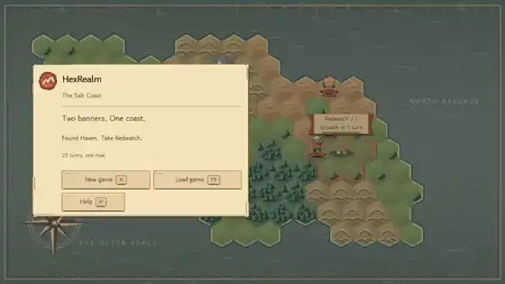

# HexRealm

HexRealm은 192칸의 솔트 해안에서 두 세력이 맞붙는 짧은 턴제 전략 게임이다. 해안에 Haven을 세우고 정찰병으로 산맥의 통로를 찾아라. 상대는 초반에 Greyharbor를 세우고 농장·광산과 병력을 갖춰 국경을 압박한다. 적 수도 Redwatch를 함락하거나 통행 가능한 땅의 40%에 깃발을 꽂으면 승리한다. 25턴을 마치면 영토, 인구, 국고, 전투 유닛의 점수를 합한다. 동점은 Redwatch가 이긴다.

*HexRealm 한 판. Haven을 세우고 정찰로 해안을 밝히며, 식량으로 도시가 자라 국경이 한 칸씩 넓어진다. 궁수가 활로 Redwatch의 병력을 막고 25턴 점수로 해안을 차지한다.*

[최종 플레이 화면과 검증 기록](../../engine/tests/results/hexrealm/README.md)

## 한 판 시작하기

1. **New game**을 누른다. 선택된 개척자로 **B**를 눌러 첫 도시를 세운다. 개척자를 옮긴 뒤 정착해도 첫 도시가 수도다.
2. 정찰병을 클릭하고 커서를 주변 칸에 올린다. 청록색 외곽선은 이번 턴에 갈 수 있는 칸이다. 노란 선과 하단 패널에서 경로, 비용, 도착 후 남는 이동력을 본 뒤 우클릭한다.
3. Haven을 클릭하고 **4**로 창병을 생산한다. 도시 이름표에는 인구, 다음 성장까지 남은 턴, 식량 진행 막대가 표시된다. 선택 카드에서는 현재 식량과 다음 턴의 수확량을 확인한다.
4. **Enter**로 상대 턴을 진행한다. 시야에 있는 상대 부대가 이동한 뒤 새 턴의 생산, 수확, 연구, 영토 편입이 차례로 표시된다. 창병은 인접한 적을 공격하고, 궁병은 두 칸 안의 적에게 제자리에서 화살을 쏜다. 피해는 화살이 닿을 때 표시되며, 반격이 있으면 그 뒤에 표시된다. 적 위에 커서를 두면 피해, 공격 후 체력, 반격을 주문 전에 확인할 수 있다.
5. 최종 칙서에서 양측 점수를 본다. **N**으로 타이틀에 돌아가거나 **F5**로 결과를 저장한다. 상단 **Land Goal**의 뒤쪽 숫자는 영토 승리에 필요한 칸 수다. 결과의 **Land tiles**는 현재 영토 칸 수이며 1칸당 1점을 얻는다.

양피지로 덮인 칸은 아직 탐험하지 않은 구역이다. 처음 발견한 칸은 탐험 경계에서 바깥으로 양피지가 걷힌다. 해안과 그 주변 바다에는 같은 덮개를 쓴다. 색이 바랜 땅은 탐험했지만 지금 시야 밖이다. 국경의 청록은 Haven, 주홍은 Redwatch를 뜻한다. 발견한 상대 영토에는 옅은 주홍색을 얹고, 상대 말은 시야에 있을 때 보인다. 말 아래 체력 막대를 확인하고, 이동을 모두 사용해 색이 흐려진 말은 다음 턴에 다시 움직인다.

## 국경 넓히기

- **성장**. 도시의 식량이 차면 인구가 1 늘고, 빈 땅이 있으면 점선으로 표시된 칸 한 곳이 편입된다. 도시 주변 한 칸에 농장을 지으면 성장까지 걸리는 턴을 줄일 수 있다. 수확을 마치고 남은 식량은 다음 성장에 이월된다. 인구 상한은 8이다.
- **개척**. 새 도시를 세우면 도시 칸과 주위의 빈 땅을 얻는다. 기존 어느 도시에서든 세 칸 이상 떨어져 있어야 하며 상대 영토에서는 정착할 수 없다.
- **점령**. 도시의 방어력을 무너뜨리고 공격자가 살아남으면 그 도시가 관리하는 칸을 함께 얻는다. 적 수도를 점령하면 최종 점수에 반영하고 캠페인을 끝낸다.

국경이 바뀌면 새 칸에 진영의 잉크가 번지고 증가량이 뜬다. 상단 **Land goal**에 커서를 올리거나 **H**를 눌러 세 가지 방법을 다시 볼 수 있다. 도시 칸에 아군이 있으면 같은 칸을 한 번 더 클릭해 해당 부대를 선택할 수 있다.

## 명령

| 입력 | 동작 |
| --- | --- |
| 좌클릭 / 우클릭 | 칸 선택 / 이동·공격 |
| Tab | 다음 아군 선택 |
| B | 개척자로 정착. 기존 도시에서 세 칸 이상 떨어진 곳에 세운다 |
| I / M / O | 아군 영토의 일꾼으로 농장 / 광산 / 도로 건설 |
| 1–5 | 도시에서 개척자 / 일꾼 / 정찰병 / 창병 / 궁병 생산 |
| R | 연구에 턴당 금화 2개 투입 또는 중지 |
| + / −, WASD | 지도 상세 / 전체 보기, 카메라 이동. 배율이 부드럽게 바뀌며 상세 보기에서는 선택한 칸으로 카메라가 이동한다 |
| F5 / F9 | 현재 캠페인 또는 결과 저장 / 이어서 플레이 |
| H | 조작법 열기·닫기 |

목초지의 이동 비용은 1, 숲·구릉·건조지는 2다. 도로가 있는 칸은 1에 통과한다. 바다와 산봉우리는 지나갈 수 없다. 농장은 인구 성장, 광산은 부대 생산을 돕는다. 연구는 테라스 농법, 궁병, 도시 교역, 성벽 강화 순으로 열린다.

저장은 명령과 시드, 상태 해시를 1번 슬롯에 기록한다. 불러올 때 명령을 다시 적용한 결과가 저장 해시와 일치해야 캠페인이 열린다. 타이틀·캠페인·최종 칙서 사이를 오갈 때 짧은 페이드가 끝나면 다음 명령을 받는다. 이전 버전 저장을 열면 버전 안내와 함께 새 캠페인을 시작한다. F5를 눌러 새 캠페인을 저장할 수 있다.

## 에디터에서 찾아보기

**samples/HexRealm**을 열고 **Scenes/Realm.scene**을 Play한다. Ground는 HexPointy 타일맵의 좌표를 제공한다. 실행하면 같은 시드에서 지형을 만들고 해안선, 구름, 국경, 주문 레이어를 채운다. [보드 씬](../../samples/HexRealm/Scenes/Realm.scene)

`RealmRules`에 이동·전투·생산·점수 규칙이 있다. `RealmBoard`는 경로 비용을 화면에 표시하고 저장을 복원한다. `RealmPresentation`은 셀 이동을 애니메이터에 연결하고 타격음, 연기 스프라이트, 월드 텍스트로 교전 결과를 보여 준다. 화면 흔들림과 번쩍임은 프로젝트의 접근성 설정을 따른다. [게임 스크립트](../../samples/HexRealm/Scripts)

그림은 [샘플 도구](../../samples/HexRealm/Tools/build_board.py)에서 다시 만들 수 있다. 같은 입력을 여러 실행 경로에 넣는 방법은 [회귀 하네스](../../engine/tests/HexRealm.Play/README.md)를 따른다.
