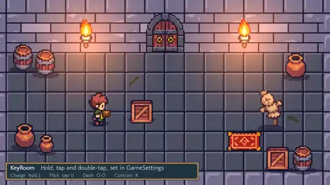

# 입력 액션

[매뉴얼 목차](README.md) · [KeyRoom 설정](../../samples/KeyRoom/GameSettings)

게임 스크립트는 키 대신 `Jump`, `ShowControls`처럼 동작의 이름을 읽는다. 여러 입력을 한 동작에 연결하면 게임 코드를 바꾸지 않고 조작법을 바꿀 수 있다.

## 프로젝트에서 지정하기

1. Play를 멈추고 **Project → Input Actions…**로 Input Actions 패널을 연다. **+ Action**을 누르고 액션 이름을 입력한다. 이름은 영문자로 시작하고 영문자·숫자·밑줄을 포함해 64자까지 허용한다. 대소문자만 다른 이름은 같은 액션이다.
2. 행의 **+ Bind**를 누른 후 키, 마우스 버튼·휠 또는 패드 버튼·스틱·트리거를 조작한다. 새 입력은 행 끝에 추가된다. **Esc**는 입력 대기를 취소한다. **Controls** 칸에서 쉼표로 직접 편집할 수도 있다. 예를 들어 `H, Mouse.Right, Pad.Start`를 `J, Mouse.Right`로 바꾸면 기존 H와 Start 연결은 사라진다.
3. **Interaction**, **Ticks**, **Buffer** 칸은 [홀드·탭·더블탭과 입력 버퍼](#홀드탭더블탭과-입력-버퍼) 규칙이다. Press는 규칙 없음이다. Ticks를 비우면 고른 상호작용의 기본값(칸에 흐리게 표시)을, Buffer를 비우면 버퍼 없음을 쓴다.
4. 아래 **Vector** 목록은 네 액션을 묶은 [2D 벡터](#2d-벡터-액션)다. **+ Vector**로 추가하고 이름과 Left·Right·Up·Down 액션 이름을 적는다. 첫 번째 벡터가 `tick.Input.Move`다.
5. 빈 Controls는 연결 없는 액션으로 남고, **×**는 액션 자체를 삭제한다. **Save**를 누르면 프로젝트 루트의 YAML 파일 `GameSettings`에 저장된다. 다음 Play와 새로 내보내는 게임 모두 이 맵을 사용한다. 예전 프로젝트의 Left·Right·Up·Down·Interact 설정은 읽을 수 있고, 다음 설정 저장부터 액션 목록으로 기록된다. 잘못된 값(범위 밖 Ticks·Buffer, 없는 액션을 가리키는 벡터, 중복 이름)은 패널 아래에 런타임 GameSettings 검증과 같은 문구로 표시되고 저장하지 않는다. 저장 한 번은 Undo 한 번으로 되돌리며, 바꾼 것 없이 Save하면 파일을 쓰지 않는다.

| KeyRoom 기본 액션 | 키보드 | 마우스 | 패드 |
| --- | --- | --- | --- |
| MoveLeft / MoveRight / MoveUp / MoveDown | 방향키, WASD | — | D-pad, 왼쪽 스틱 |
| Interact (상자 열기) | E, Space | — | South (아래쪽 버튼) |
| ShowControls (안내 열기·닫기) | H | 오른쪽 버튼 | Start |
| PauseGame (일시정지·재개) | P | — | Back |
| OpenBag (첫 방 인벤토리) | I | Bag [I] 버튼 | West |
| MenuBack (한 단계 뒤로) | Backspace, I | Cancel / Close 버튼 | East |
| KeyBindings (ShowcaseMoves 조작키 화면 열기·닫기) | K | — | RightShoulder |
| DetailView (두 번째 카메라 작은 화면 켜기·끄기) | F8 | — | — |

**Controls** 버튼을 직접 클릭해도 같은 안내가 열린다. KeyRoom은 [ToggleControls.cs](../../samples/KeyRoom/Scripts/ToggleControls.cs)에서 최근 입력 기기의 첫 바인딩을 표시한다. 그 기기에 해당 액션의 바인딩이 없으면 키보드 바인딩을 표시한다.

## 스크립트에서 읽기

`FixedUpdate(ScriptTick tick)`에서 현재 입력 모드에 속한 컴포넌트가 같은 틱의 입력을 읽는다.

| API | 의미 |
| --- | --- |
| `tick.Input.Pressed("Jump")` / `Released("Jump")` | 액션의 첫 입력을 누른 틱 / 마지막 입력을 놓은 틱. 두 키가 연결되어 있어도 하나가 남아 있으면 해제되지 않는다. 틱 사이에 키를 눌렀다 놓으면 두 값 모두 참일 수 있다. |
| `tick.Input.Held("Jump")` / `Value("Jump")` | 현재 눌려 있는지 / 연결된 입력 중 가장 큰 세기(0~1). 버튼은 0 또는 1이며 스틱·트리거는 중간값을 낸다. |
| `tick.Input.Move` / `InteractPressed` | 네 이동 액션을 합친 벡터([첫 번째 2D 벡터 액션](#2d-벡터-액션)) / Interact를 누른 순간. Move에는 아날로그 세기가 반영되고 대각선 최대 속도는 일정하다. |
| `tick.Input.Triggered("Jump")` / `Consume("Jump")` / `Vector("Aim")` | [홀드·탭·더블탭과 입력 버퍼](#홀드탭더블탭과-입력-버퍼)의 판정 / 판정을 사용 처리 / [2D 벡터 액션](#2d-벡터-액션) |
| `tick.Input.PointerPosition` / `PointerInside` | 게임 화면 왼쪽 위를 (0, 0)으로 한 논리 좌표 / 게임 화면 안인지 여부. 아래로 갈수록 Y가 커진다. 검은 여백에서 시작한 클릭은 액션을 누르지 않는다. |
| `tick.Input.ActiveDevice` | 최근 입력 기기: Keyboard, Pointer, Gamepad. 게임 영역 안에서 마우스를 움직여도 Pointer로 바뀐다. |

게임 UI가 먼저 입력을 받는다. UI 버튼을 활성화한 클릭이나 키는 같은 틱에 게임 액션까지 누르지 않는다. Esc는 Play 중지 또는 게임 종료에 쓰인다. 패드는 SDL이 인식한 첫 번째 게임패드 한 대를 사용한다. 스틱은 중심에서 20%, 트리거는 10% 이내의 작은 움직임을 무시한다. 연결을 끊거나 창이 포커스를 잃었을 때 이동이 계속되지 않는다.

## 홀드·탭·더블탭과 입력 버퍼



*KeyRoom 조작 쇼케이스. J를 길게 눌러 상자를 부수고, U를 짧게 눌러 동전을 튕기고, O를 두 번 눌러 대시한다. 너무 짧거나 느린 입력은 화면에 이유가 뜬다. 끝에서 K 메뉴로 대시 키를 F로 바꾼다.*

액션에 `interaction`, `ticks`, `buffer`를 정하면 `tick.Input.Triggered("이름")`이 그 규칙으로 판정한다. 판정은 60Hz 게임 틱 단위라 입력 재생과 세 실행 경로에서 같은 틱에 나온다. Input Actions 패널의 Interaction·Ticks·Buffer 칸에서 정하며, 저장 결과는 아래처럼 `GameSettings`에 직접 적은 파일을 엔진이 저장한 것과 바이트 단위로 같다. [패널 검증](../../engine/tests/results/editor-input-audio/README.md)

```yaml
input:
  actions:
  - {name: Charge, controls: [J, Pad.West], interaction: Hold, ticks: 30}
  - {name: Flick, controls: [U], interaction: Tap, ticks: 12}
  - {name: Dash, controls: [O], interaction: DoubleTap, ticks: 15}
  - {name: Jump, controls: [Space, Pad.South], buffer: 8}
```

| `interaction` | `Triggered`가 참인 틱 | `ticks` 기본값 |
| --- | --- | --- |
| 없음 | 누른 틱(`Pressed`와 같음) | — |
| `Hold` | 누른 틱을 1로 세어 `ticks`번째 틱까지 계속 누르고 있을 때 한 번 | 30 |
| `Tap` | 누른 뒤 `ticks` 틱이 지나기 전에 놓은 틱 | 12 |
| `DoubleTap` | 첫 입력에서 `ticks` 틱 이내의 두 번째 입력 틱. 판정된 두 입력은 다음 판정에 다시 쓰지 않는다. | 18 |

`buffer: N`은 판정을 N틱 동안 더 유지한다. `tick.Input.Consume("Jump")`는 판정이 남아 있으면 참을 반환하고 그 자리에서 사용 처리해, 같은 틱의 다른 스크립트와 다음 틱은 더 이상 보지 못한다. 착지 직전에 누른 점프를 착지 틱에 쓰는 식이다. 규칙이 없는 액션의 `Triggered`·`Consume`은 `Pressed`와 같다. `ticks`는 1–3600, `buffer`는 0–3600이다. 판정은 게임 입력(`FixedUpdate`)에만 있고 `UpdateUi`의 입력에서는 `Pressed`와 같다. 이전 틱에 받아 둔 `GameInput`은 판정을 보거나 쓰지 않는다. 재바인딩하면 그 액션의 판정 상태를 비운다.

## 2D 벡터 액션

Input Actions 패널의 Vector 목록(또는 `GameSettings`의 `vectors`)에 네 액션을 묶은 벡터를 선언하고 `tick.Input.Vector("Aim")`으로 읽는다. 길이는 1을 넘지 않아 대각선도 같은 세기다. **첫 번째 벡터가 `tick.Input.Move`다.** `vectors`가 없으면 예전처럼 `MoveLeft`·`MoveRight`·`MoveUp`·`MoveDown`을 묶은 `Move`를 쓰므로, 기존 프로젝트는 그대로 동작하고 새 프로젝트는 이동 액션 이름을 자유롭게 정할 수 있다.

```yaml
  vectors:
  - {name: Walk, left: MoveLeft, right: MoveRight, up: MoveUp, down: MoveDown}
  - {name: Aim, left: AimLeft, right: AimRight, up: AimUp, down: AimDown}
```

벡터는 입력이 바뀐 틱에만 다시 계산하고, 키를 누르고 있는 동안에는 틱마다 할당하지 않는다. KeyRoom 복사본에 위 설정을 넣고 같은 입력을 Scene Play·Release·Native AOT에서 재생해 판정 틱을 비교한 기록이 [KeyRoom.InputInteractions](../../engine/tests/KeyRoom.InputInteractions)다. [Mac 기록](../../engine/tests/results/engine-features-2/README.md#1612-입력-상호작용과-버퍼)

## 실행 중 바꾸기

게임 내 설정 화면에서는 `tick.Session.RebindInput("ShowControls", "J", "Pad.Start")`처럼 이미 정의한 액션의 **전체** 바인딩을 교체한다. `tick.Session.BindingFor("ShowControls", tick.Input.ActiveDevice)`는 해당 기기의 첫 바인딩을, 없으면 null을 반환한다. `InputRevision`이 바뀌면 표시 중인 안내를 갱신할 수 있다. 런타임 변경은 현재 게임의 씬 전환 동안 유지되며 다음 실행의 프로젝트 기본값에는 영향을 주지 않는다. 플레이어가 고른 값을 다음 실행에도 쓰려면 [플레이어 조작키 설정](#플레이어-조작키-설정과-저장)처럼 설정에 저장한다.

## 플레이어 조작키 설정과 저장

KeyRoom의 기술 쇼케이스(`Scenes/ShowcaseMoves.scene`)에서 **K** 또는 패드 **RightShoulder**를 누르면 조작키 화면(`ShowcaseBindings.scene`)이 겹쳐 열린다. Charge(누르고 있기)·Flick(짧게)·Dash(두 번)의 키보드와 게임패드 첫 바인딩이 표시되고, 첫 칸에 포커스가 있다. 아래 방향키로 칸을 옮긴다. [화면 씬](../../samples/KeyRoom/Scenes/ShowcaseBindings.scene) · [스크립트](../../samples/KeyRoom/Scripts/KeyBindingsMenu.cs)

1. 칸을 클릭하거나 **Enter**·패드 **South**로 선택하면 `…`로 바뀌고 입력을 기다린다. 키보드 칸은 다음 키, 게임패드 칸은 다음 패드 버튼·스틱·트리거를 받는다. 선택에 쓴 키를 누르고 있어 생기는 반복 입력은 무시한다.
2. 다른 액션이 쓰던 입력을 고르면 두 액션의 입력을 교환한다. Dash에 **J**를 지정하면 Charge에 O가 연결되고, 상태 줄에 `Dash (double tap): J. Charge (hold) now uses O.`가 표시된다. 같은 액션의 두 번째 입력을 고르면 첫 번째 입력과 순서만 바뀐다. 나머지 바인딩은 유지된다.
3. 입력 대기 중 **Esc**를 누르면 취소한다. 키보드 칸에서는 마우스 클릭이나 패드 입력도, 게임패드 칸에서는 키 입력도 취소로 처리한다. Caps Lock처럼 연결할 수 없는 키는 무시하고 계속 기다린다. 취소에 쓴 입력은 게임 액션을 누르지 않는다.
4. **Restore defaults**를 누르면 모든 액션이 `GameSettings`의 값으로 돌아간다. 다시 **K** 또는 **Close**를 누르면 닫힌다.

변경할 때마다 `player.settings`에 저장되며 두 슬롯이 함께 사용한다. 게임을 다시 실행하면 쇼케이스 아래 안내 줄의 `Dash  J J`와 대시 키가 저장한 값을 따른다. 첫 방의 **Controls** 안내도 같은 설정을 읽는다. 저장 위치는 [플레이어 저장](player-data.md#파일-위치)과 같다.

| API | 의미 |
| --- | --- |
| `tick.Session.BeginRebind("Interact", InputDevice.Keyboard)` | 다음 새 입력으로 해당 기기의 첫 바인딩을 바꾼다. 입력은 게임 UI보다 먼저 처리된다. |
| `RebindingAction` / `RebindingDevice` | 입력 대기 중인 액션과 기기. 대기 중이 아니면 `null`이다. |
| `CancelRebind()` | 입력 대기를 취소한다. 대기 중이 아니면 `false`를 반환한다. |
| `LastRebind` | 마지막 결과. `Control`, 바뀌기 전의 `Previous`, 입력을 내준 액션 목록 `Swapped`, 취소 여부 `Cancelled`를 제공한다. |
| `SwapBinding(action, device, control)` | 입력 대기 없이 같은 교환 규칙을 적용한다. 다른 기기의 입력이면 `ArgumentException`이 발생한다. |
| `RestoreDefaultBindings()` | 모든 액션을 프로젝트 기본값으로 되돌린다. |
| `ControlsFor(action)` | 액션의 현재 입력 전체를 순서대로 반환한다. |
| `SaveInputBindings(settings)` / `LoadInputBindings(settings)` | 기본값과 다른 액션만 `GameData`의 `inputBindings`에 쓰거나 적용한다. 바뀐 액션이 없으면 키를 지운다. 알 수 없는 액션이나 잘못된 입력은 기본값을 사용한다. |

바인딩이 바뀌면 `InputRevision`이 증가한다. KeyRoom의 방(ToggleControls)과 기술 쇼케이스(MoveTrainer)는 `OnCreate`에서 설정을 읽어 `LoadInputBindings`를 호출하고, 조작키 화면이 `InputRevision` 변화를 감지하면 `LoadSettings(1)`로 최신 설정을 다시 읽은 뒤 `SaveInputBindings`와 `SaveSettings`를 호출한다. 같은 파일에 다른 값을 쓰는 스크립트도 저장 직전에 설정을 다시 읽어야 다른 스크립트가 저장한 바인딩을 덮어쓰지 않는다. [ToggleControls.cs](../../samples/KeyRoom/Scripts/ToggleControls.cs) · [검증 기록](../../engine/tests/results/player-rebinding/README.md)

## 게임패드 진동과 마우스 커서

`tick.Session.Rumble(low, high, seconds)`는 연결된 게임패드의 저주파(왼쪽)·고주파(오른쪽) 모터를 0–1 세기로 `seconds`(0–60초) 동안 진동시킨다. 범위 밖 값은 `ArgumentOutOfRangeException`이다. 엔진이 입력을 읽는 첫 번째 패드에 SDL의 `SDL_RumbleGamepad`로 전달하며, 새 호출은 진행 중인 진동을 대체한다. 시간이 지나면 SDL이 멈춘다. 패드가 없거나 창 없이 실행하면 무시된다. 플레이어가 `tick.Ui.Preferences.Rumble`을 끄면 요청을 버린다. 이 값도 [흔들림·깜빡임 설정](cameras.md#흔들림과-깜빡임-줄이기)과 함께 `SaveTo`·`LoadFrom`으로 저장한다.

`tick.Session.SetCursor(sprite, hotX, hotY)`는 프로젝트 PNG(최대 256×256, 더 크면 `ArgumentException`)를 마우스 커서로 쓴다. 핫스폿은 클릭 위치가 되는 이미지 픽셀이며 이미지 밖이면 `ArgumentOutOfRangeException`이 발생한다. `ResetCursor()`로 시스템 커서를 복원하고, `Cursor`로 현재 상태를 읽는다. 스크립트 필드를 `SpriteReference`로 선언하면 빌드가 PNG를 배포본에 포함한다. 플레이어는 SDL 컬러 커서로 표시한다. Scene Play는 같은 픽셀로 Mac에서는 SDL Scene 패널의 `NSCursor`를, Windows 에디터에서는 Avalonia 커서를 만들어 Scene 패널 위에 표시하고, Play를 멈추면 원래 커서로 돌아간다.

CameraLab 쇼케이스에서 **6**(패드 North)은 `Rumble(.3, .9, .2)`, **1**은 흔들림과 함께 `Rumble(1, .5, .4)`를 요청한다. **8**(RightStick)은 진동 끄기, **7**(LeftStick)은 조준 커서 [Cursor.png](../../samples/CameraLab/Assets/Cursor.png)(핫스폿 8, 8)와 시스템 커서를 바꾼다.

`MONOON_FEEDBACK_LOG=<파일>`을 지정하면 플레이어와 Scene Play가 보낸 진동(기기 이름, 모터 세기 0–65535, 밀리초, 결과)과 커서(파일, 크기, 핫스폿, RGBA 해시)를 한 줄씩 기록한다. 패드 없이 확인할 때 쓴다. [Mac 기록과 비교](../../engine/tests/results/rumble-cursor/README.md)

## 입력 모드 전환과 복귀

KeyRoom 첫 방에서 **I** 또는 **Bag [I]**로 인벤토리를 연다. **Manage compass**를 선택하고 **Apply**를 누르면 나침반이 장착되고 HUD에 출구 방향이 표시된다. 다시 적용하면 가방에 넣는다. **Cancel**은 장비 상태를 유지한다. **Backspace**를 한 번 누르면 확인창에서 인벤토리로, 한 번 더 누르면 게임으로 돌아간다. **Tab / Shift+Tab**과 **Enter**로도 모든 버튼을 조작할 수 있다. [KeyRoom 예제 스크립트](../../samples/KeyRoom/Scripts/BagMenu.cs)

1. Hierarchy에서 패널로 쓸 UI Group을 만들고 Inspector의 **UI Rect → Input mode root**를 켠다. 버튼과 해당 모드에서 입력을 읽을 스크립트를 그 아래에 둔다. 확인창도 같은 방식으로 인벤토리 아래에 만들 수 있다. Scene 편집 중에는 Hierarchy에서 패널이나 자식을 선택해 해당 배치를 본다.
2. 여는 버튼의 스크립트에서 `click.Ui.PushInputMode(panelId)`를 호출한다. Play 시작 시 닫혀 있던 패널이 표시되고 처음 사용 가능한 버튼이나 텍스트 필드에 포커스가 간다. `UpdateUi`에서도 같은 API를 사용할 수 있다. 중첩된 패널은 부모 패널이 열려 있어야 한다.
3. 닫을 때는 `click.Ui.PopInputMode(panelId)`를 호출한다. 전달한 ID가 맨 위 패널일 때만 닫히며 이전 포커스가 복원된다. `ActiveInputMode`는 맨 위 패널의 ID이고 게임 기본 입력으로 돌아오면 `null`이다. 두 메서드는 성공 여부를 반환한다.

열려 있는 동안 클릭·스크롤·포커스 탐색과 스크립트의 `tick.Input`은 맨 위 패널과 그 자식에게 전달된다. 뒤쪽 스크립트도 빈 입력으로 업데이트되므로 애니메이션과 물리는 계속 진행된다. 전환에 쓴 클릭이나 누른 채 둔 이동 키는 다음 모드로 이어지지 않는다. 패널을 숨기거나 비활성화·제거하면 그 위에 열린 모드까지 정리한다.

## 월드 오브젝트 클릭과 드래그

KeyRoom 첫 방(Showcase)의 나무 상자 두 개(**Crate**, **Crate 2**)를 마우스로 끌 수 있다. [샘플 씬](../../samples/KeyRoom/Scenes/Showcase.scene)

1. 오른쪽 아래 상자를 잡고 움직인다. 오른쪽 위에 **Mouse drag** 태그가 나타나고 `Crate 2  /  Drag`처럼 현재 단계가 표시된다. 잡은 지점이 포인터 아래에 머문다.
2. **F8**을 누르면 보물상자 주변을 2.5배로 비추는 두 번째 카메라(**Detail Camera**)가 왼쪽에 작은 화면으로 나타난다. 나무 상자를 보물상자 옆으로 끌어 놓은 뒤, 작은 화면 안에서 다시 잡고 화면 밖까지 끌어 본다. 버튼을 놓을 때까지 작은 카메라의 확대율로 움직인다. 다시 **F8**을 누르면 사라진다.
3. 상자 위에 겹친 **Bag** 버튼을 누른 채 끌면 상자는 움직이지 않는다. UI가 먼저 입력을 받는다.

오브젝트의 `GameBehaviour`에 `IWorldPointerHandler`를 구현하면 `OnWorldPointer(WorldPointerEvent)`가 호출된다. 왼쪽 버튼을 누른 위치에서 게임 UI를 먼저 검사하고, 그 위치를 표시하는 최상단 카메라에서 렌더링 순서상 가장 앞에 있는 입력 가능한 오브젝트를 찾는다. 맞닿은 영역은 오브젝트의 너비·높이와 월드 변환으로 정해진다. 회전·스케일·부모 변환과 Y 정렬·정렬 그룹이 적용된다. [엔진 API](../../engine/src/Engine.Core/WorldPointer.cs)

`Press`에서 정한 `ObjectId`, `CameraId`, `GrabLocalPosition`은 한 번의 드래그 동안 유지된다. `ScreenPosition`은 게임 해상도 기준 논리 좌표이며 `WorldPosition`은 처음 집은 카메라로 환산한 월드 좌표다. 샘플은 `Drag`마다 현재 변환으로 잡은 지점을 구하고 `TryMoveStep`으로 그 지점과 `WorldPosition` 사이의 차이만큼 이동한다. [DragCrate.cs](../../samples/KeyRoom/Scripts/DragCrate.cs)

버튼을 놓으면 `Release`를 받는다. 누른 지점에서 4 논리 픽셀 미만으로 움직이고 같은 카메라와 오브젝트 위에서 놓으면 이어서 `Click`을 받는다. 포커스를 잃거나 모달 입력 모드가 열리거나 대상이 제거되는 등 조작이 중단된 경우에는 `Cancel`로 정리한다.
