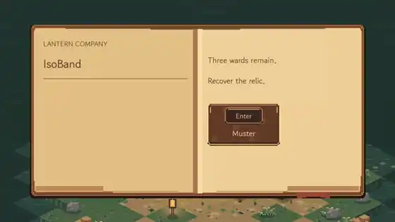

# IsoBand

IsoBand는 대장을 움직여 **랜턴 용병단**을 이끄는 등각 액션 RPG다. Haven에서 단원을 꾸리고, 습지와 유적을 거쳐 Stag Guardian을 쓰러뜨린 뒤 마을로 돌아온다. [플레이 및 검증 기록](../../engine/tests/results/isoband/README.md)

*IsoBand 한 판. Haven에서 단원을 꾸린 용병단이 습지·유적·묘지의 적 무리를 자동 전투와 Pulse로 물리치고, Stag Guardian을 쓰러뜨린 뒤 마을로 돌아와 원정 장부를 연다.*

## 조작

| 동작 | 키보드·마우스 | 패드 |
| --- | --- | --- |
| 대장 이동 | WASD·방향키 또는 걸을 수 있는 곳 클릭 | 왼쪽 스틱·방향 패드 |
| Pulse | Space | South |
| 관문·타이틀·결과 확인 | Enter | Start |
| 안전한 모닥불에서 휴식 | R | East |
| Haven에서 고용·장비 강화 | H / U | West / North |
| 현장 노트 | Tab | Right Shoulder |
| 열린 관문에서 Haven으로 돌아가기 | V | Left Shoulder |
| 완료한 슬롯으로 새 원정 | N | Back |

## Haven에서 출발하기

1. 타이틀에서 **Enter**를 누르거나 **Muster**를 클릭한다. 모닥불 옆의 Ysra에게 다가가면 고용과 강화의 키캡과 가격이 표시된다.
2. 대장·방패병·궁수로 출발한다. 새 슬롯의 6크라운으로 치유사를 고용할 수 있다. 3레벨부터 두 번째 궁수 자리가 열리며 단원은 대장을 포함해 최대 5명이다.
3. 청록색 관문 앞에서 **Enter**를 누른다. 각 지역의 3개 무리를 쓰러뜨리면 다음 관문이 열린다. 유적이나 습지를 클리어한 뒤 관문 앞에서 **V**를 누르면 Haven에서 고용·강화하고 다음 지역으로 출발할 수 있다.

## 전투와 저장

- 대장과 방패병은 가까운 적을 공격한다. 궁수는 화살을 쏘고 치유사는 가장 다친 아군을 회복한다. 왼쪽 위 방패 초상 아래의 금빛 체력 바는 피해를 받으면 붉은 밀랍색을 드러낸다. 쓰러진 단원의 초상에는 X가 뜬다. 오른쪽 위에는 크라운 수와 레벨 배지, 경험치 바가 있다. 하단 Wave 패널의 점은 현재 무리를, 적 문장 옆 숫자는 지역에서 처치한 수와 총수를 표시한다. 황동 메달의 테두리가 한 바퀴 차고 반짝이면 Pulse를 쓸 수 있다. 대장의 깃발 아래 황금 룬이 퍼지며 주변 적을 밀어낸다.
- 지하 묘지에서는 Stag Guardian이 붉은 룬으로 다음 타격 위치를 표시한다. 원 밖으로 대장을 옮기면 동료도 물러난다. Guardian의 체력이 절반 아래로 내려가면 공격 간격이 짧아진다.
- 전투가 끝난 뒤 체력이 부족하면 모닥불 가까이에서 **R**을 누른다. 쓰러진 동료도 일어난다. 대장이 쓰러지면 Haven으로 돌아가 마지막으로 저장한 지역부터 출발한다.
- 슬롯 1에 장비·단원·크라운·경험치·지역 클리어가 기록된다. 엔딩 장부에는 지역별 처치 수, 최종 레벨과 인원, 전투 지역에서 보낸 시간이 적힌다. 장부에서 **Haven**을 클릭하거나 **Enter**를 누르면 마을을 둘러볼 수 있다. **New run**을 클릭하거나 **N**을 누르면 장비와 성장을 보존하면서 첫 지역을 다시 연다.

## 에디터에서 열기

`samples/IsoBand`의 Haven을 Play하면 타이틀에서 시작한다. Marsh·Ruins·Crypt를 직접 Play하면 각 지역의 제목 두루마리가 펼쳐진다. 카메라는 대장을 따라가고 교전 중에는 현재 무리도 화면에 담는다. UI 글자 크기와 흔들림·플래시 배율은 플레이어 표시 설정을 따른다. 손으로 배치한 맵과 원본 스프라이트의 생성 절차는 [제작 계획](../plans/samples/2-iso-rpg.md)에 있다.
