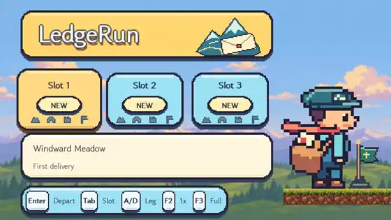

# LedgeRun

바람이 부는 초원에서 출발해 횃불 사이를 지나고, 탑에 올라 정상의 신호기를 켜는 짧은 플랫포머다. **File → Open Project…**에서 [LedgeRun](../../samples/LedgeRun/)을 열고 **Trailhead** 씬에서 Play를 누른다. Trailhead에서 슬롯과 스테이지를 고른 뒤 **Enter**로 출발한다. 노란색 카드는 현재 슬롯이며 빈 슬롯에는 **NEW**가 뜬다. 먼저 열어야 하는 구간은 회색 실루엣으로 표시된다. 진행 중인 슬롯의 구간 아이콘 아래에는 네 구간을 한 번에 마친 최단 원정 시간과 구간별 보석 최고 기록의 합계가 나온다. 선택한 구간의 최단 시간은 별도 카드에서 볼 수 있다.

*LedgeRun 한 판. Trailhead에서 출발해 초원의 틈을 대시로 건너고, 횃불이 켜진 동굴과 벽 점프로 오르는 탑을 지나, 정상에서 돌진·충격파·불씨를 쓰는 Warden을 기절시켜 세 번 밟는다.*

| 동작 | 키보드 | 게임패드 |
| --- | --- | --- |
| 이동, 열린 스테이지 선택 | 좌우 방향키 또는 A·D | D-pad 또는 왼쪽 스틱 |
| 점프, 벽 점프 | Space | South |
| 대시 | X | West |
| 출발, 다음 스테이지 | Enter | Start |
| 일시정지와 재개 | P | Back |
| Trailhead로 돌아가기 | Backspace | East |
| Trailhead에서 저장 슬롯 바꾸기 | Tab | North |
| Trailhead에서 글자 크기, 화면 효과 바꾸기 | F2, F3 | |

발판 끝을 막 벗어났거나 착지 직전에 누른 점프도 받아준다. Space를 길게 누르면 더 높이 오른다. 탑에서 벽 쪽으로 이동키를 누르고 있으면 내려오는 속도가 줄고, 그 상태에서 점프하면 반대쪽으로 튄다. 대시는 착지하면 다시 사용할 수 있다.

탑 초입에서 왼쪽 벽을 차고 오른다. 황동 발판 위에 서면 승강기가 움직이고, 위쪽 발판으로 옮겨 탈 수 있다. 초원과 동굴, 탑의 청록 깃발은 체크포인트다. 깃발이 켜진 뒤 낙하하거나 하트를 다 잃으면 그곳에서 돌아온다. 모서리까지 이어지는 금색 토큰을 따라 길을 찾고, 높은 발판과 벽 바깥에서 각 스테이지의 보석 세 개를 찾는다. 보석 가장자리의 작은 반짝임이 단서다. 동굴에서는 포탑의 불씨를 피한다.

정상의 Warden은 예고 후 돌진하고, 뛰어올라 양방향 충격파를 내보낸 뒤 왕관에서 불씨 세 발을 뿌린다. 돌진과 충격파는 도약대 위에서 피할 수 있다. 불씨가 떠오르면 착지 지점에서 비켜선다. Warden이 벽에 부딪혀 갑옷이 열린 동안 도약대에서 뛰어 머리를 밟는다. 체력이 한 칸 남으면 예고와 이동이 빨라진다. 세 번째 타격 뒤 신호기가 올라오면 깃발에 닿아 원정을 마친다.

깃발에 닿으면 Courier가 편지를 들어 올리고 **Delivered** 배지 아래 표에 시간, 토큰, 보석이 차례로 집계된다. 정상에서 신호기를 켜면 표에 네 구간의 기록과 합계가 표시된다. 전체 시간은 같은 출발에서 클리어한 구간의 시간을 더한 값이다. **Enter** 또는 **Start**로 다음 구간으로 가거나, 정상 결산을 닫고 Trailhead로 돌아간다. 스테이지를 끝낼 때 현재 슬롯에 최단 시간, 수집 최고 기록, 해금 범위를 저장한다. 손상된 슬롯은 백업에서 복구할 수 있으며, 백업도 읽을 수 없으면 Trailhead에서 다른 슬롯을 선택할 수 있다.

F2는 글자 크기 100%와 200%를 전환한다. F3는 화면 흔들림·확대 펀치·플래시, HUD의 튀는 효과와 패드 진동을 전환한다. 두 설정은 다음 실행에도 적용된다.

## 에디터에서 찾아보기

- **Meadow → Trail terrain**에서 16px 직교 타일과 단방향 발판을 편집한다. 꽃·수정·탑의 장식은 **Trail dressings**에 있다. [Trail.tileset](../../samples/LedgeRun/Assets/Trail.tileset)
- **Courier**는 Capsule Collider와 Character Motor를 쓴다. 하위 **Courier sprite**의 애니메이터는 이동 자세마다 클립을 전환한다. [TrailRunner](../../samples/LedgeRun/Scripts/TrailRunner.cs) · [Courier.animator](../../samples/LedgeRun/Assets/Courier.animator)
- **Cave**에서는 Global Light·Point Light가 타일과 빛을 합성한다. **Tower**의 지형과 장식 레이어는 Courier가 있는 청크를 기준으로 반경 1청크를 스트리밍한다.
- **HUD** 하위 패널에 9-slice 이미지를 사용한다. 타이틀과 일시정지 패널에서 조작을 확인할 수 있다. [Trailhead](../../samples/LedgeRun/Scenes/Trailhead.scene)
- [TrailProfile](../../samples/LedgeRun/Scripts/TrailProfile.cs)은 스테이지 스코어를 저장한다. 일반 적의 이동과 발사는 [TrailEnemy](../../samples/LedgeRun/Scripts/TrailEnemy.cs), 정상 전투와 신호기 타이밍은 [SummitWarden](../../samples/LedgeRun/Scripts/SummitWarden.cs)에서 조정한다.

[제작 계획](../plans/samples/1-platformer.md) · [구현 및 검증 기록](../../engine/tests/results/ledgerun/README.md)
