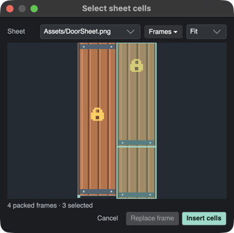

# 스프라이트와 애니메이션

[매뉴얼 목차](README.md)

## PNG를 씬에 배치하기

**Project → + → Import Assets…**로 원본을 프로젝트에 가져온다. Project의 PNG를 Scene으로 드래그하면 놓은 위치에 **Sprite Renderer**가 붙은 오브젝트가 생긴다. 기존 오브젝트의 그림을 바꾸려면 해당 오브젝트를 선택하고 PNG를 Inspector의 **Sprite Renderer → Sprite**에 놓는다. 필드 메뉴에서도 프로젝트 이미지를 고르거나 **Square**로 돌아갈 수 있다.

**Size**는 월드에 그려지는 크기다. **Layer / Order**로 타일맵, 캐릭터, 전경의 앞뒤를 정한다. PNG를 여러 오브젝트에서 참조할 때 원본은 공유한다.

## 발 위치로 앞뒤 정렬하기

1. 나무처럼 한 장으로 그리는 오브젝트는 **Sprite Renderer → Y sort → Use foot Y**를 켠다. 기준점은 오브젝트 사각형의 아래쪽 가운데다. PNG 밑에 투명 여백이 2만큼 있으면 **Foot ΔY**를 `-2`로 맞춘다. 오프셋은 오브젝트의 로컬 단위이며 부모의 회전·스케일도 적용된다.
2. 캐릭터처럼 여러 장으로 그리려면 몸통이나 공통 부모에 **Add Component → Sorting Group 2D**를 붙인다. **그룹의 Use foot Y**를 켜고 나무와 그룹의 **Layer / Order**를 같게 둔다. 장비는 그 아래에 배치한다. 그룹 안에서는 몸통의 Order를 0, 가방을 20, 버클을 22로 두면 버클이 가방 위에 그려진다. 자식에 다시 그룹을 두면 그 그룹도 내부 순서를 유지한다.
3. **Play**에서 아래로 걸으면 발의 월드 Y가 커진다. 발이 나무 기준보다 아래로 내려가면 캐릭터 전체가 나무 앞에 그려진다. KeyRoom 첫 방에서는 시작점에서 **↓ / S**로 나무를 지나고 **↑ / W**로 되돌아가 볼 수 있다. [Mac 실행 화면](../../engine/tests/results/y-sorting/README.md)

먼저 **Layer**, 그다음 **Order**가 작은 항목부터 그린다. 둘 다 같을 때 고정 순서 항목을 먼저 그리고 Y 정렬 항목을 발의 월드 Y가 작은 순서로 그린다. 발 Y까지 같으면 씬에 저장된 오브젝트 순서를 따른다. 캐릭터의 장비 순서는 그룹 안에서만 비교한다. 씬 편집과 클릭 선택도 같은 앞뒤 순서를 사용한다. 월드 이름표([Text 2D](game-ui.md#월드에-붙는-이름표와-데미지-숫자))도 같은 Layer·Order·Use foot Y로 스프라이트 사이에 끼어 그려진다.

## 색상, 반전과 마스크

**Color**는 원본 RGB에 곱하는 색이다. 흰색(`#FFFFFF`)이면 원본 색이 유지된다. **Flip X / Y**는 투명 여백을 포함한 사각형의 중심을 기준으로 그림만 뒤집는다. 자식과 충돌체까지 뒤집고 싶을 때는 Transform의 **Scale**을 사용한다. 회전·스케일의 중심은 **Transform → Pivot**으로 지정한다.

**Pixel snap**은 마지막에 그릴 원점만 반올림한다. Scene 편집에서는 월드 픽셀, Play와 게임에서는 카메라를 적용한 게임 해상도 픽셀을 기준으로 한다. 이동 값과 충돌 위치는 바뀌지 않는다. **Mask → Choose mask PNG…**로 이미지를 지정하면 마스크의 알파가 스프라이트의 알파에 곱해진다. 흰색·검은색 모두 불투명하면 그대로 보이고, 투명한 곳은 보이지 않는다. 마스크는 트림 전 크기에 맞춰져 그림과 같이 뒤집힌다. **None**으로 해제한다. 이 설정은 같은 오브젝트에서 재생되는 애니메이션에도 적용된다.

## 반복 타일과 9-slice 스프라이트

Sprite Renderer의 `drawMode`로 그리는 방식을 고른다. 기본값 **Simple**은 오브젝트 사각형에 그림 하나를 늘려 그린다. **Tiled**는 PNG(아틀라스 셀이면 그 셀)를 원래 픽셀 크기(월드 1단위 = 1픽셀, Transform의 Scale을 곱함)로 오브젝트 너비·높이만큼 반복하고, 마지막 줄은 잘라 그린다. **Sliced**는 `slice`의 left·top·right·bottom 픽셀을 테두리로 두고 모서리는 원래 크기, 변은 한 방향, 가운데는 양방향으로 늘린다. Tiled에 `slice`를 함께 두면 변과 가운데를 늘리는 대신 반복한다.

```yaml
- type: spriteRenderer
  asset: Assets/SignBoard.png
  drawMode: Sliced
  slice: {left: 4, top: 4, right: 4, bottom: 4}
```

배포 게임은 회전·반전 없이 X·Y 배율이 같은 스프라이트를 BRUTAL의 `SDL_RenderTextureTiled`·`SDL_RenderTexture9Grid`·`SDL_RenderTexture9GridTiled` 한 번으로 그린다. 회전하거나 뒤집은 스프라이트는 같은 조각을 스프라이트 배치로 그리므로 드로우콜은 늘지 않는다. 두 경로 모두 프레임마다 할당하지 않는다. 마스크를 지정한 스프라이트는 Simple로 그린다. Inspector의 Sprite Renderer에서 **Draw**(Simple·Tiled·Sliced)를 고르고, Sliced(또는 Tiled에서 **Slice borders**를 켠 경우)는 **Slice L·R**·**Slice T·B** 행에 PNG 픽셀로 테두리를 넣는다. Sliced로 처음 바꾸면 PNG 크기에 맞춰 최대 8픽셀 테두리가 들어간다. 모드 변경과 테두리 확정은 각각 Undo 한 번이다. 씬 YAML에 직접 써도 된다. 예제는 [PlatformerLab Parallax 씬](../../samples/PlatformerLab/Scenes/Parallax.scene)의 언덕·나무·땅(Tiled)과 표지판(Sliced)이다.

## PNG 여러 장을 아틀라스로 묶기

1. **Project → + → New Sprite Atlas…**에서 이름을 입력한다. 프로젝트의 PNG를 체크하거나 **Import PNGs…**로 외부 PNG 여러 장을 가져온 뒤 **Pack**을 누른다.
2. Inspector나 클립 타임라인에서 평소처럼 **원본 PNG**를 고른다. 엔진이 원본 ID로 아틀라스의 현재 셀을 찾는다. 기존에 지정한 스프라이트도 다시 연결할 필요가 없다.
3. 원본 그림을 바꾸거나 추가했다면 Project에서 `.atlas`를 더블클릭해 **Repack**을 누른다. 투명 테두리를 잘라내고 가장자리 픽셀을 한 칸씩 복제해 배치한다. 셀 위치가 달라져도 씬·클립은 같은 원본 ID를 가리킨다. 소스 파일을 이동할 때는 `.meta`도 함께 옮긴다.

한 PNG는 한 아틀라스에만 넣을 수 있다. 시트의 최대 크기는 4096×4096이다. 원본 파일, `.atlas`, 프로젝트 루트 `.monoon-atlas/`를 함께 보관한다. `.atlas`는 YAML이고 실제 시트는 내용 해시가 이름인 PNG다. 재패킹이 실패해도 이전 시트는 유지된다. 빌드에는 참조되는 세대만 포함된다. 빌드가 쓰는 셀이 시트의 70%보다 적으면 쓰는 셀만 다시 패킹한 시트를 배포한다(프로젝트 파일은 그대로다). [빌드용 아틀라스 재패킹](build.md#빌드용-아틀라스-재패킹) 원본 시트에서 좌표로 잘라 쓴 클립, UI, 타일맵 또는 마스크가 원본을 필요로 하면 그 PNG도 함께 배포된다.

[SpriteLab 샘플](../../samples/SpriteLab)의 동전·꽃·덤불은 `Assets/Showcase/Props.atlas` 한 장의 셀로 그린다. 연못가의 반사는 같은 걷기 프레임에 상하 반전·색상·물결 마스크를 적용한 것이다. 등불 옆 반딧불의 깜빡임은 `FireflyBlink.aseprite`에서 가져온 두 프레임 클립이다. [Aseprite 파일 가져오기](#aseprite-파일-가져오기)

## 개별 PNG로 클립 만들기

1. **Project → + → New Animation Clip…**을 열고 이름을 정한다. 기존 클립은 Project에서 `.clip`을 더블클릭한다.
2. **Add → Add PNG…**에서 프로젝트 이미지를 선택하거나 Project의 PNG를 타임라인의 삽입선에 놓는다. 썸네일을 드래그하거나 **Frame → Move left / Move right**로 순서를 바꾼다. 같은 메뉴의 **Duplicate**, **Remove**는 선택한 프레임에 적용된다.
3. **Seconds**에 선택한 프레임의 재생 시간을 초 단위 양수로 입력한다. 타임라인의 눈금을 드래그해 특정 시각을 보거나 처음·이전·다음 프레임 버튼을 사용한다. **Play**는 미리보기를 시작한다. **Loop**가 켜지면 마지막에서 처음으로 돌아가고, 꺼지면 마지막 프레임에 머문다.
4. **Save Clip** 또는 ⌘S / Ctrl+S로 저장한다. 클립은 Clip 패널에 열리며, 이 패널에 포커스를 두고 Undo/Redo하면 클립 편집을 되돌리거나 다시 적용한다. 프레임 누락, 잘못된 시간, PNG 경계 밖 영역은 편집기에서 고친 뒤 저장한다.

## 시트의 일부만 프레임으로 쓰기

[Door.clip](../../samples/KeyRoom/Assets/Door.clip)을 열고 **Add → Sheet cells…**에서 **DoorSheet.png**를 선택한다. 왼쪽의 닫힌 문이 1번, 오른쪽 위와 아래가 차례로 2번과 3번이다. 완전히 열린 4번은 투명한 1픽셀이므로 **Frames ▾ → Frame 4**로 고르기 쉽다. 그림이나 메뉴 항목을 눌러 선택·해제한 뒤 **Insert cells**로 타임라인에 넣는다. **Replace frame**은 한 프레임을 골랐을 때 사용할 수 있고 기존 재생 시간을 유지한다.



각 영역의 좌표는 시트 PNG의 왼쪽 위를 기준으로 하며, 이 시트의 프레임 순서와 영역은 PNG 옆의 `.meta`에 저장되어 있다. 클립에는 선택한 영역, 잘라내기 전 크기와 그 안에서 그림이 시작하는 위치를 저장한다. 문은 24×94 크기를 기준으로 윗부분을 고정해 재생한다.

KeyRoom의 원본 문 PNG를 외부에서 덮어쓰면 그 PNG에 연결된 셀이 갱신된다. [외부 PNG 자동 재임포트](project-assets.md#외부-png-자동-재임포트)

규칙적으로 잘라 쓰는 PNG는 **Grid**에서 셀 크기, 여백, 간격을 설정한다. 시트 전체를 보려면 **Fit**, 픽셀을 확대하려면 **2×** 등 고정 배율을 고른다.

## Aseprite 파일 가져오기

`.aseprite` 또는 `.ase` 파일을 프로젝트 폴더에 복사한다. 에디터는 열려 있는 동안 파일을 감시하고, 게임 빌드도 시작할 때 같은 임포트를 실행한다. `Hero.aseprite`를 넣으면 같은 폴더에 다음 파일이 생긴다.

| 생성 파일 | 내용 |
| --- | --- |
| `Hero.png` | 모든 프레임을 원본 캔버스 크기 그대로 격자로 배치한 시트. 프레임 순서대로 `.meta`에 셀이 기록되어 **Add → Sheet cells…**에서도 고를 수 있다. |
| `Hero.clip` | 모든 프레임을 순서대로 반복하는 클립 |
| `Hero.<태그>.clip` | 태그마다 하나. 태그 범위, 방향(정방향·역방향·핑퐁·역핑퐁), 반복 횟수를 반영한다. 반복이 0이면 반복 재생하고, N이면 N번 재생한 뒤 마지막 프레임에 머문다. 핑퐁은 한 방향을 1회로 센다. |

프레임마다 Aseprite에서 지정한 시간(ms)이 클립의 **Seconds**가 된다. 보이는 레이어만 합성하고, 레이어와 셀의 불투명도를 적용한다. RGBA, Indexed, Grayscale 색상 모드를 읽는다. 블렌드 모드는 **Normal**만 지원한다. Multiply 같은 다른 모드나 타일맵 레이어가 보이는 상태라면 에디터 상태 표시줄과 빌드에 오류가 나타난다. 해당 레이어를 숨기거나 Normal로 바꾸면 된다. 그룹의 불투명도는 자식 레이어마다 곱해서 근사한다.

Aseprite에서 같은 경로에 다시 저장하면 시트와 클립이 다시 만들어진다. 시트의 GUID는 유지되므로 씬, Sprite Animator, 애니메이터의 참조를 다시 연결하지 않아도 된다. 원본 내용이 같으면 출력 파일을 다시 쓰지 않는다. 생성된 PNG와 클립은 원본을 다시 저장할 때마다 덮어쓰므로, 시간이나 이벤트를 바꾸려면 Aseprite에서 수정한다. 태그를 지우거나 이름을 바꿔도 이전 태그의 클립은 지워지지 않는다. 쓰지 않는 클립은 직접 삭제한다. 같은 이름의 PNG가 이미 있고 Aseprite에서 만든 것이 아니면 덮어쓰지 않고 오류를 낸다. 둘 중 하나의 이름을 바꾼다.

게임 빌드에는 생성된 PNG와 클립 중 씬에서 쓰는 것만 들어간다. `.aseprite` 원본과 임포터 코드는 포함되지 않는다. SpriteLab의 반딧불에서 확인할 수 있다. [Mac 검증 기록](../../engine/tests/results/aseprite-import/README.md)

## 게임에서 재생하기

게임 오브젝트에 **Sprite Renderer**와 **Sprite Animator**를 붙이고 **Clip**을 고른다. **Play on start**로 자동 재생하거나, KeyRoom의 문처럼 트리거에서 `contact.PlayEffect(문 오브젝트 ID)`를 호출한다. 문이 열릴 때 함께 소리를 내려면 같은 오브젝트에 **Audio Source**를 붙이고 **Sound**에 WAV를 지정한다. WAV 파일은 프로젝트의 `Assets/`에 둔다. 클립 편집기의 미리보기와 게임은 같은 프레임 순서·시간·원본 영역을 읽는다.

## 파라미터로 애니메이션 전환하기

1. 프로젝트에 사용할 클립을 만든 뒤 **Project → + → New Animator Controller…**를 연다. **States → Add…**에서 상태에 이름과 클립을 지정한다. **Set Entry**로 처음 재생할 상태를 선택한다.
2. **Parameters**에서 Bool, Int, Float, Trigger, Vector2를 추가한다(Vector2는 [방향 세트](#48방향-클립-세트)용). Bool은 참·거짓, Int와 Float는 숫자 비교에 사용한다. Int의 기본값과 비교값은 정수다. Trigger는 한 번 켜지며, 그 Trigger를 조건으로 쓴 전환이 일어날 때 소비된다. 막힌 전환의 Trigger는 켜진 채 남는다.
3. **Transitions**에서 출발 상태, 도착 상태와 조건을 지정한다. **Add condition**으로 조건 행을 더하면 모든 행이 참일 때만 전환한다(AND). **Exit time**은 출발 상태에 들어온 뒤 그 클립을 재생한 비율이다. 1이면 클립 한 번이 끝난 다음 틱부터 전환할 수 있다. 조건 없이 Exit time만 둘 수도 있다. **From**에서 **Any State**를 고르면 모든 상태에서 검사하고, 이미 도착 상태에 있으면 다시 들어가지 않는다. 한 틱에 여러 규칙이 맞으면 목록 위쪽 규칙 하나를 선택하고 새 클립의 첫 프레임부터 재생한다. ↑·↓로 우선순위를 바꿀 수 있다. 실행 중에는 현재 상태에서 나가는 규칙의 조건만 검사하며 메모리를 할당하지 않는다.
4. **Preview**에서 파라미터를 직접 조작한다. 현재 상태와 프레임, 이벤트 발생 횟수와 최근 네 이벤트가 표시된다. **Restart**로 기본값부터 다시 확인하고 **Save Controller**로 `.animator`를 저장한다.
5. 씬 오브젝트의 **Sprite Animator → Controller**에서 에셋을 고른다. **Play on start**를 켜면 자동 재생한다. 단일 클립은 기존 **Clip** 필드로 재생할 수 있다.

**프레임 이벤트**를 넣으려면 Project에서 `.clip`을 더블클릭하고 타임라인에서 프레임을 선택한다. **Event**에 이름 하나를 입력하고 **Save Clip**을 누른다. 비워 두면 그 프레임의 이벤트가 해제된다. 게임에서는 해당 프레임에 진입할 때 같은 오브젝트에 붙은 스크립트의 `OnAnimationEvent`를 호출한다. 한 업데이트가 여러 프레임을 지나면 시간순으로 전달하며, 루프가 처음으로 돌아오면 첫 프레임 이벤트도 다시 발생한다.

게임 스크립트에서 파라미터를 바꾸거나 이벤트 이름을 읽는 예다. `Marker.Frame`은 0부터 시작한다.

```csharp
public override void FixedUpdate(ScriptTick tick)
{
    var animator = tick.Objects.Animator(tick.ObjectId);
    animator?.SetBool("Running", tick.Direction.X != 0);
}

public override void OnAnimationEvent(ScriptAnimationEvent frame)
{
    if (frame.Marker.Name == "Footstep")
        frame.Session.Set("stepped");
}
```

`SetInt`, `SetFloat`, `SetTrigger`, `SetVector2`도 같은 핸들에서 호출한다. `Play()`는 진입 상태부터 재생을 시작한다. 같은 컨트롤러를 연결한 여러 오브젝트는 각자 자신의 파라미터와 현재 프레임을 가진다. [AnimatorLab 샘플](../../samples/AnimatorLab) · [Mac 검증 화면](../../engine/tests/results/animator/README.md)

**AnimatorLab에서 조건 시험하기.** [AnimatorLab](../../samples/AnimatorLab)을 열고 Play한다(`Scenes/Showcase.scene`). **Space**를 누를 때마다 경비병이 허수아비를 친다(Combo에 지금까지의 공격 수, Attack Trigger). 공격은 Combo < 3일 때만 나가고, 클립이 끝나면 Exit time 1로 Recover를 거쳐 Idle로 돌아온다. 공격 클립의 **Swing** 이벤트마다 허수아비가 뒤로 젖혀지고, 세 번째 타격 뒤에는 되받아쳐 Hit Trigger를 켠다. 피격은 Any State 규칙이라 어느 상태에서든 Hurt로 간다. 잠시 서 있으면 Combo가 0으로 돌아간다. 같은 컨트롤러는 걷기(Speed > 0.1 **그리고** Grounded)와 공중에서 Hurt에 머무는 규칙(조건과 Exit time을 함께 쓰는 전환)도 갖고 있고, [회귀 하네스](../../engine/tests/AnimatorLab.Conditions/README.md)가 키로 그 파라미터를 바꿔 시험한다. [Guard.animator](../../samples/AnimatorLab/Assets/Showcase/Guard.animator) · [미리보기·Scene Play·Release·Native AOT 기록](../../engine/tests/results/engine-features-3/README.md#165-애니메이터-조건-확장)

### 4·8방향 클립 세트

탑다운 캐릭터처럼 바라보는 방향마다 클립이 다른 상태는 방향 세트로 만든다.

1. **Parameters**에 **Vector2** 파라미터(예: Move)를 추가한다. 기본값은 (0, 0)이고 전환 조건에는 쓰지 않는다.
2. **States → Edit…**의 **Clips**에서 **4 directions** 또는 **8 directions**를 고르고 **Parameter**에 그 Vector2를 지정한다. 방향마다 클립을 하나씩 고른다. 4방향은 N·E·S·W, 8방향은 N·NE·E·SE·S·SW·W·NW다. 월드 +Y가 아래쪽이므로 N은 화면 위쪽, 즉 (0, −1)이다.
3. 스크립트에서 `animator.SetVector2("Move", 방향)`을 호출한다. 길이는 상관없다.

- 매 틱 벡터에 가장 가까운 방향을 고른다. 경계에서 클립이 깜빡이지 않도록 지금 방향은 벡터가 30°(8방향) 또는 60°(4방향) 넘게 벗어날 때까지 유지한다. 가장 가까운 방향으로 바뀌는 지점보다 7.5°·15° 늦다.
- (0, 0)이면 마지막 방향을 유지한다. 처음 방향은 S다. 4방향 상태가 대각선 방향을 이어받으면 시계 방향으로 바로 앞의 축을 보여 준다(NE → N, SE → E).
- 방향이 바뀌어도 재생 위치는 이어진다. 걷기 주기가 처음부터 다시 시작하지 않는다.
- `animator.Facing`은 마지막으로 보여 준 방향 번호(0 N, 1 NE, … 7 NW)다. `AnimationState.Compass[animator.Facing]`로 이름을 얻는다.
- 방향 선택은 곱셈·덧셈과 비교만 쓴다. 삼각함수를 쓰지 않아 모든 CPU와 Native AOT에서 같은 클립을 고르고, 틱마다 메모리를 할당하지 않는다.
- **Preview**에서는 Vector2를 X·Y 두 칸으로 입력하고, 상태 옆에 현재 방향이 표시된다.

**AnimatorLab에서 방향 시험하기.** 같은 쇼케이스의 정찰병을 방향키로 움직인다. 누르는 동안 8방향으로 걷고(Walk), 놓으면 4방향 Idle이 마지막 방향을 바라본다. 대각선으로 걸으면 태그가 켜진다. 각 방향이 가장 가까운 경계를 지나서도 잠시 유지되는 것은 [회귀 하네스](../../engine/tests/AnimatorLab.Directions/README.md)가 정사각형 둘레를 도는 벡터로 확인한다. [Scout.animator](../../samples/AnimatorLab/Assets/Showcase/Scout.animator) · [미리보기·Scene Play·Release·Native AOT 기록](../../engine/tests/results/engine-features-3/README.md#165-48방향-클립-세트)


## 선과 궤적

[BarrageLab](../../samples/BarrageLab)에서 Play 후 **Space**를 누르면 전함의 레이저가 켜진다. 돌아가는 레이저는 화면 가장자리에서 최대 세 번 반사되고, 시작점에서 끝으로 색이 바뀐다. 18틱마다 발사되는 혜성은 뒤에 궤적을 남긴다. **Space**를 다시 누르면 레이저가 꺼지고 각도는 그대로 남는다. **R**은 혜성을 거두고 처음 각도부터 다시 돌린다. [레이저 스크립트](../../samples/BarrageLab/Scripts/BossLaser.cs) · [Mac 실행 검증](../../engine/tests/results/lines-paths/README.md)

| Add Component | Inspector에서 설정하는 값 |
| --- | --- |
| Line 2D | Width는 월드 단위 두께, Start color·End color는 선 길이를 따라 섞이는 `#RRGGBB` 색이다. Point·X·Y와 **+**·**×**·**Smooth/Corner** 버튼으로 점을 편집한다(아래). 점은 오브젝트의 로컬 좌표이며 이동·회전·스케일이 적용된다. |
| Trail 2D | 오브젝트 중심이 게임 틱마다 Min step 이상 움직이면 점을 하나 기록하고, 각 점은 Time (s) 동안 Head color에서 Tail color로 바뀌며 투명해지고 가늘어진다. Max points(2–256)가 넘으면 가장 오래된 점부터 버린다. |

선과 궤적은 Sprite Renderer가 없으면 Layer·Order로 그리는 순서를 정한다. 같은 오브젝트에 스프라이트가 있으면 스프라이트의 자리를 함께 쓰며, 궤적은 스프라이트 아래, 선은 위에 그린다. 꺾이는 점은 두께가 유지되도록 마이터로 잇고, 곡선은 구간마다 24개의 직선으로 나눠 그린다. 배포 게임과 Scene Play는 SDL3의 `SDL_RenderGeometry`로, Windows 에디터의 Avalonia Scene 미리보기는 사각형마다 선형 그라데이션으로 같은 모양을 그린다.

스크립트에서 `tick.Objects.SetLinePoints(id, points)`로 월드 좌표의 점 목록을 매 틱 바꿀 수 있다(레이저의 반사점). `TryGetLinePoints`는 그려지는 점(곡선은 나눈 점)을, `TryGetTrailPoints`는 궤적이 기록한 점을 오래된 순서로 월드 좌표에 담는다. 궤적은 게임 시간으로 기록하므로 같은 입력 기록을 재생하면 프레임 속도와 관계없이 같은 점이 남는다. 오브젝트를 비활성화하거나 풀에 돌려보내고 다시 빌려 오면 궤적이 지워진다.

### Scene에서 점 편집하기

Line 2D나 [Path Follower 2D](platformer-physics.md#곡선-경로를-따라가는-발판)가 있는 오브젝트 하나를 선택하면 Scene에 노란 경로와 점이 표시된다. 점을 끌면 옮겨지고(스냅을 켜면 16px 단위), 누른 점이 선택되어 금색으로 바뀐다. Inspector의 **+**(Add point)는 선택한 점과 다음 점 사이의 가운데(마지막 점이면 같은 방향으로 한 구간 더)에 점을 넣고, **×**(Delete point)는 선택한 점을 지운다(최소 2개). **Smooth**는 이웃 점 방향으로 접선 핸들을 만들고 **Corner**는 없앤다. 핸들 끝의 작은 사각형을 끌면 반대쪽 핸들이 대칭으로 움직여 곡선이 매끄럽게 이어진다. 점 끌기와 버튼 하나가 각각 실행 취소 한 단계이며 **Cmd+Z** 또는 **Ctrl+Z**로 되돌린다.

## 컴포넌트 속성 키프레임

1. Project에서 KeyRoom의 **Assets/LidMotion.clip**을 더블클릭한다. **Component keys → Property → Rotation**을 고르면 타임라인 눈금에 회전 키가 표시된다.
2. **Time (s)**에 `0.25`, **Value**에 `-18`을 입력하고 **Set Key**를 누른다. 눈금에서 해당 키를 누르면 그 시점으로 이동한다. 같은 시각에 다시 설정하면 기존 값을 바꾼다. **Remove**로 선택한 속성의 해당 키만 지운다. **Cmd+Z** 또는 **Ctrl+Z**로 되돌릴 수 있다.
3. **Save Clip**을 누르고 다시 열어 변경한 값을 확인한다. 샘플을 원래대로 돌리려면 추가한 0.25초 키를 지우고 저장한다.
4. Scene Play에서 닫힌 상자의 뚜껑을 본 뒤 **E**로 연다. 뚜껑은 열기 전까지 회전하고 세로로 늘어난다. 상자에서 나온 코인은 **CoinPulse.clip**에 따라 흰색에서 청록색으로 변하면서 흐려졌다가 다시 밝아진다.

| 속성 | 입력값 | 적용 대상 |
| --- | --- | --- |
| Rotation | 시계 방향 각도(도) | 오브젝트의 로컬 회전 |
| ScaleX · ScaleY | 0을 제외한 배율 | 로컬 X축 또는 Y축 스케일 |
| Tint | `#RRGGBB` | Sprite Renderer의 RGB 색 |
| Opacity | 0~1 | Sprite Renderer의 알파 |

속성마다 독립된 시간에 키를 둘 수 있다. 두 키 사이는 선형으로 보간하고 첫 키 앞과 마지막 키 뒤에서는 끝값을 유지한다. **Loop**는 클립 길이에서 처음으로 돌아간다. 끊김 없이 반복하려면 시작과 끝에 같은 값을 둔다. 한 축의 스케일은 클립 안에서 같은 부호를 유지해야 한다.

**Add → Use object renderer**는 오브젝트의 기존 스프라이트를 그대로 사용하는 프레임을 만든다. 프레임의 **Seconds**로 길이를 정한 뒤 PNG 없이도 속성 키를 넣을 수 있다. 오브젝트가 지정되지 않은 클립 창에서는 기본 사각형으로 미리 본다. Scene Play에서는 대상의 스프라이트와 피벗을 사용한다. 기존 PNG 프레임과 시트 셀 위에도 같은 속성 트랙을 추가할 수 있다.
