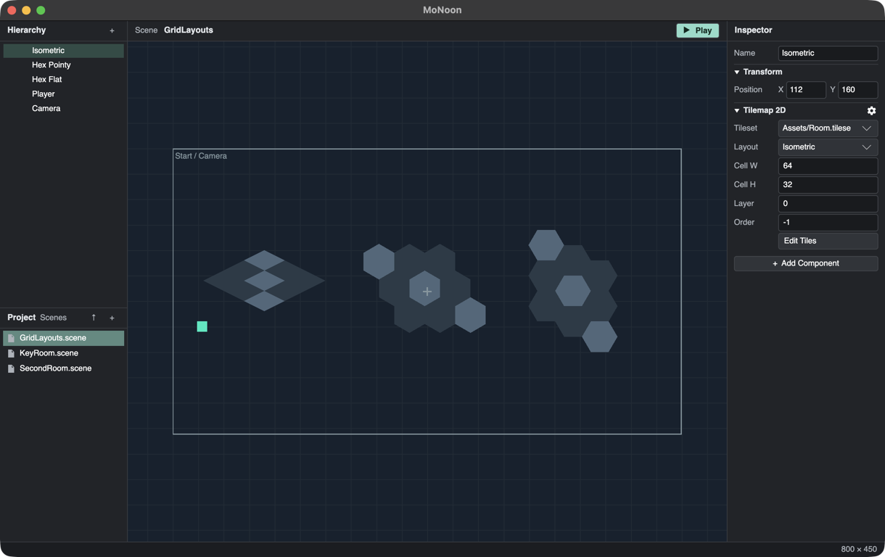
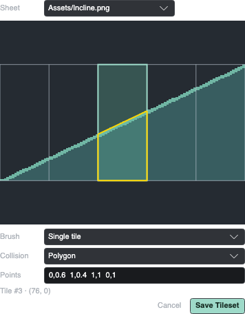

# 타일맵과 타일셋

[매뉴얼 목차](README.md)

## 세 가지 모양을 한 씬에서 열어 보기

**File → Open Project…**로 [KeyRoomTiles](../../samples/KeyRoomTiles/) 폴더를 연다. Project에서 **Scenes → GridLayouts.scene**을 더블클릭한다. 왼쪽은 아이소메트릭, 가운데는 꼭짓점이 위인 육각형, 오른쪽은 평평한 면이 위인 육각형이다. 밝은 타일은 벽이고 어두운 타일은 걸어갈 수 있다. **Play**를 누르고 방향키 또는 WASD로 작은 플레이어를 움직여 본다. [예제 씬](../../samples/KeyRoomTiles/Scenes/GridLayouts.scene)

## 레이어와 격자 선택

Hierarchy의 빈 공간에서 우클릭해 **Create Tilemap**을 선택한다. 기존 오브젝트에는 **Add Component → Tilemap 2D**를 붙인다. Inspector의 **Tileset**에서 팔레트를 지정하고 **Layout**, **Cell W**, **Cell H**를 설정한다. 세 예제 레이어는 같은 [Room.tileset](../../samples/KeyRoomTiles/Assets/Room.tileset)을 사용한다.

| Layout | 셀 모양과 배치 | 실습용 Cell W × H |
| --- | --- | --- |
| Orthogonal | 가로·세로가 곧은 직교 격자. 기존 타일맵의 기본값 | 32 × 32 |
| Isometric | 두 셀 축이 오른쪽 아래와 왼쪽 아래로 뻗는 마름모 격자 | 64 × 32 |
| Hex · Pointy | 위아래에 꼭짓점, 좌우에 수직 변이 있는 육각형 | 48 × 56 |
| Hex · Flat | 위아래에 평평한 변, 좌우에 꼭짓점이 있는 육각형 | 56 × 48 |

**Cell W / H**는 월드에서 한 타일을 둘러싸는 사각형의 전체 너비와 높이다. 타일셋 편집기의 셀 크기는 PNG를 자르는 픽셀 단위다. 불투명한 직사각형 PNG도 선택한 격자 외곽에서 잘려 그려진다. 레이아웃을 바꾸면 기존 셀 주소와 타일 ID를 유지한 채 화면 위치와 충돌 모양이 달라진다. 바닥·벽·전경을 따로 편집하려면 오브젝트를 레이어별로 만들고 **Layer / Order**를 지정한다.

## 타일셋에서 그림과 충돌 설정

1. **Project → + → Import Assets…**로 시트를 가져온 뒤 **New Tileset…**을 연다. **Name**에 이름을 입력하고 **Sheet**에서 PNG를 선택한다. **Grid**에서 셀의 **Width / Height**, 바깥쪽 **Margin**, 셀 사이 **Spacing**을 픽셀 단위로 입력한다. **Grid**를 다시 누르면 설정이 접혀 미리보기가 넓어진다.
2. 잘라낸 셀을 클릭한다. 이동을 막는 벽은 **Collision → Full cell**, 걸어갈 바닥은 **None**을 선택한다. **Save Tileset**으로 저장한다. 같은 타일 ID를 쓰는 모든 레이어에 이 설정이 적용된다.
3. 기존 `.tileset`은 Project에서 더블클릭한다. 파일 이름은 창 제목에, 현재 셀 크기는 **Grid** 버튼에 표시된다. 다시 자를 때 이미 쓰는 ID의 영역이 사라지면 편집기가 사용 위치를 표시한다. 대체할 셀을 선택하고 **Use selected tile**로 연결한다.

## 칠하기, 지우기, 되돌리기

Hierarchy에서 레이어를 선택하고 **Edit Tiles**를 누른다. **Tile**에서 썸네일을 선택한다. Scene에서 포인터 외곽선이 실제로 수정할 셀을 가리킨다.

| Tool | Scene에서 하는 일 |
| --- | --- |
| Brush | 클릭하거나 드래그한다. 빠르게 드래그해도 중간 셀을 잇는다. 육각형은 변을 공유하는 이웃을 따라간다. |
| Eraser | 클릭하거나 드래그해 셀을 비운다. |
| Rectangle | 시작 셀에서 끝 셀까지 드래그한 뒤 놓는다. 두 **격자 축** 사이를 채우므로 등각·육각에서는 화면상 평행사변형 영역이 된다. |
| Eyedropper | 칠해진 셀을 클릭해 타일을 가져오면 Brush로 돌아간다. |

드래그 한 획은 Undo 한 번으로 취소된다. 아직 버튼을 놓기 전에는 **Esc**로 획을 버릴 수 있다. **Finish Editing**으로 돌아와 **Save Scene**으로 배치를 저장한다. 레이어를 지우거나 복제하기 전에 Hierarchy에서 대상 이름을 확인한다.

## 충돌과 배포 확인

Player에 **Box Collider 2D**를 붙이고 한 타일을 **Full cell**로 지정해 칠한다. Play에서 타일 중앙으로 들어가면 벽에 막히고, 빈 모서리는 지나갈 수 있다. 사선에 비스듬히 접근하면 변을 따라 미끄러진다. 이 타일 충돌은 정적인 셀을 대상으로 한다. 이벤트가 필요한 문·열쇠는 별도 오브젝트의 **Is Trigger**와 스크립트로 구성한다.

예제 씬을 독립 게임의 첫 화면으로 내보내려면 **Build → Build Game…**에서 **GridLayouts.scene**을 **Start scene**으로 선택하고 같은 씬을 **Included scenes**에도 체크한다. KeyRoomTiles의 기본 시작 씬은 첫 번째 방이다. [빌드 절차](build.md)

## 타일별 충돌 도형과 단방향 발판

Project에서 타일셋을 더블클릭하고 셀을 선택한다. **Collision**에서 도형을 고른 뒤 **Save Tileset**을 누른다.

| Collision | 동작과 입력 예시 |
| --- | --- |
| None | 충돌 없이 그림만 표시한다. |
| Full cell | 격자의 기본 윤곽을 사용한다. 등각 타일은 마름모, 육각 타일은 육각형이다. |
| Polygon | **Points**에 볼록 다각형의 꼭짓점 3~32개를 테두리 순서대로 적는다. 오른쪽으로 올라가는 삼각 경사는 `0,1  1,0  1,1`이다. |
| One-way face | **Points**에 선분의 양 끝점을 적는다. 윗면 발판은 `0,0  1,0`이다. 두 점의 순서를 뒤집으면 막는 방향도 뒤집힌다. |

점은 셀의 왼쪽 위가 `0,0`, 오른쪽 아래가 `1,1`인 좌표다. 미리보기의 노란 선이 충돌면이고 짧은 수직선은 막는 쪽을 가리킨다. 단방향 면의 반대쪽에서 올라가는 캐릭터와 레이는 통과한다. **Overlap**은 방향 없이 실제 선분과 겹치는지 검사한다.

**PlatformerLab에서 시험하기.** 시작 위치에서 **Space**를 눌러 머리 위 발판을 통과하고 착지한다. **→ / D**로 오른쪽 경사를 끝까지 오른 뒤 **← / A**로 내려온다. **Assets/Incline.tileset**의 다섯 타일이 경사를 이루고, 발판에는 **Assets/Ridge.tileset**의 16번 타일을 사용한다. [실행 기록](../../engine/tests/results/tile-collision/README.md)

## 오토타일 브러시

[PlatformerLab](../../samples/PlatformerLab/)의 **Ridge terrain → Tilemap 2D → Edit Tiles**에서 **#1 · Terrain**을 선택한다. 빈 공간에 하나를 찍고, 바로 옆에 하나 더 찍으면 두 셀이 서로를 향해 연결된다. **Eraser**로 가운데를 지우면 양쪽 끝이 닫힌다. 청크 경계에서도 같다. **Cmd+Z** 한 번은 마지막 획만 되돌린다. 씬에는 선택한 브러시 ID가 저장되므로 이웃 그림을 따로 고칠 필요가 없다.

새 브러시를 만들려면 타일셋 편집기에서 시트의 **첫 셀**을 선택한 뒤 **Brush**를 설정한다. 브러시의 **Collision** 설정이 모든 연결 모양에 적용된다. 시트의 나머지 셀을 일반 타일로 직접 칠할 수도 있다.

| Brush | 시트 배치 (행 우선, 첫 셀이 마스크 0) |
| --- | --- |
| Single tile | 선택한 셀 하나만 그린다. |
| Terrain · 4 edges | 16칸. 직교·등각 격자에서 −Y, +X, +Y, −X 방향 이웃의 값은 각각 1, 2, 4, 8이다. 예를 들어 좌우가 연결된 모양은 10번 칸이다. |
| Terrain · 6 edges | 64칸. 두 육각 레이아웃 모두 축 좌표 (+1,0), (0,+1), (−1,+1), (−1,0), (0,−1), (+1,−1) 순서로 1, 2, 4, 8, 16, 32를 더한다. |

같은 레이어에서 같은 브러시 ID끼리만 연결된다. 필요한 수만큼 연속된 셀이 없으면 저장 시 누락된 마스크를 알려준다. 격자와 브러시의 변 개수가 다르면 연결되지 않은 첫 그림을 사용한다.

## 캐릭터 주변 청크만 실행하기

**Tilemap 2D → Stream chunks**를 켜고 **Follow**에서 캐릭터 또는 **Active camera**를 선택한다. **Radius**는 셀 수가 아닌 청크 수(1–16)다. 청크 한 변은 32셀이다. 반경 1이면 중심을 포함해 3×3 범위에서 실제로 지형이 있는 청크만 올린다. 위치는 타일맵의 로컬 격자 기준이어서 음수 좌표와 변환된 레이어에도 적용된다. 레이어나 추적 대상이 비활성화되면 해당 레이어의 청크는 해제된다.

Scene 편집 화면에는 전체 지형이 표시된다. Play에서는 현재 편집 상태를 임시 청크로 구워 사용하므로 저장 전의 획도 시험할 수 있다. Release와 Native AOT는 빌드할 때 YAML 청크 파일을 생성한다. 배포 씬에는 청크 좌표와 파일 식별자만 들어가고 실행 중에는 필요한 파일만 읽는다. 렌더링·충돌·레이 질의는 같은 상주 셀을 본다. 청크 밖의 타일은 레이에 맞지 않지만, 청크 끝 타일의 연결 그림은 원래대로 유지된다.

이 기능은 **타일 레이어 단위**다. 일반 오브젝트나 AI까지 구역별로 교체하려면 [추가 씬 로드](scene-streaming.md)를 사용한다. 청크 파일은 경계를 건너는 틱에 동기적으로 읽으므로, 큰 지형에서는 반경을 정한 뒤 프로파일러로 경계 이동 시간을 확인한다.

PlatformerLab에서 **→ / D**로 경사를 올라 **Chunk 2**가 표시되면 발판에 타기 전에 **← / A**로 돌아온다. HUD와 Play Inspector가 상주 청크 수와 누적 로드·해제 횟수를 보여준다. [세 실행 모드의 화면과 기록](../../engine/tests/results/tile-world/README.md).
