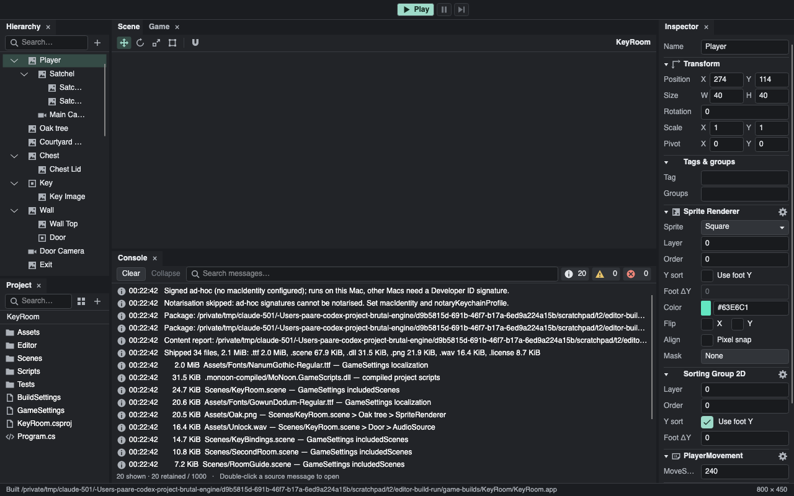

# 에셋 빌드 보고서와 도달성 제외 회귀 검사 (T2·T3)

2026-11-24, macOS 27.0.1 arm64(Apple Silicon)에서 기준 커밋 `d523ec7` 위에 검증했다. 측정 중 QEMU 게스트는 실행되지 않았다(`pgrep -f qemu-system` 결과 없음). Windows·Linux 게스트에서는 실행하지 않았다.

## 무엇이 바뀌었나

- `GameBuild.ExportCore`의 기존 의존성 탐색이 경로마다 **처음 발견한 참조 경로**를 함께 기록한다. 별도 탐색은 추가하지 않았다. 씬 → 오브젝트 → (프리팹 → 오브젝트)… → 컴포넌트 또는 스크립트 필드 순서로 기록한다. 씬 자체는 `GameSettings includedScenes`, UI 테마는 `GameSettings uiTheme`, 번역 테이블·글꼴·`.license`는 `GameSettings localization`으로 표시한다.
- 빌드가 성공하면 `.monoon-build-cache/<프로젝트>/<호스트>-<대상>-<release|native-aot>-<프로필>/report.yaml` 옆에 `assets.yaml`을 쓴다. Release와 Native AOT 모두 같다. 보고서에는 `Game/`의 모든 파일(경로, 번들 전 바이트, 이유, 콘텐츠 번들), 확장자별 합계, `Assets/` 아래 미참조 에셋, 1 MiB 초과 WAV 경고가 들어간다.
- CLI(`./monoon build`)와 에디터 **Console**에는 요약만 표시한다. 요약 내용은 합계, 크기 상위 10개와 이유, 미참조 개수·합계와 상위 10개, 경고, 보고서 경로다. Console에서 경고 줄은 Warning 수준이다. 에디터 UI 컨트롤은 추가하지 않았다.
- 아틀라스에 패킹돼 아틀라스 PNG로 배포된 원본 스프라이트는 미참조로 경고하지 않는다. `Assets/` 밖 폴더(`Scenes/` 등)도 경고하지 않는다(3-trim.md 결정 4). WAV는 자동 변환하지 않는다(결정 5, B9).
- BRUTAL: 빌드 도구 내부의 보고 기능이라 해당하는 BRUTAL 기능이 없다. 런타임 코드와 배포 파일은 바뀌지 않았다.

## 보고서 예시

KeyRoom Release의 CLI 요약은 다음과 같다(경로 앞부분 생략).

```text
Shipped 34 files, 2.1 MiB: .ttf 2.0 MiB, .scene 67.9 KiB, .dll 31.5 KiB, .png 21.9 KiB, .wav 16.4 KiB, .license 8.7 KiB
     2.0 MiB  Assets/Fonts/NanumGothic-Regular.ttf — GameSettings localization
    31.5 KiB  .monoon-compiled/MoNoon.GameScripts.dll — compiled project scripts
    24.7 KiB  Scenes/KeyRoom.scene — GameSettings includedScenes
    20.6 KiB  Assets/Fonts/GowunDodum-Regular.ttf — GameSettings localization
    20.5 KiB  Assets/Oak.png — Scenes/KeyRoom.scene > Oak tree > SpriteRenderer
    16.4 KiB  Assets/Unlock.wav — Scenes/KeyRoom.scene > Door > AudioSource
    ...
Unreferenced under Assets/: 2 files, 1.0 KiB (not shipped)
       816 B  Assets/Chest.prefab
       223 B  Assets/WallSegment.prefab
Asset report: …/.monoon-build-cache/64fb4cd6…/osx-arm64-osx-arm64-release-Distribution/assets.yaml
```

`assets.yaml` 일부:

```yaml
shippedBytes: 2239866
bytesByType:
  ".ttf": 2075868
  ".scene": 69563
  ...
unreferencedBytes: 1039
warnings: []
shipped:
- path: Assets/CoinPulse.clip
  bytes: 326
  reason: Scenes/KeyRoom.scene > Chest > Assets/Coin.prefab > Coin > SpriteAnimator clip
- path: Assets/DoorOpen1.png
  bytes: 211
  reason: "Scenes/KeyRoom.scene > Key > KeySequence.Frames[0]"
unreferenced:
- path: Assets/Chest.prefab
  bytes: 816
- path: Assets/WallSegment.prefab
  bytes: 223
```

InventoryLab Native AOT 빌드에서는 64 MiB WAV 경고와 번들 이름이 함께 나온다.

```yaml
warnings:
- Assets/Market/MarketMorning.wav is 64.0 MiB of PCM WAV; import it as Ogg Vorbis to ship less.
shipped:
- path: Assets/Market/MarketMorning.wav
  bytes: 67108908
  reason: Scenes/Inventory.scene > Market ambience > AudioSource
  bundle: Assets/Market
```

전체 파일: [KeyRoom Release](keyroom-release-assets.yaml) · [InventoryLab Native AOT](inventorylab-aot-assets.yaml)

다른 샘플을 Release로 빌드해 미참조 목록을 확인했다. AudioLab `Tide.wav`, CardLab `Decks/Deck.prefab`, KeyRoomTiles `DoorOpen1~3.png`, PlatformerLab `Runner.png`, SpriteLab `Dot.png`이 나왔다. 저장소 전체에서 이 파일들의 ID를 검색했다. 결과는 `.monoon-assets`와, SpriteLab `Dot.png`의 경우 아틀라스 셀 정의(`Icons.atlas`)뿐이었다. 따라서 실제로 배포되지 않는 파일이다. 나머지 9개 샘플은 0개였다.

## 회귀 검사 (Engine.Checks `AssetReportChecks`)

KeyRoom을 임시 폴더에 복사한 뒤 다음 파일을 추가한다. 1024×1024 무작위 픽셀 PNG(약 4 MiB) `Assets/Unused/BigUnused.png`, 2 MiB PCM WAV `Assets/Unused/BigUnused.wav`, SpriteLab의 `ArrowCycle.aseprite`를 복사한 `Assets/Unused/Art.aseprite`다. 문의 효과음 `Assets/Unlock.wav`는 1 MiB를 조금 넘는 PCM으로 바꾼다. 빌드에서 뺀 `PrefabWorkshop.scene`·`WallWorkshop.scene`만 쓰는 `Chest.prefab`·`WallSegment.prefab`은 원래 샘플에 있다. 검사는 먼저 이 조건이 실제로 성립하는지 확인한다.

| 단언 | Release | Native AOT |
| --- | --- | --- |
| 미참조 PNG·WAV, 제외 씬 전용 프리팹, 제외 씬이 `Game/`에 없음 | PASS | PASS |
| `.meta`, `.aseprite`, `.cs`, `.csproj`, `.inputreplay`, `Tests/`, `Editor/` 파일이 `Game/`에 없음 | PASS | PASS |
| 보고서는 `report.yaml` 옆에 있고 제품 안에는 없음 | PASS | PASS |
| `shipped` 목록 = `Game/`의 실제 파일, 바이트·확장자별 합계 일치 | PASS (34) | PASS (33, 스크립트 DLL 없음) |
| 미참조 목록에 위 4개 포함, `Assets/`만, 배포 파일과 겹치지 않음, 큰 순서 | PASS | PASS |
| `Coin.png` 이유 = `Scenes/KeyRoom.scene > Chest > Assets/Coin.prefab > Coin > SpriteRenderer`, `Unlock.wav` = `… > Door > AudioSource`, 글꼴·씬은 GameSettings 이유 | PASS | PASS |
| `Assets/`·`Scenes/`의 모든 배포 파일이 씬 또는 GameSettings에서 시작하는 이유를 가짐 | PASS | PASS |
| 경고는 `Unlock.wav` 1 MiB 초과 WAV 1건뿐(미참조 2 MiB WAV는 배포되지 않아 경고 없음) | PASS | PASS |

미참조 목록(두 빌드 동일): `BigUnused.png`, `BigUnused.wav`, `Chest.prefab`, `Art.clip`, `WallSegment.prefab`, `Art.png`. `Art.png`·`Art.clip`은 Aseprite 임포터가 복사본에서 만든 시트다.

실행: `./monoon test`(Release만, 전체 스위트 722 PASS, `All checks passed.`). Native AOT까지 확인하려면 `dotnet run --project engine/tests/Engine.Checks -c Release -- "$PWD" --asset-report-only`를 실행한다. 이 명령은 Release와 Native AOT를 모두 실행한다.

### 탐색을 일부러 넓혔을 때

`GameBuild.ExportCore`의 씬 탐색 직후에 아래 한 줄을 임시로 넣었다. 각각 `--asset-report-only`를 실행한 뒤 원본으로 되돌렸다. 되돌린 파일에 실험 줄이 없는 것을 `grep`으로 확인하고 다시 PASS를 확인했다.

| 넣은 줄 | 결과 |
| --- | --- |
| `foreach (var e in assets.Entries) if (e.Path.StartsWith("Assets/Unused/")) dependencies.Add(e.Path);` | 종료 코드 1, `FAIL excluded asset is not shipped: Assets/Unused/BigUnused.png` |
| `foreach (var e in assets.Entries) if (e.Path.EndsWith(ProjectAssets.Prefab)) dependencies.Add(e.Path);` | 종료 코드 1, `FAIL excluded asset is not shipped: Assets/Chest.prefab` |

이유 없이 `dependencies`에 직접 추가한 `Assets/`·`Scenes/` 경로는 이유가 `build metadata`로 표시된다. 그러면 "참조 경로가 없는 배포 파일" 단언에서도 실패하도록 했다. 이 경우는 따로 실험하지 않았다.

## 배포본 변화 없음

같은 템플릿으로 기준 코드(`d523ec7`)와 변경 코드에서 각각 내보냈다. 제품 폴더의 파일 목록과 파일별 바이트 크기를 비교했다.

| 샘플 · 빌드 | 파일 수 | 총 바이트 | 목록 비교 |
| --- | ---: | ---: | --- |
| KeyRoom Release | 271 | 99,847,119 | 동일 |
| KeyRoom Native AOT | 52 | 20,736,630 | 동일 |
| InventoryLab Release | 253 | 151,066,533 | 동일 |
| InventoryLab Native AOT | 34 | 71,752,348 | 동일 |

금지 파일 검사(`*skia*`, `Avalonia*`, `Engine.Editor*`, `Engine.Authoring*`, `StbTrueTypeSharp*`, `NVorbis*`, `*.glyphs`, `HarfBuzz*`, `MoNoon.dll`)와 `assets.yaml`·`report.yaml` 검색 결과는 네 제품 모두 0건이다. 빌드 시간 증가는 따로 측정하지 않았다. 추가 작업은 경로당 문자열 하나와, 이미 스테이징한 `Game/` 파일 목록의 크기 조회뿐이다.

## 에디터 Console

배포 에디터(`engine/scripts/build-editor-mac.sh`로 만든 `editor/MoNoon.app`)에서 [KeyRoom 에디터 빌드 검사](../../KeyRoom.EditorBuild/README.md)를 실행했다. **Build Game…** 대화 상자로 Release(패키지 포함)를 빌드하고, 에디터를 다시 시작해 Native AOT를 빌드했다. 검사 훅은 빌드 직후 Console 줄을 `result-*.json`에 기록하고 Console 패널을 캡처한다. 두 빌드 모두 `Shipped …`, `Unreferenced under Assets/: 2 files`, 마지막 줄 `Asset report: …/assets.yaml`이 표시되어 PASS였다. 같은 검사의 에디터·CLI 결과 비교, 대화 상자 정렬 측정을 포함한 36개 항목도 모두 PASS였다. 새 컨트롤은 없고 Console 행만 추가되므로 대화 상자 레이아웃은 바뀌지 않는다.



[Native AOT 빌드 직후 Console](console-aot.png)

## 확인하지 않은 것

- Windows·Linux x64에서 빌드한 보고서(이번 단계에서는 VM을 사용하지 않음). 보고서 코드는 OS와 무관하다. 경로 구분자는 `/`로 정규화한다.
- WAV 경고는 형식 태그를 읽지 않으므로 압축 WAV(ADPCM)도 PCM으로 표시한다(코드에 shortcut 주석).
- T2 표의 나머지 경고: 미사용 스크립트, 아틀라스 사용률, 동일 해시 중복, 1 MiB 초과 글꼴은 이번 범위에서 제외했다.
