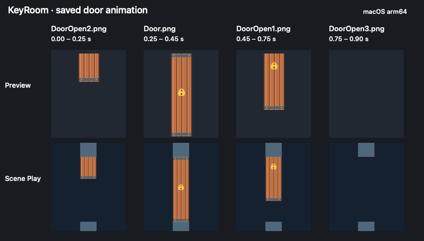

# KeyRoom 문 클립: Mac 에디터 검증

대상: macOS 27.0.1 arm64, 패키지 `editor/MoNoon.app`의 클립 창 및 SDL Scene Play. 샘플을 임시 폴더에 복사한 뒤 마우스·키보드 입력으로 조작했다. 실제 샘플의 문은 기존의 4 × 0.09초 그대로다.

1. Project의 Assets에서 Door.clip.yaml을 열고 세 번째 썸네일을 첫 번째 앞에 드롭했다. 프레임마다 Seconds를 바꾸고 ⌘S로 저장했다.
2. 앱 프로세스를 종료하고 같은 프로젝트로 다시 시작했다. 클립을 다시 열었을 때 순서와 시간, Loop 꺼짐 및 총 0.900초가 유지됐다. [저장한 YAML](edited-clip.yaml)과 클립의 기존 .meta 바이트를 확인했다. [원본 화면](01-original.png) · [재시작 후 타임라인](02-reopened.png)
3. 클립 창의 Play로 네 프레임이 재생된 뒤 [마지막에 멈추는 화면](03-preview-end.png)을 캡처했다. 창을 닫고 메인 에디터의 Play에서 왼쪽 방향키로 열쇠를 획득했다. 문 카메라에서 아래 순서로 그려지고 문이 완전히 열린 상태로 남았다. [게임 화면](04-play-after-key.png)
4. Project의 PNG를 타임라인에 드롭하면 삽입선 위치에 0.1초짜리 프레임이 생겼다. 지속 시간 0에서는 저장이 비활성화됐고, Discard 후 다시 열면 저장했던 네 프레임으로 돌아갔다. [Project 드롭](06-project-drop.png) · [폭 398pt의 타임라인](05-narrow.png)

| 구간 (초) | PNG | 지속 시간 |
| --- | --- | --- |
| [0.00, 0.25) | DoorOpen2.png | 0.25초 |
| [0.25, 0.45) | Door.png | 0.20초 |
| [0.45, 0.75) | DoorOpen1.png | 0.30초 |
| [0.75, 0.90] 및 종료 후 | DoorOpen3.png (투명) | 0.15초 |



화면 캡처는 순서와 이미지 대조에 썼다. 정확한 타이밍은 [ClipChecks](../../../Engine.Checks/ClipChecks.cs)에서 별도로 검사한다. 원본의 0.10·0.35·0.37초, 누적 경계의 바로 직전/정각, 마지막 유지와 반복 경계를 확인한다. 이어 위의 편집값을 저장·재로드하고, KeyRoom 스크립트로 열쇠를 먹은 틱부터 실제 GameSession.Draw가 그린 PNG와 미리보기 프레임을 60 Hz로 매 틱 비교한다. Loop 꺼짐/켜짐 각각 116틱 일치. 저장소 루트에서 재실행:

```sh
dotnet run --project engine/tests/Engine.Checks -c Release -p:NuGetAudit=false -- "$PWD"
```
