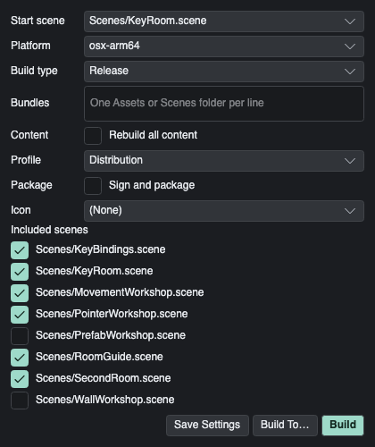
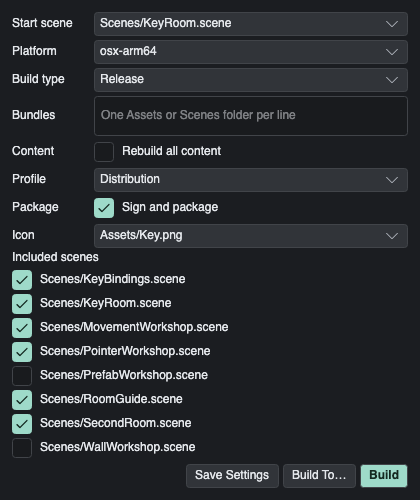

# 에디터 Build Game과 `monoon build`의 같은 결과

2026-11-23, macOS 27.0.1 (26A434) arm64, .NET SDK 10.0.101(런타임 10.0.1), 이 작업 트리에서 빌드한 `editor/MoNoon.app`과 `./monoon`. 실행 중 QEMU Debian x64 게스트가 함께 떠 있었다(시간 측정은 하지 않음). [하네스](../../KeyRoom.EditorBuild/README.md)

## 무엇을 바꿨나

- **빌드 설정 파일.** **Build Game…**의 Platform, Build type, Profile, Package, Content(Rebuild all content)를 프로젝트 루트의 `BuildSettings`(VYaml, 확장자 없음)에 저장한다. 타입은 `Engine.Authoring`의 `BuildSettings` 레코드다. 런타임 `GameSettings`와 게임 데이터에는 들어가지 않는다. 확장자가 없어 에셋 스캐너가 무시하고, 빌드는 참조 에셋만 `Game/`에 복사하며, 프로젝트 패키지·템플릿 보관 목록에도 없다.
- **대화 상자.** 파일 값으로 시작한다. 파일이 없으면 지금 기본값(호스트 RID, Release, Distribution, 패키지 끔, 증분)이다. **Save Settings**, **Build**, **Build To…** 모두 저장한다. 다른 OS의 Native AOT가 저장돼 있으면 Platform을 바꿀 때와 같이 Release를 보인다.
- **CLI.** `monoon build <project>`만으로 저장값을 쓴다. 빌드 종류와 `--profile`·`--target`·`--content`·`--package`·`--output`은 그 실행만 덮어쓰고 파일은 바꾸지 않는다. `--profile development`만 주면 대화 상자처럼 패키지를 끈다. 기존 호출(`release`·`native-aot` + 옵션)은 그대로 동작한다. 다른 OS의 Native AOT는 기존 메시지 `Build the win-x64 Native AOT player on a matching host.`와 종료 코드 1로 끝난다.
- **재현 가능한 빌드(비교 중 발견해 고침).**
  - 게임 스크립트 컴파일 참조를 파일 이름순으로 정렬했다. 에디터(자체 포함 앱)와 CLI(공유 런타임)는 같은 `System.*` 파일을 다른 순서로 넘겨 PDB의 참조 목록이 달라졌고, 그 결과 `MoNoon.GameScripts.dll`의 MVID·PDB ID(72바이트)가 달랐다. IL과 메타데이터는 같았다.
  - Native AOT 작업 폴더를 실제 경로(`/private/var/...`)로 만들고 전체 작업 폴더에 `PathMap`을 건다. 기존 `GameSources` 경로 매핑은 `/var`와 `/private/var` 표기가 달라 적용되지 않았고, 배포 실행 파일에 `…/T/monoon-aot-XXXXXX/GameScripts/GameSources/Scripts/*.cs` 임시 경로가 들어가 있었다. 이제 `/_/Scripts/*.cs`로 기록되고, PDB도 빌드마다 같다.

## 하네스 결과

KeyRoom 복사본에서 [editor.py](../../KeyRoom.EditorBuild/editor.py)를 `gui-lock.sh`로 감싸 실행했다. 31개 검사가 모두 통과했다. 산출물 파일 검사(아래 표 마지막 행)는 이 실행 뒤 하네스에 추가했고, 같은 네 빌드에 비교 함수를 다시 돌려 통과를 확인했다.

| 검사 | 결과 |
| --- | --- |
| 첫 대화 상자 기본값 | osx-arm64, Release(+Native AOT 선택 가능), Distribution, 패키지 끔, 증분, 아이콘 없음 |
| 1280px·1920px 행 정렬 | 8행 모두 레이블 x 0, 입력 x 82, 레이블·입력 세로 중심 차 0px, 콤보 높이 24px, 버튼 세 개 y 452. 대화 상자 420×500으로 두 폭에서 같다 |
| Save Settings 후 다시 열기 | Package 체크, Icon `Assets/Key.png` 등 고른 값 그대로. `GameSettings.icon`도 저장 |
| 에디터 재시작 후 | 같은 값으로 열림 |
| 저장된 win-x64 Native AOT | 대화 상자는 Release만 표시, CLI는 종료 코드 1과 위 메시지, 파일은 그대로 |
| Platform linux-x64 | Build type이 Release뿐 |
| `BuildSettings` | Release 뒤 `target: osx-arm64 / type: release / profile: distribution / content: incremental / package: true`, Native AOT 뒤 `type: native-aot`. CLI 실행 뒤에도 바이트가 같다 |
| 산출물 검사 | 네 빌드 어디에도 `BuildSettings`, Avalonia, SkiaSharp, Engine.Authoring, Engine.Editor 파일이 없다 |

### 에디터 빌드와 CLI 빌드 비교

앱, `Symbols/`, zip·dmg를 펼친 내용까지 파일 목록·SHA-256·실행 비트·링크 대상을 비교했다. [Release 비교](compare-release.json) · [Native AOT 비교](compare-native-aot.json)

| 빌드 | 항목 | 바이트까지 같음 | 빌드 ID·서명만 다름 | 그 밖의 차이 |
| --- | --- | --- | --- | --- |
| Release, 배포용, 패키지(ad-hoc 서명 앱·zip·dmg) | 884 | 872 | 12 | 없음 |
| Native AOT, 배포용, 패키지 | 232 | 218 | 14 | 없음 |

허용한 차이와 근거는 다음과 같다. 각 파일은 해당 부분만 빼고 다시 비교해 같았다.

- **`MoNoonBuild` 영수증** (앱, 심볼 폴더, zip·dmg 안): `buildId`는 빌드마다 새로 만드는 무작위 GUID이고 심볼 폴더 이름이다. Native AOT는 링커 UUID(`nativeUuid`)와 그 UUID가 든 실행 파일 해시(`playerSha256`)도 다르다. 나머지 줄(대상, 모드, 프로필, PDB ID, MVID 등)은 같다.
- **`_CodeSignature/CodeResources`**: 번들 봉인이 영수증 해시를 포함한다. 영수증 항목을 뺀 봉인은 같다.
- **`Contents/MacOS/MoNoonPlayer`**: 내장 ad-hoc 서명이 봉인을 포함한다. `codesign --remove-signature` 뒤 같다. Native AOT는 Mach-O `LC_UUID` 16바이트만 다르다. ld는 링크할 때 목적 파일의 디버그 맵(빌드마다 새로 만드는 임시 작업 폴더 경로와 파일 시각)을 포함한 내용으로 UUID를 계산한다. 이 UUID는 실행 파일과 dSYM을 짝짓는 빌드 ID다.
- **Native AOT dSYM**: DWARF 파일은 `LC_UUID`만, `Relocations/aarch64/MoNoonPlayer.yml`은 임시 링크 폴더를 가리키는 `binary-path` 줄만 다르다.
- **zip·dmg 컨테이너 자체**: 파일 시각이 들어간다. 펼친 내용은 위 규칙으로 파일별로 같다.

게임 스크립트 DLL·PDB, 엔진 PDB, `Game/` 데이터, 템플릿 파일, Info.plist와 다른 모든 서명 파일은 바이트까지 같다.

### 대화 상자 캡처

  

## 회귀 검사

모두 이 Mac(macOS arm64)에서 위 변경을 넣은 뒤 실행했다.

| 검사 | 결과 |
| --- | --- |
| `engine/scripts/build-players.sh`, `engine/scripts/build-editor-mac.sh` | 성공 |
| `./monoon test` | 통과, `All checks passed.`(PASS 721줄). 새 `BuildSettingsChecks`: 기본값, YAML 왕복, 잘못된 값 거부, CLI 덮어쓰기 우선순위와 파일 불변, 실제 Release 내보내기 결과에 `BuildSettings` 없음 |
| [InventoryLab.Incremental](../../InventoryLab.Incremental/README.md) `verify.py --dependencies` (`build … release --target --output --content`) | 통과. 첫 빌드 7개 생성, 대사 변경 후 1개 재생성·6개 재사용, 저장 SHA-256 `eed41def…` |
| [KeyRoom.WorldCheckpoints](../../KeyRoom.WorldCheckpoints/README.md) `ci.py osx-arm64` (`build … release/native-aot --profile --target --output`) | 통과(PASS 22줄). Native AOT도 새 경로 매핑으로 빌드·재생 |
| `./monoon ci` (`build samples/InventoryLab release/native-aot --profile distribution --output`) | 통과. 두 빌드 3개 체크포인트 바이트 동일, 리플레이 저장 171바이트 SHA-256 `EED41DEF…` 동일 |
| [AudioLab.Vorbis](../../AudioLab.Vorbis/README.md) `ci.py osx-arm64` | 두 `monoon build`(Release·Native AOT, 명시 인자)는 성공. 재생 단계에서 `mac-input focus`가 `No keyboard event permission`으로 종료 코드 2를 반환해 실패했다. `gui-lock.sh`로 감싸 다시 실행해도 같았다. 이 셸에 키 입력 권한이 없어서이며 빌드 변경과 무관하다. 재생 결과는 확인하지 못했다 |
| CLI 사용법 | `build --help` 0, `build`(프로젝트 없음) 2, `--package maybe` 2, `release --profile development --package on` 2, 값 없는 `--output` 2, 없는 프로젝트 1 |

## 확인하지 않은 것

- Windows·Linux 호스트의 에디터·CLI 빌드 비교(macOS arm64만 실행했다. Windows 검증은 보류, Linux 에디터는 지원하지 않음).
- win-x64·linux-x64 대상 Release를 에디터에서 빌드해 CLI와 비교하지 않았다. 대상 RID만 다르고 같은 코드 경로를 쓴다.
- 실제 Developer ID 서명·공증. 서명 설정이 없는 프로필이라 ad-hoc 서명만 확인했다.
- Native AOT의 `LC_UUID`까지 같게 만드는 것(고정 작업 폴더와 링커 재현 옵션이 필요하다).
- 빌드된 게임 실행. 이 하네스는 산출물 비교만 한다. 실행 회귀는 아래 기존 하네스가 확인한다.
- AudioLab 배포본의 재생 결과(키 입력 권한 없음, 위 표).
