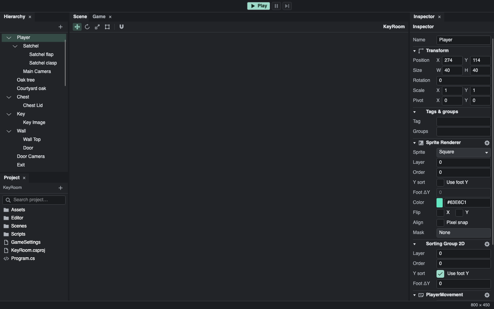
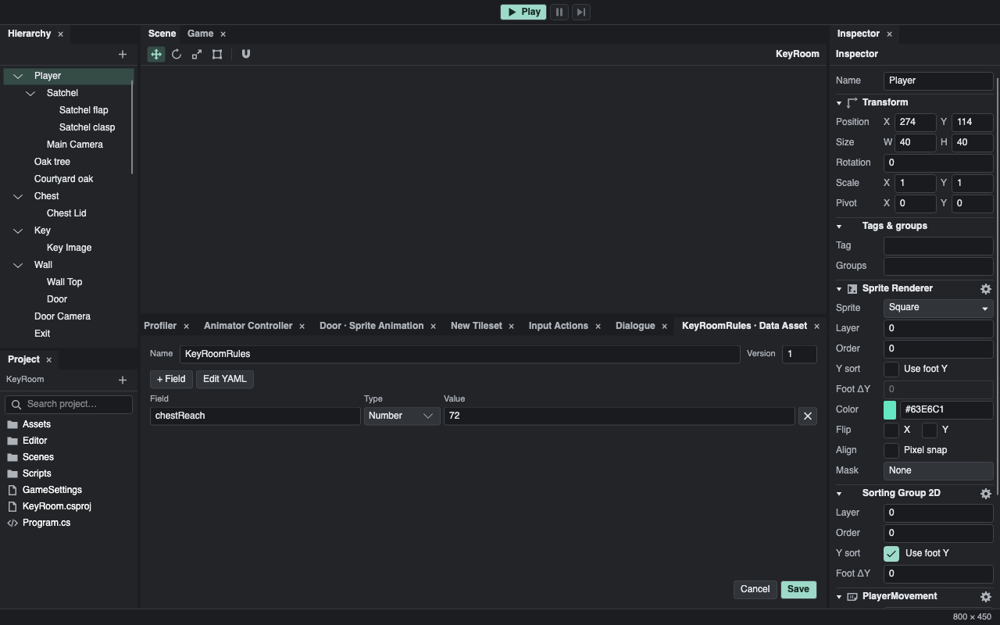
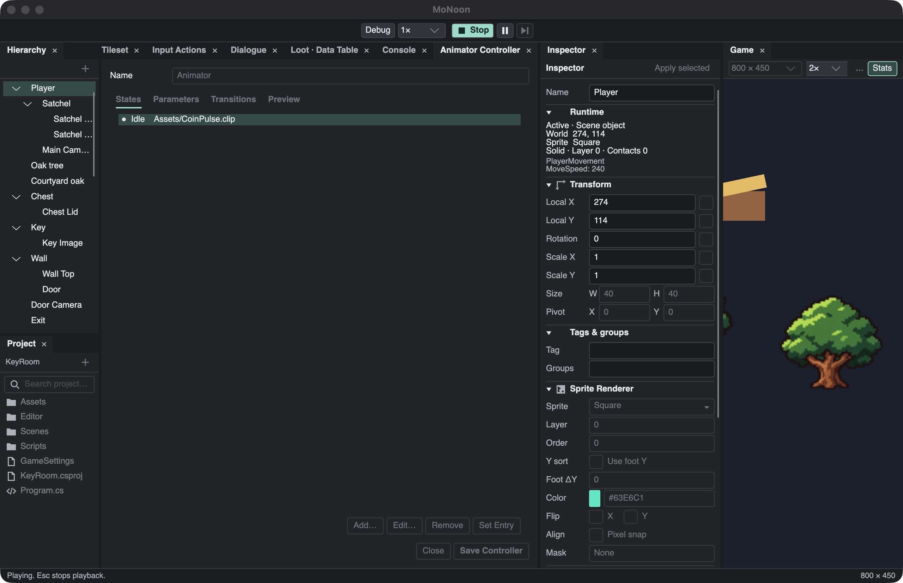

# 에디터 패널 도킹과 Scene·Game 탭 (12.1–12.5)

2026-11-23 · macOS 27.0.1 (26A434) · Apple M4 Max · .NET SDK 10.0.101 · 화면 작업 영역 2056×1247(배율 1). 같은 소스로 `engine/scripts/build-editor-mac.sh`가 만든 `editor/MoNoon.app`에서 [KeyRoom.EditorDocking](../../KeyRoom.EditorDocking/README.md)의 다섯 단계를 실행했다. 다섯 단계 모두 통과했다. 원본 값: [first](first.json) · [restore](restore.json) · [fallback](fallback.json) · [panels](panels.json) · [panels-restore](panels-restore.json)

12.4·12.5를 넣은 뒤 모든 캡처와 측정값을 다시 만들었다. 메인 창 맨 위에 도구 모음 줄(32px)이 생기고 Scene 옆에 Game 탭이 생겨 레이블 x가 1px 바뀌었다. 레이블과 입력 사이(column 61), 행 사이 차이(drift 0)는 그대로다.

## 도킹 방식 결정

Dock.Avalonia 11.3.12.1(MIT)과 의존 패키지를 받아 확인했다. 이 버전의 `Dock.Avalonia`에는 컨트롤 템플릿이 없다. DockControl·ToolDock·탭·드롭 대상의 Fluent 테마는 별도 패키지 `Dock.Avalonia.Themes.Fluent`에 있다. 이번에 승인된 다운로드에 포함되지 않았다. 내부 PART 규약에 맞춰 템플릿 20여 개를 직접 쓰는 것보다 직접 구현한 배치가 코드가 적고 Scene 뷰 문제도 피할 수 있다고 판단했다. 따라서 Grid·GridSplitter와 탭 줄로 [DockHost](../../../src/Engine.Editor/DockHost.cs)를 직접 만들었다. Dock 패키지 참조는 제거했다. 에디터에 새로 추가한 NuGet 패키지는 없다. 승인 없이 테마 패키지를 받을 수 있다면 다시 비교할 수 있다.

- 패널 컨트롤은 XAML에서 한 번 만들어 DockHost의 자식으로 계속 남는다. 배치가 바뀌면 탭 묶음의 빈 영역 위치에 패널을 다시 배치한다. 부모가 바뀌지 않으므로 `x:Name` 필드, `FindControl`, Scene의 NSView와 SDL 렌더러, Play 세션이 그대로 유지된다.
- 끄는 동안 표시하는 미리보기는 팝업 창이다. 네이티브 Scene 뷰는 메인 창 안에 그린 Avalonia 컨트롤을 덮기 때문이다.

## 처음 배치와 Inspector 정렬

Default는 기존 배치와 같다. 왼쪽 Hierarchy·Project 176px, 가운데 Scene·Game 탭, 오른쪽 Inspector 218px이다. 패널 사이 분할선은 4px이다. 각 탭 줄의 높이는 24px이며 기존 패널 머리줄은 그 아래에 남는다. 탭 이름과 겹치는 Hierarchy·Project 머리줄 제목만 뺐다.

Name·Position·Tag 행을 비교했다. 레이블 왼쪽 끝 차이와 입력 왼쪽 끝 차이는 drift, 입력과 레이블 왼쪽 끝 사이는 column, 레이블과 입력의 세로 중심 차이는 vertical이다.

| 경우 | 창 너비 | Inspector 폭 | 레이블 x | 입력 x | column | drift | vertical |
| --- | ---: | ---: | ---: | ---: | ---: | ---: | ---: |
| [Default](default-1280.png) | 1280 | 218 | 1070 | 1131 | 61 | 0 | 0 |
| [Default](default-1600.png) | 1600 | 218 | 1390 | 1451 | 61 | 0 | 0 |
| [Default](default-1920.png) | 1920 | 218 | 1710 | 1771 | 61 | 0 | 0 |
| [긴 이름 입력](long-name-1280.png) | 1280 | 218 | 1070 | 1131 | 61 | 0 | 0 |
| [분할선으로 넓힘](splitter-278.png) | 1280 | 278 | 1010 | 1071 | 61 | 0 | 0 |
| 다시 연 뒤 Reset Layout | 1500 | 218 | 1290 | 1351 | 61 | 0 | 0 |
| 띄운 Inspector를 다시 붙임(창 오른쪽, 320px) | 1280 | 320 | 968 | 1029 | 61 | 0 | 0 |

column 61은 기존 레이블 열 56px과 간격 5px의 합이다. 12.7에서 레이블과 입력 사이 간격을 4px 격자에 맞춰 4px로 바꿨으므로 지금 검사기는 column 60을 기대하고, 떠 있는 Inspector의 머리줄 검사는 제목 줄 대신 작업 줄의 28px 스타일을 본다. 표의 값은 12.5 당시 실행 결과다([12.7 결과](../editor-panels/README.md)). 긴 이름에서도 Name 입력 폭은 141px로 유지됐다. [KeyRoom.EditorTheme](../editor-theme/README.md)도 1280·1920px과 긴 이름에서 Inspector 27행의 레이블·입력 왼쪽 끝이 각각 한 값이고 세로 중심 차이가 0px이었다. 이동 여섯 번 뒤에도 매번 같은 기준으로 검사했다.

## 탭 끌기·분할·분할선

| 조작 | 결과 배치 |
| --- | --- |
| Project 탭 → Inspector 가운데 ([미리보기](drag-preview-tab.png), [결과](project-tabbed.png)) | `Row[(Hierarchy) (Scene,Game) (Inspector,Project*)]` |
| Hierarchy 탭 → Scene 아래쪽 ([미리보기](drag-preview-split.png), [결과](hierarchy-below-scene.png)) | `Row[Column[(Scene,Game) (Hierarchy)] (Inspector,Project*)]` |
| Project → Scene 왼쪽 | `Row[Column[Row[(Project) (Scene,Game)] (Hierarchy)] (Inspector)]` |
| Hierarchy → Inspector 위 | `Row[(Project) (Scene,Game) Column[(Hierarchy) (Inspector)]]` |
| Hierarchy → Inspector 아래 | `Row[(Project) (Scene,Game) Column[(Inspector) (Hierarchy)]]` |
| Project → Inspector 오른쪽 | `Row[(Scene,Game) Column[Row[(Inspector) (Project)] (Hierarchy)]]` |
| Hierarchy → 창 왼쪽 가장자리 | `Row[(Hierarchy) (Scene,Game) (Inspector) (Project)]` |
| Project → Hierarchy 가운데 ([결과](moved.png)) | `Row[(Hierarchy,Project*) (Scene,Game) (Inspector)]` |

- 두 번의 탭 끌기에서 미리보기가 열려 있는 동안 네 패널의 위치·크기가 끌기 전과 같았다.
- Inspector 왼쪽 분할선: 218 → −80px 끌기 298 → +400px 끌기 218(최소 폭에서 멈춤) → −60px 끌기 278.

## Play 중 Game 패널 이동

Game 패널을 Inspector 왼쪽으로 떼어 놓고 Play를 시작했다. Game 탭이 앞으로 오고 SDL 화면이 Game 패널로 옮겨진 것을 확인한 뒤, Play 중에 Game 패널을 계속 옮겼다. 1.2초 간격으로 측정했다. 고정 틱은 진행한 틱 수, 그리기는 SDL 그리기 호출 증가량이다.

| 상태 | 같은 세션 | 고정 틱 | 그리기 | NSView 유지 |
| --- | --- | ---: | ---: | --- |
| Game을 Inspector 왼쪽으로 옮긴 뒤 Play 시작 | 예 | 72 | 884 | 예 |
| Play 중 Hierarchy·Project 아래로 분할 | 예 | 72 | 871 | 예 |
| Play 중 Inspector와 탭으로 묶고 Inspector 탭 표시 | 예 | 73 | 884 | 예 |
| Game 탭 다시 표시 | 예 | 71 | 871 | 예 |
| Play 중 창 오른쪽 가장자리로 이동 | 예 | 72 | 871 | 예 |

[마지막 상태의 실제 창](play-game-moved.png)에서 오른쪽 Game 패널에 게임 화면이 그려졌다. Stop 뒤에는 Scene 탭이 앞에 있고 화면이 Scene 패널로 돌아왔다.

## 저장·복원·Window 메뉴

- Window → Layout에서 [Editing](layout-editing.png), [Animation](layout-animation.png), [Default](layout-default.png)를 차례로 적용했다. 각각 미리 정한 구조와 같았다. Default에서 Project를 Inspector 아래로 옮겨 Save Layout as Custom으로 저장했다(`Row[(Hierarchy) (Scene,Game) Column[(Inspector) (Project)]]`).
- 이어서 Editing을 적용하고 Inspector를 360px로 넓힌 뒤 창을 1500×860으로 바꾸고 종료했다. 같은 사용자 폴더로 다시 실행하자 `Row[(Hierarchy*,Project) (Scene*,Game) (Inspector)]`, Inspector 360px, 창 1500×860이 [복원](restored.png)됐다.
- Layout → Custom을 고르자 저장한 Custom 배치가 적용됐다. Reset Layout 뒤에는 [Default](reset.png)로 돌아갔다(Hierarchy 176px, Scene 1098px, Inspector 218px).
- Hierarchy 탭의 ×로 닫자 Window 메뉴 체크가 해제됐다. Window → Hierarchy로 다시 열자 Project 위에 돌아와 Default와 같은 구조가 됐다.
- 크기 40000px의 패널과 화면 밖 위치(-60000, -60000)의 9000×7000 창을 기록한 파일로 실행했다. Default 배치, 1220×740 창이 화면 안 (418, 159)에 열렸고 Custom은 비활성이었다.

## 별도 창의 패널화 (12.4)

Console, Profiler, Animator, 클립 타임라인(Clip), Tileset, Input Actions, Dialogue, 데이터 에셋·테이블(Data)을 각 편집기의 실제 진입 메서드(`ShowConsole`, `SetProfiler`, `EditAnimator`, `EditClip`, `EditTileset`, `EditInput`, `EditValues`)로 열었다. 별도 창은 하나도 생기지 않았다. 처음 연 Console이 Scene 아래를 나누고 나머지는 같은 묶음의 탭이 됐다. 탭이 묶음보다 넓으면 탭 줄이 옆으로 밀리고 앞의 탭이 보인다.

| 패널 | 탭 제목 | 편집기 | 캡처 |
| --- | --- | --- | --- |
| Console | Console | 기존 콘솔(시작할 때 한 번 만듦) | [panel-console](panel-console.png) |
| Profiler | Profiler | XAML 패널(`FramePanel` 등 이름 유지) | [panel-profiler](panel-profiler.png) |
| Animator | Animator Controller | AnimatorWindow | [panel-animator](panel-animator.png) |
| Clip | Door · Sprite Animation | ClipEditorWindow | [panel-clip](panel-clip.png) |
| Tileset | New Tileset | TilesetWindow | [panel-tileset](panel-tileset.png) |
| Input Actions | Input Actions | InputMapWindow | [panel-input-actions](panel-input-actions.png) |
| Dialogue | Dialogue | DialogueWindow | [panel-dialogue](panel-dialogue.png) |
| Data | KeyRoomRules · Data Asset | ValuesWindow | [panel-data](panel-data.png) |

- 같은 묶음의 다른 탭을 앞에 둔 뒤 같은 메서드를 다시 부르면 그 탭이 앞으로 오고, 편집기 인스턴스와 열린 패널 목록이 그대로였다. Data 패널에 `Loot.table`을 열자 데이터 에셋 편집기가 닫히고 `Loot · Data Table`로 바뀌었다.
- Window 메뉴에 13개 패널(Hierarchy·Project·Scene·Game·Inspector와 도구 패널 8개)이 모두 있고 체크 상태가 열린 패널과 같았다.

**에셋 편집기 규칙.** 종류마다 패널 하나를 쓴다. 같은 에셋(새 에셋끼리 포함)을 다시 열면 그 탭으로 이동하고, 다른 에셋을 열면 기존 편집기를 닫은 뒤 바꾼다. 저장하지 않은 클립·애니메이터는 먼저 묻고 Cancel이면 그대로 둔다. 이전의 클립 편집기가 이미 이 규칙(한 번에 하나, 다른 클립은 닫기 확인)이었고, 패널 이름이 고정되어 레이아웃 저장·Window 메뉴·플로팅 위치 복원이 단순해진다. 에셋별 탭은 만들지 않았다.

**구현.** 예전 창 클래스는 `Window` 대신 [EditorPanel](../../../src/Engine.Editor/EditorPanel.cs)(UserControl)을 상속한다. EditorPanel은 기존 코드가 쓰던 Title, `Close(result)`, Closing·Closed·Opened·Activated·Deactivated, IsActive를 그대로 제공한다. `x:Name` 필드와 `FindControl`은 그대로다. `ShowDialog`로 기다리던 저장 뒤 처리는 편집기가 결과를 내며 닫힐 때 실행한다. 그래서 편집기가 열려 있어도 `busy`가 걸리지 않고 다른 메뉴와 Play를 쓸 수 있다. 예전에 모달이던 편집기는 Play 중 비활성이 되고 Clip만 Play 중에도 쓸 수 있다. Escape가 메인 창 전체에서 Cancel을 누르지 않도록 `IsCancel`을 뺐다. 편집기 안에서 여는 확인·시트 선택 창은 편집기를 보여 주는 창(메인 또는 플로팅)을 소유자로 쓴다.

### 플로팅 창

탭을 메인 창 밖으로 끌어 놓거나 탭 우클릭 → Float in Window로 띄운다. 창의 Dock 버튼이나 창 닫기로 다시 붙는다. 패널 컨트롤은 띄운 창으로 옮겨졌다가 그대로 돌아온다.

| 패널 | 띄운 창 | 다시 붙인 뒤 |
| --- | --- | --- |
| Console | [640×420](float-console.png) | 도구 묶음의 탭 |
| Animator | [640×420](float-animator.png), Preview의 SDL 뷰 포함 | 도구 묶음의 탭 |
| Inspector | [컴포넌트 머리말 6개, 패널 머리줄 28px](float-inspector.png) | 창 오른쪽 320px, 정렬 column 61 · drift 0 |
| Scene | [NSView 핸들 유지, 편집 화면](float-scene.png) | Game과 같은 묶음, NSView 유지 |

Scene을 띄운 채 Play하면 게임은 메인 창의 Game 탭에 그려지고, Stop하면 SDL 화면이 띄운 Scene 창으로 돌아갔다. Play 중에 Game을 띄웠다가 붙여도 세션이 이어졌다.

| Play 상태 | 같은 세션 | 고정 틱 | 그리기 | NSView 유지 |
| --- | --- | ---: | ---: | --- |
| Scene은 띄우고 게임은 메인 창 Game 탭 | 예 | 72 | 871 | 예 |
| [Game도 띄움](float-game-play.png) | 예 | 73 | 923 | 예 |
| Game을 다시 붙임 | 예 | 72 | 884 | 예 |
| Game 2× 배율 | 예 | 73 | 923 | 예 |

- 띄운 창은 메인 창의 패널 스타일, Inspector 컴포넌트 템플릿, 게임 입력·단축키 처리를 함께 받는다. 템플릿은 패널이 창에 들어가기 전에 넣어야 한다. 넣기 전에 붙이면 정적 컴포넌트 머리말이 ContentControl 기본 템플릿으로 바뀌었다(수정 전 실패를 확인).
- 창마다 레이아웃 대기열이 따로 있다. 대기열에 남은 컨트롤이 다른 창으로 옮겨지면 Avalonia가 `Attempt to call InvalidateArrange on wrong LayoutManager`로 종료했다. 옮기기 전에 이전 창의 레이아웃을, 옮긴 직후 새 창의 레이아웃을 끝낸다. Scene·Game 사이의 SDL 화면 이동에도 같은 순서를 쓴다.

**위치 저장.** 띄운 창의 위치·크기는 레이아웃 파일의 `Floating`에 들어간다. Console을 (538, 299) 520×300에 띄우고 종료한 뒤 다시 열자 [같은 위치·크기로 복원](restored-float-console.png)됐고 배치도 종료 전과 같았다. 화면 밖(-60000, -60000)에 저장된 Animator 항목은 메인 창 가운데 (738, 363) 640×420에 열렸다. 패널 크기가 화면보다 큰 레이아웃은 띄운 창 목록과 함께 Default로 돌아간다.

## Scene·Game 탭과 도구 모음 (12.5)

- 창 맨 위 도구 모음의 가운데 선에서 Play가 시작하고 오른쪽에 일시정지·한 틱 진행이 있다. Play 중에는 왼쪽에 Debug와 배속이 나타나며 Play 위치는 바뀌지 않는다. Play 버튼의 접근성 이름(`▶  Play` / `■  Stop`)과 배경색 `EditorAccent` #9EDAC9, 크기 60×21은 그대로다. 버튼이 창 오른쪽 절반 위쪽에 있어 [verify_editor.py](../../KeyRoom.Desktop/verify_editor.py)의 탐색 영역에 들어간다.
- Scene 머리줄의 "Scene" 제목 줄을 도구 줄로 바꿨다. [이동·회전·크기·Rect 도구와 Snap](scene-tools.png)을 아이콘 토글로 고른다. 버튼 네 개를 차례로 누르자 기즈모가 Rotate·Scale·Rect·Move로 바뀌고 체크된 버튼은 하나였다. 기존에 없던 Rect는 단일 오브젝트의 Width·Height를 축 손잡이로 바꾼다. Player의 X 손잡이를 24 끌자 Width 40 → 64, Esc 취소로 40이 됐다. 단축키 T를 추가했다.
- Play를 누르면 Game 탭이 앞으로 오고 Stop하면 Scene 탭으로 돌아온다(`first`·`panels` 단계에서 확인). Game 머리줄의 해상도 메뉴는 프로젝트 게임 해상도(800 × 450)를 보여 주고 Play 중에는 비활성이다. 배율 2×에서 `Scale`이 2였다. Stats는 `57 fps · 17.6 ms · 13 draws`를 표시했다.

**Game 화면 결정.** Game 탭은 Scene과 같은 SceneViewport를 쓰고, Play와 Stop 때 그 뷰를 Scene 패널과 Game 패널 사이에서 옮긴다. Play 세션(`GameSession`), 입력, 프로파일러, 디버그 그리기가 모두 이 뷰에 있다. 두 번째 호스트를 두면 SDL NSView 렌더러가 하나 더 생겨 장면의 모든 스프라이트를 따로 올리고 세션을 넘겨야 한다. 뷰 이동은 탭 이동·플로팅에서 NSView와 세션이 유지되는 것을 이미 확인한 경로다. 그래서 Play 중 Scene 패널에는 안내 문구만 보이며, 두 화면을 동시에 보지는 못한다.

## 기존 에디터 회귀

12.4·12.5를 넣은 같은 앱으로 다시 실행했다. 모두 Mac(osx-arm64) 결과다.

| 검사 | 결과 |
| --- | --- |
| `engine/scripts/build-players.sh` 뒤 `./monoon test` | 통과 (All checks passed) |
| `engine/scripts/build-editor-mac.sh` | 통과 |
| [KeyRoom.EditorDocking](../../KeyRoom.EditorDocking/README.md) 다섯 단계 | 통과 (위 기록) |
| [KeyRoom.EditorTheme](../../KeyRoom.EditorTheme/README.md) | 통과. Inspector 27행 정렬(1280·1920·긴 이름), 예전 창 9개 모두 12px. 8개는 패널, 시트 셀 선택은 대화 상자로 캡처한다. |
| [KeyRoom.Rebinding](../../KeyRoom.Rebinding/README.md) editor.py | 통과 |
| [KeyRoom.PrefabStructure](../../KeyRoom.PrefabStructure/README.md) editor.py | 통과 |
| [CollisionLab.FrameProfiler](../../CollisionLab.FrameProfiler/README.md) editor.py | 통과. Profiler 패널에서 작업 표 열 정렬(1400·820px) 유지 |
| [CollisionLab.SplitLoading](../../CollisionLab.SplitLoading/README.md) editor.py(3회) | 통과 |
| [SeedLab.TileTerrain](../../SeedLab.TileTerrain/README.md) editor.py | 통과(Tileset 패널 700·380px 정렬) |
| [PlatformerLab.TileCollision](../../PlatformerLab.TileCollision/README.md) editor.py | 통과 |
| [KeyRoom.ComponentKeys](../../KeyRoom.ComponentKeys/README.md) editor.py | 통과(Clip 패널 710·420px, Undo/Redo, 저장·다시 열기) |
| [KeyRoom.ObjectGroups](../../KeyRoom.ObjectGroups/README.md) verify.py | 실패: 프리팹 창을 닫은 뒤 `main.IsActive`를 60초 기다리다 시간 초과. 변경 전 main의 `editor/MoNoon.app`으로 같은 검사기를 돌려도 같은 단계에서 실패했다. 이 세션에서 에디터가 앞 앱이 되지 못하는 환경 문제로 본다. 프리팹 Inspector 저장·다시 열기와 정렬 단계는 두 앱 모두 통과했다. |
| [KeyRoom.PlayInspector](../../KeyRoom.PlayInspector/README.md) verify_play.py, [KeyRoom.Desktop](../../KeyRoom.Desktop/README.md) mac/verify.sh | 실행하지 않음. 손쉬운 사용·UI 자동화 권한이 없는 세션이며 변경 전 main 앱에서도 실행되지 않았다(12.1–12.3 기록). |

검사기 변경: 패널이 된 편집기를 `OwnedWindows`·`life.Windows` 대신 메인 창의 시각 트리에서 찾도록 EditorTheme·SeedLab.TileTerrain·PlatformerLab.TileCollision·ComponentKeys 훅을 고쳤다. 저장 성공 판정은 "창이 닫혔다" 대신 "편집기가 패널에서 빠졌다"로 같은 의미를 유지한다. EditorDocking의 기대 배치 문자열에는 Game 탭이 들어갔다.

## 남은 제한

- Scene과 Game은 SDL 화면 하나를 옮겨 쓰므로 Play 중에 편집 화면과 게임 화면을 나란히 볼 수 없다.
- 플로팅 창을 다시 붙이면 떼기 전 자리가 아니라 패널별 기본 자리로 돌아간다. 메인 창 안으로 끌어 붙이는 동작은 없고 Dock 버튼이나 창 닫기를 쓴다. Scene을 띄웠다 붙이면 Game 묶음에 들어가 배치가 Default와 달라질 수 있다.
- 플로팅 창이 앞에 있을 때 macOS 메뉴 막대에는 메인 창 메뉴가 나오지 않는다. 게임 입력과 단축키 처리는 넘겨받는다.
- 에셋 편집기는 종류마다 하나만 열린다. 두 클립을 동시에 편집할 수 없다.
- 예전 편집기 탭 제목이 길어 탭이 많으면 탭 줄이 옆으로 밀린다.
- Rect 도구는 회전한 오브젝트에서도 월드 축 방향 끌기량으로 Width·Height를 바꾼다. 여러 오브젝트를 고르면 손잡이로는 크기를 바꾸지 않는다.
- 창 크기를 줄여 옆 패널이 줄어든 경우 다시 넓혀도 원래 폭으로 돌아가지 않는다.
- 다른 모니터 배율과 Windows·Linux 패키지 에디터의 패널·플로팅 확인은 12.8 범위다. 실제 마우스로 탭을 창 밖에 끌어 띄우는 동작은 포인터 이벤트 대신 `Float`/Dock 버튼으로 검사했다.
- [매뉴얼의 에디터 화면 캡처](../../../../docs/manual/editor-workspace.png)는 탭 줄과 도구 모음이 생기기 전 화면이다.

## Windows x64와 Linux x64 패키지 에디터 (12.8)

2026-11-23에 QEMU Windows 11 LTSC x64(1920×1080 세션)와 Debian 12 x64(Xvfb 2560×1440, 창 관리자 없음)의 패키지 에디터에서 다섯 단계를 모두 통과했다. Inspector 정렬(1280·1600·1920·긴 이름: 레이블 x 1070/1390/1710, 입력까지 60, 어긋남 0), 분할선 218→298→218→278, 레이아웃·창 크기·플로팅 Console 복원, 패널 8개와 Window 메뉴가 Mac과 같다. 두 OS는 Scene을 Avalonia가 그려 NSView·그리기 호출 검사는 해당 없음이고, 실제 창 캡처 자리는 RenderTargetBitmap이다. 첫 Linux 실행에서 놓기 분할(`span / 2`)이 만든 반 픽셀 패널이 100% 배율에서 도킹 영역 밖으로 1px 넘쳤다(`split drop: Hierarchy at 0, 446, 1058, 334 outside 0, 64, 1280, 715`). DockHost가 고정 크기 열·행을 정수 픽셀로 반올림하도록 고쳤다. [세 OS 결과와 캡처](../editor-ui-x64/README.md)
