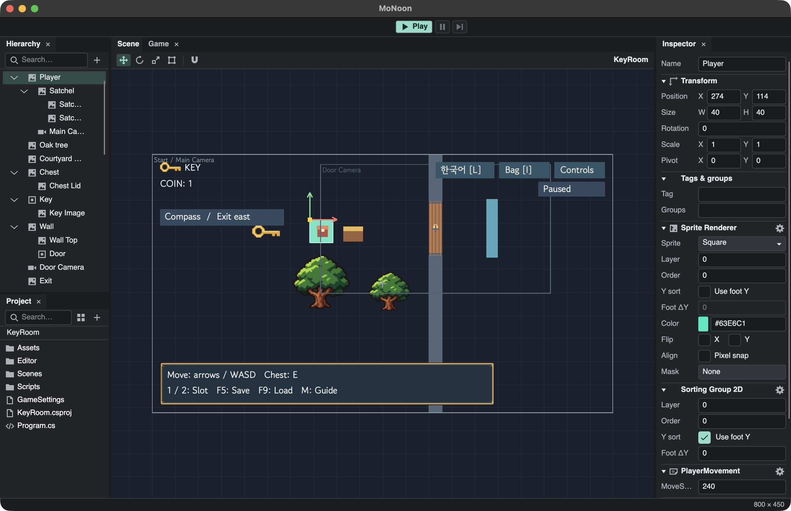

# 에디터 패널 세부 디자인 (로드맵 12.7)

2026-11-23 · macOS 27.0.1 (26A434) · Apple M4 Max · .NET SDK 10.0.101 · Avalonia 11.3.23. 같은 소스로 `engine/scripts/build-editor-mac.sh`가 만든 `editor/MoNoon.app`에서 [KeyRoom.EditorPanelsDetail](../../KeyRoom.EditorPanelsDetail/README.md)의 세 단계(`save`·`first`·`restart`)와 Release 빌드 두 번을 실행했다. 모두 통과했다. 원본 값: [save](save.json) · [first](first.json) · [restart](restart.json) · [실행 출력](run.txt)

새 글꼴·아이콘 팩은 받지 않았다. 아이콘 10개(눈·감은 눈·자물쇠·열린 자물쇠·격자·목록·경로 구분·정보·경고·오류)를 [EditorIcons.axaml](../../../src/Engine.Editor/EditorIcons.axaml)에 16px 벡터 경로로 그렸다. Engine.Core·Engine.Desktop·Engine.Player는 바뀌지 않았다.

## 결정

- **숨기기·잠그기 상태의 위치.** 씬 파일이나 프로젝트 안의 별도 파일이 아니라 사용자 폴더의 `editor-state.json`(레이아웃 파일 `editor-layout.json`과 같은 폴더, 테스트에서는 `MONOON_USER_DATA`)에 씬 파일 경로별 오브젝트 ID 목록으로 저장한다. 게임 빌드는 프로젝트 폴더만 읽으므로 빌드 도구를 고치지 않아도 결과가 같다. 다른 사용자와 공유되지 않고, 씬 파일 이름을 바꾸면 상태가 사라진다. 프리팹 편집 창의 상태는 저장하지 않는다(창을 닫으면 사라진다).
- **컴포넌트 활성 토글.** Engine.Core의 컴포넌트에는 활성/비활성 속성이 없다(`UiControlComponent.Interactable`은 입력 허용 여부이며 이미 본문 필드에 있다). 런타임 필드를 추가하지 않는다는 조건에 따라 활성 토글을 넣은 컴포넌트는 없다. 머리말에는 아이콘, 접기, 기존 톱니바퀴 메뉴(Remove, 스크립트는 Edit Script)만 있다.
- **Inspector 행 간격.** 레이블과 입력 사이 간격(`EditorFieldGap`)을 5px에서 4px로 바꿨다. XAML 행은 모두 이 토큰을 쓰도록 고쳤고 코드로 만드는 행은 이미 토큰을 썼다. 1280·1920px과 긴 이름, 떠 있는 Inspector에서 모든 행의 column이 60(=56+4), drift 0, 세로 중심 차이 0이다. [KeyRoom.EditorTheme](../editor-theme/README.md)의 27행 측정에서도 레이블 x 8, 입력 x 68이 각각 한 값이었다.
- **Inspector 제목 줄.** 탭 이름과 겹치는 제목 줄을 없앴다. 여러 개 선택(`2 selected`), Play 중 **Apply selected**, 프리팹 인스턴스의 **Overrides…**가 있을 때만 탭 아래에 28px 작업 줄이 나타난다. 한 개 선택의 편집 모드에서는 Name 행이 탭 바로 아래에서 시작한다. Play 중에는 한 개 선택이면 작업 줄이 계속 보이므로 Apply 버튼의 활성 상태가 바뀌어도 행이 움직이지 않는다.
- **폴더 트리.** 기본 Project 패널(176px)에서는 파일 영역이 너무 좁아지므로 패널이 360px 이상일 때만 트리를 보인다. Animation 레이아웃의 아래쪽 Project 탭(1280px)에서 트리가 나타났고 Default로 돌아오자 숨었다.
- **긴 ComboBox 값.** Inspector 필드는 코드로 만들어 컴포넌트 템플릿 안에 들어가므로 `#Inspector ComboBox` 스타일이 닿지 않았다(측정에서 `SelectionBoxItemTemplate`이 비어 있음). 컴포넌트 필드를 만들 때 자체 항목 템플릿이 없는 ComboBox에 말줄임·툴팁 템플릿을 넣는다.

## Hierarchy

| 검색어 | 일치 | 보이는 행 |
| --- | ---: | --- |
| `satchel` | 3 | Player, Satchel, Satchel flap, Satchel clasp |
| `Door` | 2 | Wall, Door, Door Camera |
| `zzz` | 0 | 없음, "No matching objects" 표시 |

검색을 지우면 모든 행이 다시 보였다. 행 아이콘은 첫 번째 아이콘 있는 컴포넌트(스크립트는 마지막)를 따른다. [검색](hierarchy-search.png) · [행 호버](hierarchy-hover.png)

**눈·자물쇠.** 버튼 자리(14px 두 칸)는 항상 비워 두고 투명도만 바꾼다. 행 호버와 켠 상태에서 버튼이 보였고 이름의 x와 폭은 그대로였다.

| 상태 | Scene 그리기 목록 | Door 가운데 클릭 | 기타 |
| --- | --- | --- | --- |
| 기본 ([캡처](marks-before.png)) | 있음 | Door 선택 | |
| 숨김 ([캡처](marks-hidden.png)) | 없음 | Door Camera 선택(뒤의 카메라) | 숨긴 채 Play: 런타임 Door 활성 |
| 잠금 | 있음 | Door Camera 선택 | Hierarchy에서 Door 선택 가능 |
| 부모 Wall 숨김 | 자식 Door도 없음 | | |

- 숨기기·잠그기를 켰다 끈 뒤 저장한 씬, Door 숨김·Wall Top 잠금 상태로 저장한 씬, 다시 시작해 상태를 복원한 뒤 저장한 씬이 모두 손대지 않고 저장한 씬과 SHA-256이 같았다.
- 같은 프로젝트를 상태 변경 전후로 `./monoon build … release`한 두 빌드는 269개 파일이 모두 같았다(빌드마다 새로 만드는 `Symbols/<buildId>/`와 `MoNoonBuild`의 `buildId` 줄만 제외). 빌드에 Avalonia·Skia·`editor-state` 파일이 없고 프로젝트 폴더에 새 파일이 생기지 않았다.

## Project

| 조작 | 결과 |
| --- | --- |
| Assets → Fonts 더블클릭 | 경로 줄 `KeyRoom › Assets › Fonts` ([캡처](project-path.png)) |
| 경로 줄 **Assets** | `Assets`로 이동 |
| **Parent folder** | 루트로 이동, 화살표 숨김 |
| 격자 보기 | 76×76px 칸, PNG 9개 모두 축소 이미지, 선택해도 첫 칸 위치 그대로, `ProjectGrid` 저장 ([목록](project-list.png) · [격자](project-grid.png)) |
| Animation 레이아웃 폴더 트리에서 Scripts/Shared 선택 | 파일 영역과 경로 줄이 `Scripts/Shared`로 이동, 경로 줄 **Scripts**를 누르면 트리 선택도 따라감 ([창](project-tree.png) · [패널](project-tree-panel.png)) |
| `door t:sprite` 검색 | Door.png 등 5개, 경로 줄 대신 `5 found` |

경로가 줄보다 길면 앞쪽 폴더 버튼을 통째로 감추고 `…`(툴팁에 전체 경로)를 붙인다. 1280·1920px에서 마지막 버튼은 현재 폴더이고 줄 안에 있었다. 파일을 경로 줄 폴더 버튼이나 트리 폴더에 놓아도 옮길 수 있다(위쪽 화살표와 같은 이동 경로, 검사기에서는 확인하지 않았다).

## Inspector

- Door: 컴포넌트 머리말 아이콘의 x와 톱니바퀴 오른쪽 끝이 각각 한 값이었다. Sprite Renderer를 접자 `editor-state.json`의 `Folds.SpriteRendererComponent`가 false가 됐고 Player의 Sprite Renderer도 접혀 있었다. 다시 시작한 뒤에도 접혀 있었다([캡처](restart-1280.png)). 접기 키는 컴포넌트 형식 이름, 스크립트는 `Script:<이름>`, Transform과 Tags & groups는 각각 하나다.
- Door의 ComboBox 4개(`None`, `Assets/Door.clip`, `Assets/Unlock.wav`, `Effects`)가 말줄임 템플릿을 쓰고 상자 안에 들어갔다. 218px에서 `Assets/Unlock.…`로 줄었다([캡처](inspector-folded.png)).
- Wall·Player 두 개 선택: 작업 줄에 `2 selected` ([캡처](inspector-multi.png)).

## Console

로그 5(테스트가 넣은 3개 포함)·경고 2·오류 1(스택 두 줄)에서 측정했다. [패널](console.png) · [창](console-1280.png)

| 조작 | 목록 행 |
| --- | ---: |
| 모두 표시 | 8 |
| 로그 끄기 | 3 |
| + Collapse | 2 (경고 ×2 표시) |
| 로그 다시 켜기 | 5 |
| 경고 끄고 `Other.Frame` 검색 | 1 |

선택한 오류의 아래 영역에 시간·종류와 스택 두 줄 전체가 나왔다. 버튼 숫자는 5·2·1이었고 Clear 뒤 0이 됐다. Clear·Collapse·검색·필터 버튼의 세로 중심이 같고 도구 줄 높이는 28px이다.

## 정렬

| 경우 | 레이블 x | 입력 x | column | drift | Hierarchy 도구 줄 중심 y | Project 도구 줄 / 경로 줄 중심 y |
| --- | ---: | ---: | ---: | ---: | ---: | ---: |
| [1280](main-1280.png) | 1070 | 1130 | 60 | 0 | 69.5 | 486.5 / 511.5 |
| [1920](main-1920.png) | 1710 | 1770 | 60 | 0 | 69.5 | 642 / 667 |
| [긴 이름 1280](long-name-1280.png) | 1070 | 1130 | 60 | 0 | | |

각 도구 줄 안의 검색 필드·버튼은 세로 중심이 한 값이다. 긴 이름은 Hierarchy에서 383px 중 58px로 말줄임·툴팁 처리됐고 눈·자물쇠는 트리 안에 남았다. Inspector 폭은 218px 그대로였다. [매뉴얼 캡처](../../../../docs/manual/editor-workspace.png)는 `workspace-1280.png`를 1280px 너비로 줄인 것이다.

## 기존 회귀

같은 소스로 만든 같은 앱에서 실행했다. 모두 Mac(osx-arm64) 결과다.

| 검사 | 결과 |
| --- | --- |
| `engine/scripts/build-players.sh` 뒤 `./monoon test` | 통과 |
| `engine/scripts/build-editor-mac.sh` | 통과 |
| [KeyRoom.EditorDocking](../../KeyRoom.EditorDocking/README.md) 다섯 단계 | 통과. 기대 column을 61에서 60으로, 떠 있는 Inspector 머리줄 검사를 제목 줄의 실제 높이에서 작업 줄의 스타일 높이(28px)로 바꿨다. |
| [KeyRoom.EditorTheme](../../KeyRoom.EditorTheme/README.md) | 통과 (27행, 레이블 x 8 · 입력 x 68 한 값, 긴 이름 말줄임) |
| KeyRoom.Rebinding · KeyRoom.PrefabStructure · CollisionLab.FrameProfiler · SeedLab.TileTerrain · CollisionLab.SplitLoading(3회) · KeyRoom.ObjectGroups · KeyRoom.ComponentKeys | 모두 통과 |
| [KeyRoom.PlayInspector](../../KeyRoom.PlayInspector/README.md), [KeyRoom.Desktop](../../KeyRoom.Desktop/README.md) | 실행하지 않음. 손쉬운 사용 권한이 없는 세션이며 변경 전 main에서도 실행되지 않는다. |

실행 중 화면이 잠자기 상태가 되자 에디터가 `Avalonia.Native was not able to start the RenderTimer (-6661)`로 바로 끝났다. `caffeinate -u`로 화면을 깨운 상태에서 다시 실행했다.

## 남은 제한

- 기본 Hierarchy 폭(176px)에서는 눈·자물쇠 자리(30px)만큼 깊은 행의 이름이 더 일찍 줄어든다. 툴팁에 전체 이름이 있다.
- 숨긴 UI 위젯은 화면 UI 미리보기에서 빠지며, 같은 레이아웃 그룹의 다른 위젯 위치가 미리보기에서 바뀔 수 있다. 숨긴 오브젝트가 선택되어 있으면 선택 윤곽과 기즈모는 계속 그린다.
- Hierarchy 검색은 이름만 비교한다(컴포넌트 종류 검색 없음). 검색 중 펼친 부모는 검색을 지워도 펼친 채로 남는다.
- 격자 축소 이미지는 파일 수정 시각별로 최대 512개까지 메모리에 둔다. 더 큰 프로젝트에서는 폴더를 오갈 때 다시 디코딩한다.
- 컴포넌트 활성 토글은 런타임에 해당 속성이 생길 때까지 없다.
- Windows·Linux 패키지 에디터 확인과 1600px 캡처는 12.8 범위다. 실제 마우스 호버 대신 `:pointerover` 의사 클래스를 설정해 호버 표시를 확인했다.

## Windows x64, Linux x64와 1600px 캡처 (12.8)

정렬 검사에 1600px 창을 더했다(Mac은 `screencapture -l`의 [main-1600](../editor-ui-x64/macos-arm64/panels-main-1600.png)). 2026-11-23에 두 QEMU 게스트의 패키지 에디터에서 세 단계와 Release 비교 빌드(게스트에서 패키지 CLI로 빌드)를 통과했다. Hierarchy 검색 3·2·0, Console 5·2·1, 씬 SHA-256 `FB0C1FD5…` 불변이 Mac과 같다. 처음에는 100% 배율에서 Console 도구 줄(`Console toolbar centres 459,460`)과 Project 경로 줄의 `…`(`525.5,525`)이 1px·0.5px 어긋났다. 패널 머리줄 아래 여백 1px과 `…`의 아래 패딩 1px로 고쳤다. [세 OS 결과와 캡처](../editor-ui-x64/README.md)
