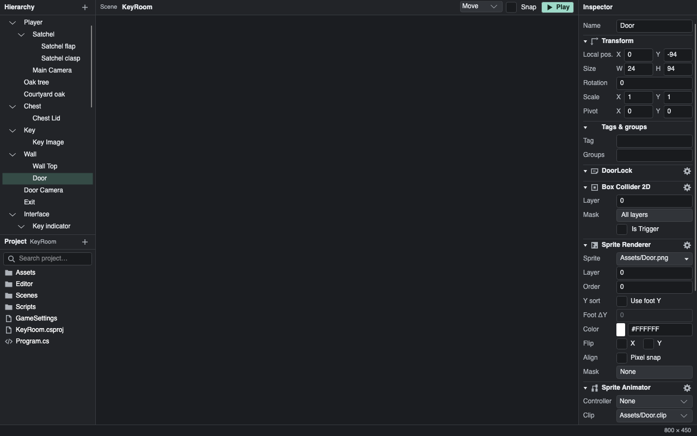

# 에디터 디자인 토큰과 아이콘 (로드맵 12.6)

2026-11-23 · macOS 27.0.1 (26A434) · Apple M4 Max · .NET SDK 10.0.101 · Avalonia 11.3.23. 같은 커밋(41deef4)의 변경 전 에디터와 변경 후 에디터를 각각 패키징해 [KeyRoom.EditorTheme](../../KeyRoom.EditorTheme/README.md)으로 캡처했다. 글꼴은 시스템 글꼴을 그대로 쓰고 아이콘은 저장소의 벡터 경로로 그렸다. 내려받은 글꼴·아이콘 팩은 없다.

## 바뀐 것

- 색·글자·간격·모서리·선 두께를 [EditorStyles.axaml](../../../src/Engine.Editor/EditorStyles.axaml) 토큰으로 정리했다. 바탕은 창(`EditorBase`)·패널(`EditorPanel`)·입력 필드(`EditorField`) 3단계다. 강조색 `EditorAccent`는 선택·포커스·Play에만 쓰고, 경고·오류는 `EditorWarning`·`EditorError`만 쓴다.
- 기본 글자는 11px에서 12px로 바꿨다. 패널 제목과 탭은 12px SemiBold, 보조 정보(`TextBlock.label`)는 11px 회색이다. 목록·트리 행은 22px, 입력 필드와 버튼은 24px, 패널 안쪽 여백은 8px, 대화상자 여백은 12px이다.
- Fluent 테마 리소스를 토큰에 연결해 Button·ToggleButton·TextBox·NumericUpDown·ComboBox·CheckBox·TreeViewItem·ListBoxItem·MenuItem·TabItem의 호버·눌림·선택·포커스·비활성 상태를 같은 규칙으로 표시한다. 키보드 포커스 테두리는 강조색이다.
- 16px 아이콘 38개를 [EditorIcons.axaml](../../../src/Engine.Editor/EditorIcons.axaml)에 추가했다. 컴포넌트 머리말, Project 행, 패널의 추가·상위 폴더 버튼, 검색 필드, Play·일시정지·한 틱 진행, 프로파일러 닫기, 톱니바퀴, 입력 액션·데이터 표의 삭제 버튼에 쓴다. 글자 없는 버튼에는 툴팁과 접근성 이름이 있다.
- 코드로 만드는 Console·Animator·입력 액션·대화·데이터 창과 클립 타임라인·시트 격자·프로파일러 그래프는 [EditorTokens](../../../src/Engine.Editor/EditorTokens.cs)로 같은 토큰을 읽는다.

| 화면 | 변경 전 | 변경 후 |
| --- | --- | --- |
| 메인 창 1280px | [before/main-1280.png](before/main-1280.png) | [after/main-1280.png](after/main-1280.png) |
| 메인 창 1920px | [before/main-1920.png](before/main-1920.png) | [after/main-1920.png](after/main-1920.png) |
| 긴 오브젝트 이름 | [before/main-1280-long-name.png](before/main-1280-long-name.png) | [after/main-1280-long-name.png](after/main-1280-long-name.png) |
| Inspector | [before/inspector-1280.png](before/inspector-1280.png) | [after/inspector-1280.png](after/inspector-1280.png) |
| Scene Play와 프로파일러 | [before/profiler-1280.png](before/profiler-1280.png) | [after/profiler-1280.png](after/profiler-1280.png) |
| Console | [before/console.png](before/console.png) | [after/console.png](after/console.png) |
| Animator Controller | [before/animator.png](before/animator.png) | [after/animator.png](after/animator.png) |
| Sprite Animation | [before/clip.png](before/clip.png) | [after/clip.png](after/clip.png) |
| 시트 셀 선택 | [before/sheet-picker.png](before/sheet-picker.png) | [after/sheet-picker.png](after/sheet-picker.png) |
| Input Actions | [before/input-actions.png](before/input-actions.png) | [after/input-actions.png](after/input-actions.png) |
| Data Asset | [before/data.png](before/data.png) | [after/data.png](after/data.png) |
| Data Table | [before/table.png](before/table.png) | [after/table.png](after/table.png) |
| Dialogue | [before/dialogue.png](before/dialogue.png) | [after/dialogue.png](after/dialogue.png) |
| Tileset | [before/tileset.png](before/tileset.png) | [after/tileset.png](after/tileset.png) |

## Inspector 정렬 측정

Door를 선택한 상태에서 최상위 행 27개를 측정했다. x는 Inspector 패널 왼쪽 기준이다. 측정값 전체는 [before/result.json](before/result.json)과 [after/result.json](after/result.json)에 있다.

| 항목 | 변경 전 | 변경 후 |
| --- | --- | --- |
| 글자 크기 | 11px | 12px |
| 레이블 왼쪽 x (1280·1920·긴 이름) | 10 (한 값) | 9 (한 값, 패널 여백 8px) |
| 입력 열 왼쪽 x | 71 (한 값) | 70 (한 값) |
| 레이블 열 너비 | 56 | 56 (`EditorFieldLabelWidth`) |
| 가장 긴 레이블의 실제 폭 | 51px (Local pos.) | 55px (Local pos.) |
| 입력 필드 높이 | 21·23·24 혼재 | 24 |
| 레이블과 입력 필드의 세로 중심 차이 | 0px | 0px |
| 긴 이름의 Hierarchy 표시 | 351px 중 107px, 말줄임·툴팁 | 383px 중 107px, 말줄임·툴팁 |
| 긴 이름 뒤 Inspector 너비 | 218px 유지 | 218px 유지 |

- 12px에서도 기존 56px 레이블 열에 모든 레이블이 들어가므로 열 너비를 넓히지 않았다. 코드로 만드는 행도 같은 토큰을 쓴다. 다른 OS 글꼴에서 레이블이 열보다 길면 말줄임표로 줄고 툴팁에 전체 이름이 나온다.
- 변경 전에는 XAML 행의 입력 필드만 21px이고 컴포넌트 코드가 만든 필드는 24px이었다. 지금은 모두 24px이다.
- X·Y·W·H 축 레이블 열은 12px 글자에서 W가 잘리지 않도록 9px에서 12px로 넓혔다.

12.7에서 레이블·입력 간격(`EditorFieldGap`)을 5px에서 4px로 바꾸고 Inspector 제목 줄을 뺀 뒤 같은 검사기로 다시 재면 레이블 왼쪽 x는 8, 입력 열 왼쪽 x는 68(각각 한 값)이다. 위 표는 12.6 당시 값이다. [12.7 결과](../editor-panels/README.md)

## 회귀 검사

같은 패키지 에디터로 실행했다. 모두 Mac 결과다.

| 검사 | 결과 |
| --- | --- |
| `engine/scripts/build-players.sh` 뒤 `./monoon test` | 통과 (`All checks passed.`) |
| `engine/scripts/build-editor-mac.sh` | 통과 |
| KeyRoom.EditorTheme | 통과 (위 측정, 별도 창 9개 12px, 아이콘 38개) |
| KeyRoom.Rebinding 에디터 Scene Play | 통과 |
| KeyRoom.PrefabStructure 에디터 | 통과 (적용·Undo·Redo·다시 열기) |
| CollisionLab.FrameProfiler 에디터 Scene Play | 통과 (R 뒤 최장 프레임에서 질의 4,032회가 85.1%) |
| SeedLab.TileTerrain 에디터 | 통과 |
| KeyRoom.PlayInspector, KeyRoom.UiLayout | 이 실행 환경에서 판정 불가. Swift 입력 도우미가 보낸 Play 클릭이 에디터에 전달되지 않아 `Scene Play` 대기 시간이 초과됐다. 변경 전 커밋으로 만든 에디터에서도 같은 위치에서 실패했다. |

KeyRoom을 Release와 Native AOT로 내보낸 결과에는 Avalonia·SkiaSharp 파일과 문자열이 없다. Engine.Core·Engine.Desktop·Engine.Player 소스는 바뀌지 않았다.

## 남은 한계

- RenderTargetBitmap은 SDL 네이티브 Scene 뷰를 그리지 않으므로 캡처의 Scene 영역은 비어 있다.
- ComboBox에 선택된 긴 값(예: `Assets/Unlock.wav`)은 말줄임표 없이 잘린다. 에셋 선택 상자에는 전체 경로 툴팁이 있다. (12.7에서 말줄임표와 툴팁으로 바꿨다.)
- 이동·회전·크기·Rect·스냅 아이콘은 리소스로만 준비했다. 도구 모음 배치는 12.5에서 바꾼다.
- Windows·Linux 패키지 에디터 캡처는 12.8에서 남긴다.

## Windows x64와 Linux x64 패키지 에디터 (12.8)

2026-11-23에 두 QEMU 게스트의 패키지 에디터에서 통과했다. 세 Inspector 캡처 모두 27행, 레이블 x 8, 필드 x 68, 세로 중심 차 0으로 Mac과 같다. 글꼴은 각 OS의 시스템 글꼴이라 Linux에서는 `Local pos.`·`Controller`가 말줄임표와 툴팁으로 줄었다. 패널 8개와 시트 셀 선택 대화 상자도 12px이다. [세 OS 결과와 캡처](../editor-ui-x64/README.md)
