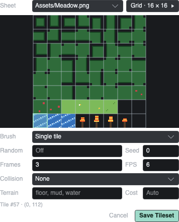
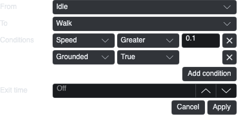
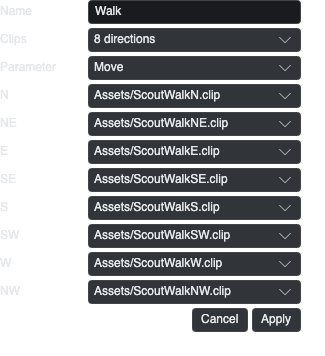

# 엔진 기능 3: 8방향 오토타일·무작위 타일·움직이는 타일, 애니메이터 조건·방향 세트 (16.9 · 16.5)

2026-11-24, macOS 27 (Apple Silicon arm64), .NET 10. 기준 커밋 `f48fc00`(wip/next1). 실행 대상은 에디터 Scene 편집(타일셋·애니메이터 패널), 에디터 미리보기, Scene Play, Release, Native AOT이며 빌드는 모두 이 Mac에서 `./monoon build --profile distribution`으로 만들었다(osx-arm64). 측정하는 동안 `qemu-system`은 실행 중이 아니었다. 판정은 모두 결정성 기준(바이트·개수 일치)이고 시간 측정은 하지 않았다. x64(Linux 게스트)는 coordinator 몫이다.

씬 스키마는 올리지 않았다. 두 기능 모두 씬 파일 형식을 바꾸지 않는다(새 키는 `.tileset`·`.animator` 에셋에만 있고, 쓰지 않으면 저장 내용이 이전과 같다).

## 16.9 8방향 오토타일과 무작위 타일

### 배포본 영향

- **셀당 데이터 0바이트.** 씬에는 지금처럼 브러시 ID만 저장한다. 47칸 모양과 무작위 선택은 이웃과 `(x, y, seed)`의 정수 해시로 정해지므로 저장할 것이 없다. 타일셋에는 타일 정의마다 선택 키 두 개(`randomTiles`, `randomSeed`, 쓰지 않으면 쓰지 않음)만 늘었다.
- **프레임 비용 0.** 지금까지는 스트리밍하지 않는 레이어가 그릴 때마다 보이는 셀의 이웃 4–6칸을 다시 읽었다. 이제 Play·배포 게임은 씬을 불러올 때 모든 셀의 그림을 한 번 계산해 두고(`Tilemap2DComponent.Resolved`), 그리기는 청크별 표 조회만 한다. 스트리밍 레이어는 원래처럼 빌드할 때 청크 파일에 구워 둔다. `SetTile`은 바꾼 칸과 여덟 이웃만, `ReplaceTiles`는 그 레이어만 다시 계산한다. 시작 비용은 셀 수 × 이웃 8칸 조회 한 번이다.
- 메모리: 연결 그림이 브러시 ID와 다른 셀만 청크별 불변 사전에 들어간다(스트리밍 페이지가 이미 쓰는 구조).
- 용량: [아래 표](#용량)
- BRUTAL에는 타일맵·오토타일 기능이 없다([docs/brutal.md](../../../../docs/brutal.md)). 그리기는 기존 SDL3 경로 그대로다.

### 바꾼 것

| 파일 | 내용 |
| --- | --- |
| `engine/src/Engine.Core/Tilemap2D.cs` | `AutoEdges: 8`(47칸 blob, 원시 8비트 마스크 → 그림 256칸 표), `RandomTiles`·`RandomSeed`, 위치 해시 `Pick`, 실행용 해석본 `Resolved`, 부분 갱신 `Refresh` |
| `engine/src/Engine.Core/TileWorld.cs` | 스트리밍 페이지 갱신이 공용 `Refresh`(여덟 이웃)를 쓴다 |
| `engine/src/Engine.Core/RuntimeTiles.cs` | `SetTile`·`ReplaceTiles` 뒤 해석본 갱신 |
| `engine/src/Engine.Core/SceneGame.cs` | 타일 레이어를 불러올 때 해석본으로 교체(4줄) |
| `engine/src/Engine.Editor/Panels/TilesetWindow.axaml(.cs)` | Brush에 **Terrain · 8 neighbours (47 cells)**, **Random / Seed** 행(Terrain/Cost 행과 같은 열) |
| `engine/src/Engine.Editor/Panels/MainWindow.Tiles.cs` | 타일 목록에 `· Random` 표시 |
| `samples/SeedLab` | `Meadow.png`·`Meadow.tileset`·`Meadow.scene`(Hedge garden), Route → Meadow → Survey 순환(G) |
| `engine/tests/Engine.Checks/AutotileChecks.cs`, `Program.cs` | 단위 검사, `--only autotile` |
| `engine/tests/SeedLab.Autotile/` | 시트·씬 생성기와 독립 판정 모델, 세 경로 하네스 |
| `docs/manual/tilemaps.md` | [Terrain · 8 neighbours와 무작위 타일](../../../../docs/manual/tilemaps.md#같은-브러시의-무작위-타일) |

### 검증

| 검사 | Scene 편집 | Scene Play | Release | Native AOT |
| --- | --- | --- | --- | --- |
| 47칸 순서, 시트 해석, 모든 연결 모양(생울타리 323칸) = 독립 계산 | 통과 | 해당 없음 | 해당 없음 | 해당 없음 |
| 편집기 획: 직사각형으로 네 청크 걸친 3×3 칠하기, 가운데 지우기, 취소, 지우고 다시 칠하기 | 통과(`TileStroke`) | 해당 없음 | 해당 없음 | 해당 없음 |
| 시드 재현: 다시 불러온 타일셋에서 100칸 같음, 시드 8로 바꾸면 절반 넘게 바뀜 | 통과 | 통과 | 통과 | 통과 |
| 1·20·40틱 두 레이어 1,400칸 × 2 = 판정 모델(경계 칸 `SetTile` 칠하기·지우기 포함) | 해당 없음 | 통과 | 통과 | 통과 |
| 세 경로 기록 바이트 일치 | 해당 없음 | 통과 | 통과 | 통과 |
| 5·25·45프레임 PNG 일치 | 해당 없음 | 해당 없음 | 통과 | 통과(Release와 같음) |
| 해석본이 이웃 규칙 없이 같은 그림을 그림, 스트리밍 페이지도 같음 | 해당 없음 | 통과 | 통과(같은 코드) | 통과(같은 코드) |
| Tileset 패널 Seed 7→8→7 저장·재열기, 700·380px 열 정렬 | 통과 | 해당 없음 | 해당 없음 | 해당 없음 |
| 샘플 타일셋 7개가 새 키 없이 왕복 | 통과 | 해당 없음 | 해당 없음 | 해당 없음 |
| 타일 충돌 게이트 PlatformerLab.TileCollision 380틱 | 해당 없음 | 통과 `f30ed686…` | 통과 `f30ed686…` | 통과 `f30ed686…` |
| 금지 파일(SkiaSharp·Avalonia·Engine.Editor·Engine.Authoring) | 해당 없음 | 해당 없음 | 통과 | 통과 |

[Tileset 700px](tileset-700.png) · [Release 25프레임](autotile-release-25.png) · [기록](autotile-check.txt)

## 16.5 애니메이터 조건 확장

### 배포본 영향

- 전이 평가는 상태당 O(조건)이다. 컨트롤러를 불러올 때 상태마다 나가는 규칙(Any State 규칙 포함, 목록 순서)을 인덱스 배열로 만들고, 조건은 `(파라미터 번호, 비교, 값)` 구조체 배열로 바꾼다. 한 틱은 현재 상태의 규칙만 순서대로 보고 첫 번째로 맞는 하나를 고른다. 이전에는 모든 전이를 훑고 이름으로 사전을 찾았다.
- **할당 0**: 전이가 계속 일어나는 2만 틱에서 0바이트(`AnimatorConditionChecks`).
- 결정성: 비교는 float 값 그대로, Exit time은 상태 진입 뒤 누적한 고정 틱 시간(double)과 클립 길이의 곱을 비교한다. 네 경로 기록이 같다.
- 용량: [아래 표](#용량)
- BRUTAL에는 애니메이터 상태 기계가 없다.

### 바꾼 것

| 파일 | 내용 |
| --- | --- |
| `engine/src/Engine.Core/AnimationController.cs` | `Int` 파라미터, `AnimationCondition`, 전이의 `And`·`ExitTime`, `Any State`, 컴파일된 상태별 규칙, `IGameAnimator.SetInt` |
| `engine/src/Engine.Editor/Panels/AnimatorWindow.cs` | 전이 대화상자: From에 Any State, 조건 행 추가·삭제(같은 세 열), Exit time. 파라미터 Int, 미리보기 Int 입력, 목록 표시 |
| `samples/AnimatorLab` | `Guard.scene`, `Guard.animator`, 클립 4개, `GuardDemo.cs` |
| `engine/tests/Engine.Checks/AnimatorConditionChecks.cs`, `Program.cs` | 단위 검사, `--only animator-conditions` |
| `engine/tests/AnimatorLab.Conditions/` | 생성기, 독립 상태 기계 모델, 네 경로 하네스 |
| `docs/manual/sprites.md` | [파라미터로 애니메이션 전환하기](../../../../docs/manual/sprites.md#파라미터로-애니메이션-전환하기) |

### 검증

| 검사 | 에디터 미리보기 | Scene Play | Release | Native AOT |
| --- | --- | --- | --- | --- |
| AND 조건, Int 비교, Exit time, Any State, 목록 우선순위, Trigger 보존·소비 | 통과(단위 검사) | — | — | — |
| 2만 틱 할당 0바이트 | 통과(단위 검사) | — | — | — |
| 이전 `Beacon.animator`가 새 키 없이 왕복, 기존 AnimatorChecks | 통과 | — | — | — |
| 잘못된 입력 거부(Int 1.5, 조건·Exit time 없음, Float에 Triggered, `Any State` 상태 이름, 음수 Exit time) | 통과 | — | — | — |
| 320틱 상태 = 독립 모델(다섯 상태 모두 방문) | 통과 | 통과 | 통과 | 통과 |
| 네 경로 상태·프레임 기록 바이트 일치 | 통과 | 통과 | 통과 | 통과 |
| 40·95·215프레임 PNG 일치 | 해당 없음 | 해당 없음 | 통과 | 통과(Release와 같음) |
| 전이 대화상자 정렬(조건 행 = From·To 열, Conditions 레이블 = 첫 행), 420·340px | 통과 | 해당 없음 | 해당 없음 | 해당 없음 |
| 금지 파일 | 해당 없음 | 해당 없음 | 통과 | 통과 |

상태가 바뀐 틱: 6 Walk, 31 Attack, 55 Recover(Exit time), 73 Idle, 74 Walk, 91 Hurt(Any State), 141 Idle(착지 뒤), 142 Walk, 161 Idle, 171 Attack, 195 Recover, 213 Idle(Combo 3이라 대기), 261 Attack(Combo 0), 285 Recover, 303 Idle.

[340px](transition-340.png) · [Release 95프레임](guard-release-95.png) · [기록](guard-check.txt)

## 16.9 프레임 애니메이션 타일

기준 커밋 `048629b`(wip/next1, 위 두 기능 포함). 실행 대상은 Tileset 패널(Scene 편집), Scene Play, Release, Native AOT이고 빌드는 이 Mac에서 `./monoon build --profile distribution`(osx-arm64)로 만들었다. `qemu-system`은 실행 중이 아니었다.

### 배포본 영향

- **셀당 데이터 0바이트, 청크 파일 변화 없음.** 씬과 스트리밍 청크에는 지금처럼 첫 그림의 타일 ID만 있다. 타일셋의 타일 정의에 선택 키 두 개(`frames`, `fps`, 쓰지 않으면 쓰지 않음)만 늘었다.
- **타일셋마다 시계 하나.** 타일셋을 불러올 때 움직이는 타일마다 프레임 타일 ID 배열과 FPS를 만들어 둔다(`TileFrames`). 레이어를 그릴 때 한 번 모든 움직이는 타일의 현재 장을 `floor(초 × FPS) mod 장 수`로 고르고, 칸은 그 값을 사전에서 한 번 찾는다. 셀별 상태가 없어서 같은 타일의 모든 칸이 같은 장을 보여 주고, 지우고 다시 칠한 칸도 이웃과 맞는다.
- **할당 0, 그리기 묶음 유지.** 시계 갱신과 조회 2만 번이 0바이트(`TileAnimationChecks`). 프레임은 같은 타일 시트의 다른 영역이므로 레이어의 모든 칸이 여전히 한 텍스처로 그려진다(검사에서 그리기 호출의 이미지 경로가 하나). 움직이는 타일이 없는 타일셋은 칸마다 `Count != 0` 비교 하나만 늘었다.
- **결정성.** 시간은 게임 시간이다. 그리기는 다른 효과와 같은 보간 시각(`effectTime`), 스크립트의 `TryGetTile`은 그 틱의 `Time.GameSeconds`를 쓴다. 판정 모델은 float 틱 간격을 double로 더해 같은 값을 만든다(4 FPS의 15틱째가 `0.25000003 s` → 1장처럼 경계 값도 맞는다).
- 용량: [아래 표](#프레임-타일-용량)
- BRUTAL에는 타일맵 기능이 없다([docs/brutal.md](../../../../docs/brutal.md)). 그리기는 기존 SDL3 경로 그대로다.

### 바꾼 것

| 파일 | 내용 |
| --- | --- |
| `engine/src/Engine.Core/Tilemap2D.cs` | `TileDefinition.Frames`·`Fps`(검증: 2–64장, 1–60 FPS, 지형·Random 브러시와 함께 쓰지 않음, 이어지는 시트 칸 필요), `TileFrames`, `TilePalette.Clock`·`Animated`, 두 `Draw`가 장을 조회 |
| `engine/src/Engine.Core/SceneGame.cs` | 타일 레이어 그리기에 `effectTime` 전달(1줄) |
| `engine/src/Engine.Core/RuntimeTiles.cs` | `TryGetTile`의 `Display`가 그 틱의 장 |
| `engine/src/Engine.Editor/Panels/TilesetWindow.axaml(.cs)` | **Frames / FPS** 행(Random/Seed·Terrain/Cost와 같은 네 열). 세 행의 오른쪽 레이블 열을 `SharedSizeGroup`으로 묶어 입력 칸 너비도 같게 함 |
| `engine/src/Engine.Editor/Panels/MainWindow.Tiles.cs` | 타일 목록에 `· Animated` |
| `samples/SeedLab` | `Meadow.png` 마지막 줄(물 세 장, 횃불 네 장), `Meadow.tileset` #57·#60, `Meadow.scene` Water 레이어(연못 24칸 + 횃불 2칸). 기존 타일 ID는 그대로 |
| `engine/tests/Engine.Checks/TileAnimationChecks.cs`, `Program.cs` | 단위 검사, `--only tile-animation`. `AutotileChecks`의 시트 칸 부족 예시를 늘어난 시트에 맞춤(Random 7 → 15) |
| `engine/tests/SeedLab.Autotile/` | 판정 모델에 장 계산, 연못 칸 지우기·다시 칠하기, 매 틱 연못·횃불 기록, Tileset 패널 FPS 4→6→4와 Frames 행 정렬 |
| `docs/manual/tilemaps.md` | [움직이는 타일](../../../../docs/manual/tilemaps.md#움직이는-타일) |

### 검증

| 검사 | Scene 편집 | Scene Play | Release | Native AOT |
| --- | --- | --- | --- | --- |
| 600틱 동안 두 타일의 장 = 독립 계산, 움직이지 않는 타일은 그대로 | 통과(단위 검사) | — | — | — |
| 네 시각에 연못 24칸이 같은 장, 횃불 둘이 같은 장, 그리기 이미지 하나 | 통과(단위 검사) | — | — | — |
| 시계 갱신·조회 2만 번 할당 0바이트 | 통과(단위 검사) | — | — | — |
| 잘못된 입력 거부(1장, 0 FPS, FPS 없음, Random과 함께, 시트 칸 부족), 샘플 타일셋 7개가 새 키 없이 저장 | 통과 | — | — | — |
| 스트리밍 청크도 같은 장 | 통과(단위 검사) | — | — | — |
| 매 틱 연못·횃불의 장 = 판정 모델(50틱) | 해당 없음 | 통과 | 통과 | 통과 |
| 1·20·40틱 세 레이어 1,400칸 × 3 = 판정 모델(10틱에 지운 연못 칸을 30틱에 다시 칠하면 이웃과 같은 장) | 해당 없음 | 통과 | 통과 | 통과 |
| 세 경로 기록 바이트 일치(59줄) | 해당 없음 | 통과 | 통과 | 통과 |
| 5·25·45프레임 PNG 일치 | 해당 없음 | 해당 없음 | 통과 | 통과(Release와 같음) |
| Tileset 패널 연못 FPS 4→6→4 저장·재열기, Frames·FPS 행이 Random·Seed 행과 같은 위치·너비(700·380px) | 통과 | 해당 없음 | 해당 없음 | 해당 없음 |
| 기존 16.9 오토타일 검사 전체(생울타리·잔디 판정, 시드 7→8→7) | 통과 | 통과 | 통과 | 통과 |
| 금지 파일 | 해당 없음 | 해당 없음 | 통과 | 통과 |

[Tileset 700px](tileset-700.png) · [Release 25프레임(연못 2장째)](autotile-release-25.png) · [기록](autotile-check.txt) · [단위 검사와 크기](size-after-16.9-frames.txt)

### 프레임 타일 용량

기준은 `048629b`를 `git archive`로 따로 풀어 같은 플레이어 템플릿으로 `./monoon test size`를 실행한 값이다([기준](size-base-048629b.txt)). 앞의 표의 "16.9 + 16.5" 값과 바이트까지 같다.

| 빌드 | 기준 `048629b` | + 프레임 타일 | 차이 |
| --- | --- | --- | --- |
| KeyRoom Release 앱 | 33,027,866 | 33,034,010 | +6,144 |
| KeyRoom Native AOT 실행 파일 | 8,703,344 | 8,703,344 | 0 |
| PlatformerLab Release 앱 | 30,285,658 | 30,291,802 | +6,144 |
| PlatformerLab Native AOT 실행 파일 | 8,371,456 | 8,387,968 | +16,512 |
| InventoryLab Release 앱 | 83,708,380 | 83,714,524 | +6,144 |
| InventoryLab Native AOT 실행 파일 | 8,371,344 | 8,387,872 | +16,528 |

- Native AOT 실행 파일은 거의 16 KB 정렬 단위로 커진다. 실제 코드 증가는 수 KB이고, KeyRoom은 남은 페이지 안에 들어가 0, 나머지 둘은 한 페이지가 늘었다. Release는 `Engine.Core.dll` IL 증가다.
- 값 형식 제네릭 인스턴스를 새로 만들지 않았다(`Dictionary<int,TileFrames>`는 참조 형식 값이라 기존 `Dictionary<int,int[]>`와 코드를 공유한다). VYaml 역직렬화 메서드 수 350 그대로.
- 크기 게이트 통과(6개 빌드 기준선 +1% 이내).

## 16.5 4·8방향 클립 세트

기준 커밋은 16.9 프레임 타일 커밋 뒤 wip/next1 `d9d6dca`(16.10 오디오, 물리 할당, 크기 기준선 갱신)를 병합한 `e66b915`다. 실행 대상은 Animator 패널(상태 대화상자·미리보기), Scene Play, Release, Native AOT이고 빌드는 이 Mac에서 `./monoon build --profile distribution`(osx-arm64)로 만들었다. `qemu-system`은 실행 중이 아니었다.

### 배포본 영향

- **상태당 배열 하나, 틱당 비교 몇 번.** 컨트롤러를 불러올 때 상태마다 클립 트랙 배열(일반 상태 1개, 방향 세트 4·8개)과 방향 파라미터 번호를 만든다. 한 틱은 현재 상태가 방향 세트일 때만 지금 방향의 점수 하나를 보고, 벗어났을 때만 4·8방향을 훑는다.
- **정수·비교 수학.** 방향은 정수 단위 벡터(−1, 0, 1)와의 내적 제곱을 벡터 길이 제곱과 비교해 고른다. 삼각함수·제곱근·`Vector2` 변환을 쓰지 않으므로 FMA·sincos 차이가 없다(DeterminismScan 통과). 유지 기준 cos² ≥ 0.75(30°, 8방향)·0.25(60°, 4방향)는 float에서 정확한 값이다.
- **히스테리시스.** 지금 방향은 벡터가 30°(8방향) 또는 60°(4방향) 넘게 벗어날 때까지 유지한다. 가장 가까운 방향만 고르면 키보드 대각선 입력이나 스틱이 경계(22.5°·45°) 근처에서 떨릴 때 클립이 틱마다 바뀐다. 2D 탑다운 게임에서 흔히 쓰는 방식대로 경계를 7.5°·15° 넓혔다.
- **할당 0**: 72개 각도와 상태 전환을 오가는 2만 틱에서 0바이트(`AnimatorDirectionChecks`).
- 방향이 바뀌어도 재생 시간을 유지하므로 걷기 주기가 끊기지 않는다. 프레임 이벤트의 클립 ID(`AnimationMarker.Clip`)는 지금 보여 주는 방향 클립이다.
- 파일 형식: `AnimationState`에 선택 키 `directions`(GUID 목록)·`direction`(파라미터 이름), 파라미터 종류 `Vector2`. 쓰지 않으면 이전과 같은 내용으로 저장된다. `clip`은 첫 방향 클립과 같아야 한다(목록 표시와 이전 도구 호환). 씬 스키마는 바꾸지 않았다.
- 빌드: `GameBuild`와 `ProjectCatalog`가 방향 클립도 배포 에셋·참조로 모은다(처음 Release 빌드에서 방향 클립이 빠져 `Missing animation clip`으로 시작하지 못한 것을 고쳤다).
- BRUTAL에는 애니메이터 상태 기계가 없다.
- 용량: [아래 표](#방향-세트-용량)

### 바꾼 것

| 파일 | 내용 |
| --- | --- |
| `engine/src/Engine.Core/AnimationController.cs` | `AnimationState.Directions`·`Direction`·`Compass`·`Clips()`, Vector2 파라미터 검증, `IGameAnimator.Facing`·`SetVector2`, 상태별 트랙 배열과 `Face()`(히스테리시스), 마커의 클립 ID가 현재 방향 클립. 클립 로드의 `Select`·`Distinct`(Guid LINQ)를 반복문으로 바꿈 |
| `engine/src/Engine.Authoring/GameBuild.cs`, `ProjectCatalog.cs` | 방향 클립을 배포 에셋과 참조 목록에 포함 |
| `engine/src/Engine.Editor/Panels/AnimatorWindow.cs` | 상태 대화상자 **Clips**(One clip / 4 / 8 directions)·**Parameter**·N…NW 클립 행(모두 같은 레이블·입력 열), 파라미터 종류 Vector2, 미리보기 X·Y 입력과 방향 표시, 목록의 `8 directions · Move`, 이름 변경·삭제·종류 변경 시 방향 세트 처리, 조건 행은 Vector2 제외 |
| `samples/AnimatorLab` | `Scout.png`, 클립 12개, `Scout.animator`, `Scout.scene`, `ScoutDemo.cs`, GameSettings의 포함 씬 |
| `engine/tests/Engine.Checks/AnimatorDirectionChecks.cs`, `Program.cs` | 단위 검사, `--only animator-directions` |
| `engine/tests/AnimatorLab.Directions/` | 생성기·독립 방향 모델, 네 경로 하네스, 에디터 프로브 |
| `docs/manual/sprites.md` | [4·8방향 클립 세트](../../../../docs/manual/sprites.md#48방향-클립-세트) |

### 검증

| 검사 | 에디터 미리보기 | Scene Play | Release | Native AOT |
| --- | --- | --- | --- | --- |
| 히스테리시스(E를 25°·29°에서 유지, 31°에서 SE, 되돌아올 때 20°에서 SE 유지·14°에서 E), 아무 방위로 한 번에 이동, 0 벡터 유지 | 통과(단위 검사) | — | — | — |
| 4방향 Idle: 대각선 NW를 W로 표시, 55°까지 유지·65°에서 N | 통과(단위 검사) | — | — | — |
| 방향마다 다른 시트 열, 방향 전환 시 걷기 주기 유지 | 통과(단위 검사) | — | — | — |
| 2만 틱 할당 0바이트 | 통과(단위 검사) | — | — | — |
| 이전 `Beacon.animator`·`Guard.animator`가 새 키 없이 왕복, 기존 Animator·조건 검사 | 통과 | — | — | — |
| 잘못된 입력 거부(클립 3개, Float 방향 파라미터, 파라미터 없음, 첫 클립 불일치, Vector2 기본값 ≠ 0, Vector2 조건, Float에 SetVector2, NaN) | 통과 | — | — | — |
| 420틱 상태·방향 = 독립 모델, Walk 8방향 모두 | 통과 | 통과 | 통과 | 통과 |
| 네 경로 상태·프레임·방향 기록 바이트 일치(420줄) | 통과 | 통과 | 통과 | 통과 |
| 30·95·240·330프레임 PNG 일치 | 해당 없음 | 해당 없음 | 통과 | 통과(Release와 같음) |
| 상태 대화상자 정렬(N…NW 행·Clips·Parameter가 한 열, 레이블이 자기 행 높이), 4 directions에서 N·E·S·W만, 325·270px | 통과 | 해당 없음 | 해당 없음 | 해당 없음 |
| 금지 파일 | 해당 없음 | 해당 없음 | 통과 | 통과 |

한 바퀴 구간에서 클립이 바뀐 틱(가장 가까운 방향보다 한 점씩 늦다): 271 NE, 283 E, 297 SE, 315 S, 329 SW, 347 W, 361 NW, 379 N, 393 NE, 399 Idle N.

[270px](state-270.png) · [Release 95프레임(Walk SE)](scout-release-95.png) · [기록](scout-check.txt) · [단위 검사와 크기](size-after-16.5-directions.txt)

### 방향 세트 용량

기준은 wip/next1 병합 직후의 `e66b915`를 `git archive`로 따로 풀고 그 트리에서 플레이어 템플릿을 만들어 `./monoon test size`를 실행한 값이다([기준](size-base-e66b915.txt)). 크기 게이트의 기준선은 wip/next1 `f3d4bc3`에서 갱신된 값이다.

| 빌드 | 기준 `e66b915` | + 방향 세트 | 차이 |
| --- | --- | --- | --- |
| KeyRoom Release 앱 | 33,050,394 | 33,056,538 | +6,144 |
| KeyRoom Native AOT 실행 파일 | 8,719,936 | 8,719,936 | 0 |
| PlatformerLab Release 앱 | 30,309,210 | 30,315,354 | +6,144 |
| PlatformerLab Native AOT 실행 파일 | 8,371,424 | 8,371,408 | −16 |
| InventoryLab Release 앱 | 83,730,908 | 83,737,052 | +6,144 |
| InventoryLab Native AOT 실행 파일 | 8,404,448 | 8,387,920 | −16,528 |

- Native AOT는 늘지 않았다. 새 코드(배열·비교 몇 줄)보다 클립 로드에서 없앤 `Select`·`Distinct<Guid>`가 더 컸다. InventoryLab의 −16,528은 16 KB 정렬 단위 하나가 줄어든 것이다(기준 트리에서 프레임 타일이 늘린 페이지가 다시 남는다).
- 새 YAML 멤버는 `Guid[]`(GameSettings가 이미 쓰는 형식)와 `string`이라 VYaml 역직렬화 메서드 수가 356 그대로다. 값 형식 제네릭·튜플·record struct를 새로 쓰지 않았다.
- 크기 게이트 통과(6개 빌드 기준선 +1% 이내).

## 용량

기준 커밋 `f48fc00`을 따로 풀어 같은 방법(`./monoon test size`, osx-arm64 배포 빌드)으로 재고, 두 기능을 넣은 트리와 비교했다. [기준](size-base-f48fc00.txt) · [후보](size-after-16.9-16.5.txt)

| 빌드 | 기준 `f48fc00` | 16.9 + 16.5 | 차이 |
| --- | --- | --- | --- |
| KeyRoom Release 앱 | 32,999,706 | 33,027,866 | +28,160 |
| KeyRoom Native AOT 실행 파일(= 앱 차이) | 8,653,728 | 8,703,344 | +49,616 |
| PlatformerLab Release 앱 | 30,257,498 | 30,285,658 | +28,160 |
| PlatformerLab Native AOT 실행 파일 | 8,354,864 | 8,371,456 | +16,592 |
| InventoryLab Release 앱 | 83,679,708 | 83,708,380 | +28,672 |
| InventoryLab Native AOT 실행 파일 | 8,354,768 | 8,371,344 | +16,576 |

- 나누어 보면(추정): 애니메이터를 쓰지 않는 PlatformerLab·InventoryLab의 +16.6 KB가 16.9 몫(타일 코드는 모든 게임에 남는다), 애니메이터를 쓰는 KeyRoom의 추가 +33.0 KB가 16.5 몫이다. Release는 `Engine.Core.dll` IL 증가로 +28 KB다.
- 처음 구현은 KeyRoom Native AOT가 +99.6 KB였고 크기 게이트(기준선 +1%)를 넘었다. Native AOT는 값 형식 제네릭 인스턴스마다 코드를 따로 만든다. 그래서 값 튜플을 값으로 쓰는 `Dictionary<int,(int,int[])>`, `ImmutableDictionary<Point,…>.Builder`, `List<Test>`, `record struct`(생성 멤버), 값 튜플·`byte`·`float` LINQ를 배열·반복문·기존 인스턴스(`Dictionary<int,int[]>`, `SetVisual`)로 바꿔 절반으로 줄였다.
- 크기 게이트는 통과한다(6개 빌드 모두 기준선 +1% 이내). 기준선은 갱신하지 않았다.
- 새 YAML 형식 `AnimationCondition`으로 Native AOT 키트의 VYaml 역직렬화 메서드가 347 → 350개다. 직렬화 코드는 여전히 0개다.

## 공통 회귀

`./monoon test` 통과(새 검사 묶음 `autotile`, `animator-conditions`, `tile-animation`, `animator-directions` 포함, DeterminismScan·PlayerYaml·YAML 기본값·빌드 크기 게이트 포함). 프레임 타일과 방향 세트는 wip/next1 `d9d6dca` 병합 뒤 트리에서 `./monoon test`와 두 하네스의 세 경로(SeedLab.Autotile)·네 경로(AnimatorLab.Directions)를 다시 실행해 모두 통과했다.

## 재현

[SeedLab.Autotile](../../SeedLab.Autotile/README.md) · [AnimatorLab.Conditions](../../AnimatorLab.Conditions/README.md) · [AnimatorLab.Directions](../../AnimatorLab.Directions/README.md) · [PlatformerLab.TileCollision](../../PlatformerLab.TileCollision/README.md)

## 확인하지 않은 것

- x64(Windows·Linux) 실행: coordinator 몫. Windows는 보류.
- 프레임 애니메이션 타일은 뒤의 작업에서 만들었다([16.9 프레임 애니메이션 타일](#169-프레임-애니메이션-타일)). Scene 편집 화면은 첫 장만 보여 주며 움직임은 확인하지 않는다.
- 4·8방향 클립 세트는 뒤의 작업에서 만들었다([16.5 4·8방향 클립 세트](#165-48방향-클립-세트)). 게임패드 스틱 입력으로 경계 근처 떨림을 직접 눌러 보지는 않았다(정사각형 둘레 입력과 단위 검사의 각도로 대신 확인).
- Scene 편집 화면의 실제 마우스 칠하기는 GUI로 누르지 않았다. 같은 획 코드(`TileStroke`)를 단위 검사로 확인했다.
- 시간 측정(시작 시간, 프레임 시간)은 하지 않았다.
