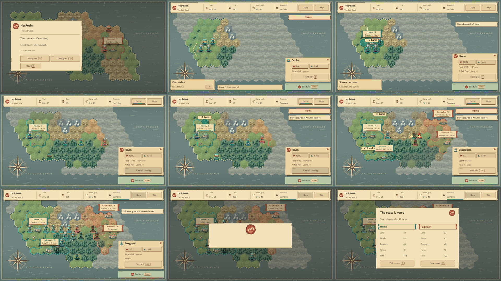

# HexRealm 솔트 해안 리메이크 검수

## 10차 궁수 사격

- 두 진영의 궁수가 같은 38×42px 크기와 진영별 팔레트·외곽선을 쓰는 조준 두 프레임, 발사, 복귀 포즈로 쏜다. 발사자 몸통과 받침의 중심은 타일에 두고, 활이 표적 쪽을 향하도록 좌우를 반전한다.
- 발사 프레임의 `Loose` 이벤트에서 활 위치에 화살을 생성한다. 1칸은 0.300초, 2칸은 60Hz에서 26틱(0.433초)에 도착한다. 2칸 궤적의 높이를 더 높였다. 화살은 매 틱 포물선의 접선 방향을 바라보고, 끝이 표적에 닿도록 배치한다.
- 명중 순간에 표시용 체력 막대를 갱신하고 피해 수치, 국소 흔들림과 섬광, 깃털·먼지, 명중음을 재생한다. 규칙이 반격 피해를 반환하는 경우에만 명중 이후 별도 반격 수치와 효과를 표시한다. 기존 피해·반격 계산과 명령 순서로 재생한 25턴·승리·복원 해시를 검증했다.
- [BarrageLab 풀이 쓰는 Rent·Return](../../../../samples/BarrageLab/Scripts/ShipPilot.cs)과 [Trail 2D](../../../../docs/manual/sprites.md#선과-궤적)를 사용했다. 타일 간 이동과 명중은 기존 게임 루프에서 계산하고 별도 물리 충돌체를 추가하지 않았다. 활시위에는 0.10초, 16kHz 모노 합성 WAV를 넣고 명중에는 기존 `Hit.wav`를 재사용했다.

### 시연 검수

| 사격 | 시연 발사 → 명중 | 확인 |
| --- | --- | --- |
| Haven 2칸 | 37.250 → 37.683초 | 높은 포물선과 깃털·먼지, 반격 표시 없음 |
| Redwatch 2칸 | 51.667 → 52.100초 | 화면 가운데에서 왼쪽을 향해 발사, 대상 체력 막대가 도착에 맞춰 바뀜 |
| Haven 1칸 | 68.767 → 69.067초 | 낮고 짧은 포물선, 인접 반격은 명중 약 0.12초 뒤 표시 |

| 회차 | 확인과 반영 |
| --- | --- |
| 1 | 3배 확대에서 양쪽 발사 방향, 비행, 명중 순서를 확인했다. 숫자가 투구와 겹쳐 다음 촬영에서 높이를 올리고 진한 바탕을 붙였다 |
| 2 | 숫자와 투구가 분리된 것을 확인했다. 상대 턴에도 조준하는 궁수를 바로 알아볼 수 있도록 비행 중 진영색을 유지하고 반격 숫자에도 같은 바탕을 적용했다 |
| 3 | 두 진영과 두 사거리의 0.05초 간격 확대를 확인했다. 다수 유닛이 같은 틱에 발사·명중할 때 같은 소리가 겹쳐 WAV가 포화되는 구간을 발견했다 |
| 4 | 같은 틱의 동일한 소리를 한 번만 재생한 빌드로 전체 시연을 다시 찍고 WAV를 다시 믹스했다. 3차와 전체 PNG 3,889장 및 확대 원본 45장이 일치했다. 최종 WAV의 최대 피크는 0.9094이며 명중·반격음의 틱이 분리됐다 |

### 연속성과 규칙 검증

9차와 같은 320×180 회색조 검사에서 밝기 차이 24를 넘는 픽셀이 2.5% 이상인 모든 인접 프레임을 확인했다.

| 10차 기준을 넘은 프레임 | 수 |
| --- | ---: |
| 카메라 확대·복귀 | 22 |
| 궁수 사격 구간의 주문·피격 표시 | 26 |
| 턴 보고, 선택, 이동·전투 표시 | 49 |
| 칙서·저장 복원 전환 | 10 |
| 합계 | 107 |

9차는 94개였다. 10차의 최고 변화율은 의도된 카메라 확대 중 12.536%다. 표에 적은 세 대표 사격의 발사부터 명중 직후까지 최고 변화율은 각각 1.479%, 0.276%, 0.241%였다. 프레임 쌍에서 새 편집 경계나 지도 전체의 순간 이동이 생기지 않았음을 확인했다. 입력 대기 시간을 조정해 상대의 사격과 새 턴 표시를 끝까지 보여 주고, 같은 입력 순서로 25턴을 진행했다. [전체 2.5% 이상 목록](round10-continuity.tsv)

macOS 27.0.1 arm64에서 프로젝트 테스트 18개와 determinism-scan을 통과했다. 새 테스트 두 개는 활시위 이벤트의 화살 생성, 사거리별 비행 틱 수, 도착 전 피해 표시 없음, 명중과 효과음 동기화, 합법 반격이 뒤에 나타나는 순서를 검사한다. Release·Native AOT 하네스의 캡처 9장과 사격 확대 원본 45장이 양쪽에서 일치했다. 25턴 해시와 최종 승리·복원 해시 `289f6e8f96950f1c`가 9차와 일치했다. 시연과 별도로 하네스의 비교 기준 PNG는 명중과 체력 표시 타이밍이 바뀌어 갱신했다. [턴과 결과 해시](macos-arm64-route.txt) · [캡처 SHA-256](macos-arm64-sha256.tsv)

| macOS arm64 Distribution | 9차 | 10차 | 차이 |
| --- | ---: | ---: | ---: |
| Release | 30,167,197 B | 30,193,572 B | +26,375 B |
| Native AOT | 11,963,696 B | 11,989,719 B | +26,023 B |

예열한 두 빌드를 번갈아 다섯 번 실행한 중앙값에서 Release 첫 프레임은 187.1 → 187.1 ms, 대기 틱은 8.6 → 8.7 µs였다. Native AOT는 76.4 → 77.2 ms, 5.2 → 5.2 µs였다. 대기 틱의 관리 할당은 두 배포본에서 24 B다. 두 배포본에서 금지 파일 검사를 통과했다. [배포 용량 기준](../build-size/baseline.tsv)

Scene Play는 GUI 잠금 아래 macOS 에디터를 실행한 직후 AppKit의 `_RegisterApplication`에서 `SIGABRT`로 종료했다. 에디터 로그가 열리기 전 종료됐으므로 프로젝트 테스트와 두 배포본에서 사격을 검증했다.

### 촬영 인계

- 1280×720, 30fps의 PNG 3,889장. **129.63초 무편집 연속 재생**. `engine/.artifacts/film/runs/HexRealm/joined/`
- 48kHz·16비트 스테레오 WAV 6,222,400샘플/채널. 60Hz 입력마다 SDL_mixer를 렌더링하고 마지막 틱을 무음으로 채워 PNG와 길이를 맞췄다. `engine/.artifacts/film/runs/HexRealm/HexRealm.wav`
- 3배 확대 시트는 사격 구간을 60Hz로 별도 캡처한 뒤 3틱(0.05초) 간격으로 8장씩 배치했다. 2칸 샷은 당김과 명중까지 담기 위해 시트를 두 장 겹쳐 사용했다. `engine/.artifacts/hexrealm-qa/review10/loop4/focus/`
- 전체 시트와 검수 로그. `engine/.artifacts/hexrealm-qa/review10/loop4/`

MP4 인코딩은 코디네이터 단계다.

## 9차 턴 연출과 시야 공개

- **상대 턴과 새 턴.** 시야 안 상대 부대의 경로를 기존 칸당 0.16초 이동으로 재생한다. 이동을 끝낸 뒤 새 턴 도장을 찍는다. 시야 안에 움직임이 없으면 `Rival is moving`을 짧게 표시한다. 전투는 타격 지점의 불꽃·연기와 피해 숫자로 전달한다.
- **새 턴 보고.** 1.02초 동안 도시별 생산, 수확, 연구, 국경 성장을 순서대로 표시한다. 생산한 유닛은 연기와 잉크 위로 나타나며 도시명과 유닛명이 오른쪽에 뜬다. 식량과 금화는 0.30초 동안 정수 중간값을 지난다. 연구 완료 때는 상단 연구 칩에 빛이 지나가며 국경 성장은 기존 잉크로 표시한다. 시뮬레이션의 결과를 먼저 확정하고 화면 표시와 입력 재개 시점만 조정했다.
- **시야와 카메라.** 양피지의 같은 무늬를 9단계로 걷어낸다. 타일당 0.30초를 적용하고 기존 탐험 경계에 닿지 않은 바깥 칸은 0.05초 늦게 시작한다. 새로 발견한 상대 도시는 덮개가 반쯤 걷힌 때 표시한다. 피격 때 카메라 전체를 움직이던 효과를 제거해 지도 기준점을 고정했다. 0.40초 확대·이동과 0.44초 화면 페이드, 제목과 점수표가 함께 나타나는 칙서 연출을 유지했다.
- **촬영.** 기존 입력 순서를 유지하고 턴 종료 뒤 다음 명령까지 최소 1.75초를 확보했다. 130초 안에 전체 턴을 담기 위해 명령 사이 0.40초를 넘던 여유 시간을 줄였다. 마지막 입력 뒤 칙서를 읽는 시간은 보존했다.

### 연속성 검사와 자체 검수

인접 프레임을 320×180 회색조로 줄여 밝기가 24를 초과해 달라진 픽셀을 셌다. **2.5% 이상**인 프레임은 전부 앞뒤를 확인했다. 아래 시각은 각 영상에서 같은 행동을 보여 주는 구간이다.

| 장면 | 8차 시각 및 최고 변화율 | 9차 시각 및 최고 변화율 |
| --- | --- | --- |
| 첫 정찰 공개 | 6.9초 · 5.484% | 5.4초대 · 2.564% |
| 두 번째 정찰 공개 | 11.0초 · 6.184% | 8.5초대 · 2.649% |
| 3턴 시작과 보고 | 16.3–16.5초 부근 · 4.872% | 12.57–13.85초 · 3.613% |
| 세 번째 정찰과 상대 도시 발견 | 31.3초 · 4.901% | 25.4초대 · 2.540% |
| 첫 카메라 흔들림 제보 지점 | 50.8초 부근 · 4.514% | 51.0초 부근 · 0.118% |
| 두 번째 카메라 흔들림 제보 지점 | 55.9초 부근 · 4.613% | 58.4초 부근 · 0.490% |

카메라 제보 두 곳에서 월드에 붙은 `North Passage` 글자 주변을 별도로 비교했다. 각 지점 인접 6쌍에서 밝기가 4를 초과해 바뀐 픽셀은 9차에 0이었다. 3턴의 이전 최고점에는 생산과 식량·연구 변경이 몰렸다. 9차 최고점에서는 새 턴 도장과 첫 안내 패널 종료가 겹친다. 개척자 등장, 식량 보간, 연구 변경은 뒤 프레임에 이어진다.

| 최종 2.5% 이상 프레임의 원인 | 수 |
| --- | ---: |
| 확대·복귀의 연속 지도 이동 | 22 |
| 명령, 선택 카드와 경로·공격 표시 갱신 | 53 |
| 정찰 명령과 경로 갱신, 이어지는 안개 공개 | 3 |
| Haven·Saltmere 건립과 국경 잉크 | 4 |
| 새 턴 도장과 첫 안내 종료 | 1 |
| 승리·복원 칙서 페이드, 저장 알림 | 11 |
| 합계 | 94 |

8차를 같은 문턱값으로 다시 검사하면 173개였다. 9차에 남은 94개는 위의 장면 변화에 해당한다. 프레임 번호, 시각, 변화율, 장면 분류를 [전체 검사 목록](round9-continuity.tsv)에 기록했다. [촬영·검사 도구](../../HexRealm.Play/continuity.py)

| 회차 | 촬영과 확인 |
| --- | --- |
| 1 | 128.13초를 전부 촬영했다. 3턴에서 생산 → 식량 → 연구를 확인하고, 안개·피격 전후를 비교했다. 정찰 때 덮개가 같은 시각에 걷히고 시야 밖 상대 턴 배너가 한 번 더 바뀌어 두 동작을 다듬었다 |
| 2 | 바깥 칸의 안개가 늦게 걷히고 상대 턴 배너가 한 번만 나타나는 것을 확인했다. 기준을 넘은 프레임은 95개에서 94개로 줄었다. 확대·복귀, 정찰 세 곳, 피격 두 곳, 최종 칙서와 불러오기의 전후를 다시 비교했다 |

### 검사와 배포

macOS 27.0.1 arm64에서 프로젝트 테스트 16개, determinism-scan, Release·Native AOT 하네스를 통과했다. 두 빌드의 캡처 9장이 일치했다. 보고 단계가 끝난 뒤 다음 입력을 넣고 캡처 시각을 맞추기 위해 캡처 기준을 갱신했다. 두 촬영과 두 빌드의 25턴 및 승리·복원 해시 `289f6e8f96950f1c`가 기준과 같다. [턴과 결과 해시](macos-arm64-route.txt) · [캡처 SHA-256](macos-arm64-sha256.tsv)

| macOS arm64 Distribution | 8차 | 9차 | 차이 |
| --- | ---: | ---: | ---: |
| Release | 30,130,773 B | 30,167,197 B | +36,424 B |
| Native AOT | 11,947,208 B | 11,963,696 B | +16,488 B |

양피지 투명도 24종을 기존 타일 아틀라스에 추가해 `MapInk.png`가 13,248 B 커졌다. 타일셋은 2,273 B, 씬은 935 B 늘었다. 기존 SDL3 타일맵을 경신해 별도 합성 텍스처와 런타임 라이브러리 없이 그린다. 두 배포본의 금지 파일 검사를 통과했다. 예열한 대기 틱 중앙값은 Release 8.5 → 8.5 µs, Native AOT 5.5 → 5.6 µs, 관리 할당은 두 빌드 모두 24 B였다. 새 타이밍으로 전체 입력을 헤드리스 재생했을 때 업데이트 시간 p95는 Release 156.4 → 170.9 µs, Native AOT 55.1 → 56.2 µs였다. [배포 용량 기준](../build-size/baseline.tsv)

Scene Play는 GUI 잠금 아래 실행했으며 AppKit 초기화 중 `SIGABRT`가 발생했다. 게임 로그가 열리기 전에 종료했다. 캡처와 재생은 macOS Release·Native AOT에서 검증했다. 엔진에서 타일별 알파를 조정할 수 있으면 현재의 투명도별 아틀라스를 줄일 수 있다.

### 촬영 인계

- 1280×720, 30fps, **3,844프레임(128.13초)**. `engine/.artifacts/hexrealm-qa/review9/film-delivery/joined/`
- 48 kHz·16비트 스테레오 WAV, 채널당 6,150,400샘플. 촬영과 같은 입력에서 SDL_mixer를 틱마다 렌더링했다. 마지막 틱의 무음 패딩까지 포함해 PNG와 길이가 같다. `engine/.artifacts/hexrealm-qa/review9/film-delivery/HexRealm.wav`
- 검수 시트, 턴·안개 연속 프레임, 수치와 검사 로그. `engine/.artifacts/hexrealm-qa/review9/loop2/`

MP4 인코딩은 코디네이터 단계다.

## 8차 시연 연속성

기존 시연 입력 912개를 한 번 재생했다. 60Hz 입력의 짝수 틱 0–7108을 순서대로 캡처한 1280×720 PNG는 3,555장, 30fps, **118.50초**다. 전체 25턴과 144 대 123의 점수 판정, 타이틀에서 불러온 최종 칙서를 담았다. 기존 입력이 100–130초에 들어오므로 상대 턴의 진행 속도와 시연 입력을 유지했다.

타이틀에서 시작하거나 결과에서 타이틀로 돌아가고, 저장을 복원할 때 기존 화면에 지도색을 0.22초 동안 덮는다. 덮인 시점에 화면을 바꾸고 0.22초 동안 새 화면을 드러낸다. 타이틀과 복원에서 카메라는 전체 지도의 중심으로 돌아온다. 상세 보기의 확대율과 중심은 카메라 하나에서 0.40초 동안 이동한다. 시작과 끝에서 속도를 낮춰 가운데 구간의 급한 움직임을 줄였다. 상세 보기에서 다른 유닛을 선택해도 같은 방식으로 따라간다. 건설·개척은 기존 소리, 타일 잉크, 불꽃으로 피드백을 준다. 칙서에는 헤드라인과 점수표를 첫 가시 프레임부터 넣고 양피지와 함께 짧게 미끄러져 들어오게 했다.

### 전후 연속성 검사

PNG를 320×180 회색조로 축소하고 직전 프레임과 밝기가 24를 초과해 달라진 픽셀의 비율을 구했다. 8%를 넘은 지점은 모두 앞뒤 프레임을 열었다. 지난 편집 경계 세 곳은 임계값 아래였으므로 실제 턴과 캡처 경계도 대조했다. [촬영·검사 도구](../../HexRealm.Play/continuity.py)

| 장면 | 6차 인접 프레임 | 8차의 해당 연출 또는 복구 구간 | 8차 최대 변화율 |
| --- | --- | --- | ---: |
| 타이틀 → 게임 | 2.100초 · 96.378% | 2.100–2.567초의 페이드 | 1.674% |
| Saltmere 개척 | 27.633초 · 8.293% | 27.633초에 도시·영토 표시 | 2.976% |
| 상세 보기 진입 | 34.533초 · 27.944% | 34.600–34.900초의 줌 중 10프레임 초과 | 12.536% |
| 전체 보기 복귀 | 36.033초 · 27.903% | 36.100–36.400초의 줌 중 10프레임 초과 | 12.576% |
| 턴 8 → 11 | 39.967초 · 4.036% | 39.967–50.133초, 305프레임 복구 | 4.125% |
| 턴 13 → 16 | 45.900초 · 2.417% | 56.067–66.533초, 314프레임 복구 | 5.250% |
| 턴 18 → 20 | 55.167초 · 2.628% | 75.800–84.667초, 266프레임 복구 | 6.240% |
| 승리 칙서 | 80.867초 · 70.372%, 80.900초 · 25.753% | 110.333–111.000초에 시야와 점수표가 전환 | 4.227% |
| 칙서 → 타이틀 | 84.833초 · 44.062% | 114.300–114.850초에 페이드 | 0.330% |
| 타이틀 → 저장 복원 | 86.033초 · 44.066% | 115.500–116.050초에 페이드 | 4.227% |

6차에서 8%를 넘은 프레임은 8개였다. 8차에서 8%를 넘은 20개는 확대·복귀의 연속 프레임이다. 두 구간은 턴·금화·유닛 상태를 유지하며 지도의 위치와 크기가 프레임마다 조금씩 달라진다. 전후 프레임과 복구한 세 턴 구간을 확인한 결과 의도하지 않은 점프는 **0개**였다. 최고 변화율이 96.378%에서 12.576%로 낮아졌다.

### 자체 검수 3회

| 회차 | 촬영과 검사 결과 |
| --- | --- |
| 1 | 편집 없이 118.50초를 촬영했다. 화면 전환 네 곳과 점수표가 한 번에 나오는 것을 확인했다. 0.36초 줌에서 프레임 변화율이 최대 13.630%로 나타나 이동을 0.40초로 늘리고 가운데 속도를 낮췄다 |
| 2 | 전체를 재촬영해 줌 최대치가 12.576%로 줄어든 것을 확인했다. 27.633초의 단발 변화는 Saltmere의 개척과 동시에 일어났다. 이때 카메라가 한 틱에 1.2% 확대되는 효과를 없앴다 |
| 3 | 최종 빌드로 전체를 촬영하고 초과 프레임과 제보 지점의 전후를 비교했다. 정착 때 변화율이 2.976%로 줄었고 8%를 넘은 20개는 연속 줌이었다. 결과 시트의 시각을 실제 턴 도장과 대조해 정리했다 |

### 검사와 용량

macOS 27.0.1 arm64의 프로젝트 테스트 15개, determinism-scan, Release·Native AOT 하네스를 통과했다. 두 배포본과 시연에서 25개 턴 해시 및 승리·복원 해시 `289f6e8f96950f1c`가 기준과 같다. 양쪽에서 같은 PNG 9장을 얻었다. 회귀 입력에 화면 페이드 대기 시간을 반영하고, 칙서가 자리를 잡은 뒤 캡처하도록 캡처 틱과 SHA-256을 갱신했다. [턴과 결과 해시](macos-arm64-route.txt) · [캡처 SHA-256](macos-arm64-sha256.tsv)

| 배포 | 6차 | 8차 | 차이 |
| --- | ---: | ---: | ---: |
| Release | 30,128,428 B | 30,130,773 B | +2,345 B |
| Native AOT | 11,947,919 B | 11,947,208 B | −711 B |

Release의 게임 어셈블리는 2,560 B 늘었고, 씬은 카메라와 칙서 구성이 간결해져 양쪽에서 727 B 줄었다. 배포한 에셋 파일 131개의 내용이 6차와 바이트 단위로 일치했다. SkiaSharp·Avalonia·Engine.Editor·Engine.Authoring 배포 파일 검사도 통과했다. 예열한 두 빌드를 번갈아 5회 실행한 중앙값에서 Release 첫 프레임은 210.0 → 208.4 ms, 대기 틱은 8.2 → 8.6 µs였다. Native AOT는 89.9 → 89.1 ms, 5.5 → 5.5 µs였다. 두 배포본 대기 틱의 관리 할당은 각각 24 B였다. [배포 용량 기준](../build-size/baseline.tsv)

Scene Play 하네스는 잠금 아래 macOS 에디터를 실행한 직후 `SIGABRT`로 종료했다. 스택의 첫 앱 초기화 지점은 AppKit의 `_RegisterApplication`이고 에디터 로그가 비어 있었다. 따라서 게임 전환은 Release·Native AOT와 프로젝트 테스트에서 검증했다. 이번 차수의 VM 검증은 범위 밖이다. 엔진에는 카메라 중심·배율을 함께 지정하는 스크립트 API를 추가하면 씬의 비가시 프레이밍 사각형을 생략할 수 있다.

### 촬영 인계

| 파일 | 경로 |
| --- | --- |
| 30fps 전체 PNG | `engine/.artifacts/hexrealm-qa/review8/film-delivery/joined/` |
| 동기화 WAV | `engine/.artifacts/hexrealm-qa/review8/film-delivery/HexRealm.wav` |
| 전체 시트와 전환 시트 | `engine/.artifacts/hexrealm-qa/review8/film-delivery/sheet.png`, `transitions.png` |
| 연속성 수치와 전후 프레임 | `engine/.artifacts/hexrealm-qa/review8/before/`, `loop1/audit/`, `loop2/audit/`, `loop3/audit/` |

WAV는 촬영에 사용한 입력을 돌리며 SDL_mixer에서 틱당 800개 스테레오 샘플 프레임을 렌더링했다. 60Hz 재생이 홀수 틱에 끝나 마지막 30fps 프레임의 나머지 1틱은 무음으로 채웠다. 48 kHz·16비트 스테레오, 채널당 5,688,000 샘플로 PNG와 같은 **118.50초**다. MP4 인코딩은 코디네이터 단계다.

## 6차 기록

## 6차 UI 규격

| 요소 | 규격 |
| --- | --- |
| 간격 | 4px 기본 단위. 카드 안쪽 기본 16px, 버튼과 칩 사이 8px. 자원 열 180px씩. 선택 카드 초상은 왼쪽 여백 열, 제목·칩·본문·동작은 카드 왼쪽에서 52px 떨어진 같은 기준선 |
| 표면 | 찢긴 양피지 9-slice, 1px 세피아 테두리, 모서리 4px, 2px 아래 그림자 |
| 글자 | 화면 제목 24px, 카드 제목·강조 값 20px, 본문 16px, 보조 14px. 잉크 `#2b1c14`, 보조 `#483023`. 주요 배경과 4.5:1 이상 |
| 아이콘 | 16px 스탯, 24px 자원·인장, 32px 선택 초상. 글자와 8px 간격 |
| 버튼 | 기본 48px, 턴 종료 56px. 양피지 테두리와 별도 호버·눌림 색, 연구 선택 시 청록 표시. 글자와 키캡 그룹을 수평·수직 가운데 정렬. 키캡 높이 24–34px |

## 6차 변경과 판단

- 상단 자원 레이블과 값은 열 안에서 같은 왼쪽 선에 놓고 아이콘을 두 행의 가운데에 두었다. 바뀐 값에는 0.15초 트윈을 적용했다.
- 선택 카드와 턴 종료 버튼은 폭 352px과 8px 간격을 공유한다. 선택 카드 높이는 실제 행에 맞춰 하단에서 커진다. 체력·이동력·인구는 아이콘과 숫자 칩을 쓴다. 정착·생산·턴 종료 등의 키는 별도 키캡이다.
- 경로 예측은 하단에 고정해 경로 끝과 교전 타일을 가리지 않게 했다. 목표와 경로 카드는 안쪽 여백과 기준선을 공유한다. 오른쪽 알림과 턴 도장은 328×44px로 맞췄다.
- 도시 리본 안에서 이름과 성장 예고를 가운데에 두고 성장 막대를 하단에 넣었다. 타이틀·도움말·칙서에서도 제목과 본문을 정렬했다. 칙서는 같은 두 열에서 진영별 레이블과 숫자를 나눈다.
- GowunDodum의 가로 길이와 글자 중심을 씬 생성 때 계산하고 게임에서는 기존 SDL_ttf로 그린다. 글자 배율이 바뀌면 위치만 다시 잡는다. 지정 색의 명암 대비는 보조 문자 8.47:1, 기본 버튼의 눌림 상태 6.69:1, 주 버튼 6.74:1이다.

## 6차 자체 검수

| 회차 | 1280×720 시트와 2배 정렬 확대에서 확인한 것 |
| --- | --- |
| 1 | 선택·턴 종료의 같은 폭과 기준선을 확인했다. 200%에서 잘리는 체력과 목표 문구를 고치고, 오른쪽 알림 열을 지도 리본에서 떼었다 |
| 2 | 200% 체력·목표와 알림 위치를 다시 확인했다. 타이틀 문장 끝과 불러오기 키캡 여백을 늘리고, 칙서 제목을 점수표 왼쪽 선과 맞췄다 |
| 3 | 100%와 200%의 전체 시트와 상단·선택·하단·칙서 확대를 열었다. 타이틀 문장과 키캡이 완전히 보이고, 칙서 제목과 점수 행이 줄을 맞춘 것을 확인했다. 턴 종료를 실제 마우스로 누르며 기본·호버·눌림 색을 각각 캡처했다 |

오버레이의 청록선은 실제 카드 사각형, 갈색선은 UI 행과 조작 요소의 사각형 및 중심선이다. `IGameUi.Bounds`를 1280×720 런타임에서 읽고 원본에 1px 선을 그린 뒤 2배로 확대했다. 루프별 전체 시트와 확대는 `engine/.artifacts/hexrealm-qa/review6/loop1/`부터 `loop3/`까지에 있다. [6차 정렬 오버레이](round6-layout-overlay.png) · [6차 200% 시트](remake-text-scale.jpg)

### 6차 콘솔 검증과 배포

프로젝트 테스트 14개가 통과했다. 새 정렬 테스트는 100%와 200%에서 선택 카드와 턴 종료의 폭·간격, 왼쪽 기준선, 버튼 글자·키캡의 중심, 키보드 포커스의 배치 유지를 확인한다. `determinism-scan`과 하네스 등록 검사를 통과했다. Release·Native AOT에서 25턴 해시와 승리·복원 해시 `289f6e8f96950f1c`, 기준 캡처 9장, 200% 시트가 일치했다. UI가 바뀌어 캡처 SHA-256을 갱신했다. [턴과 결과 해시](macos-arm64-route.txt) · [캡처 SHA-256](macos-arm64-sha256.tsv)

| 배포 | 5차 | 6차 | 차이 |
| --- | ---: | ---: | ---: |
| Release | 30,062,841 B | 30,128,428 B | +65,587 B (+0.22%) |
| Native AOT | 11,881,132 B | 11,947,919 B | +66,787 B (+0.56%) |

macOS 27.0.1 arm64의 Distribution 앱에서 일반 파일을 합산했다. 두 빌드에 SkiaSharp, Avalonia, Engine.Editor, Engine.Authoring은 포함되지 않았다. 예열 후 번갈아 재생한 중앙값에서 Release 첫 프레임은 186.7 → 186.9 ms, 대기 틱은 6.0 → 8.2 µs였다. Native AOT 첫 프레임은 75.5 → 77.2 ms, 대기 틱은 3.5 → 5.1 µs였다. 두 빌드의 대기 틱 관리 할당은 각각 24 B였다. [배포 용량 기준](../build-size/baseline.tsv)

### 6차 촬영 인계

세 번 모두 `film.py --keep`로 1280×720 PNG를 확보했다. AVFoundation은 `SIGTRAP`으로 종료했다. 6차는 PNG 시퀀스와 48 kHz 스테레오 PCM WAV를 인계한다. 입력을 재생한 118.50초의 턴 해시를 검증한 뒤 반복 교전 구간 세 곳을 프레임 단위로 덜어냈다. 남은 PNG는 원본과 바이트가 같으며 시퀀스는 30 fps, 2,670프레임, **89.00초**다. WAV에도 같은 경계만 적용했다. 펼친 칙서가 마지막 87프레임에 유지된다.

| 인계 파일 | 경로 |
| --- | --- |
| 편집 PNG | `engine/.artifacts/hexrealm-qa/review6/film-delivery/joined/` |
| 편집 WAV | `engine/.artifacts/hexrealm-qa/review6/film-delivery/HexRealm.wav` |
| 전체 시트 | `engine/.artifacts/hexrealm-qa/review6/film-delivery/sheet.png` |
| 컷 경계와 원본 | `engine/.artifacts/hexrealm-qa/review6/film-delivery/cuts.tsv`, `full-joined/` |

UI 텍스트의 세로 기준선, 가로 가운데 정렬과 측정 기능을 엔진에 추가하면 씬 생성 시 계산한 글꼴 치수와 버튼 배치 코드를 줄일 수 있다. 6차 검증은 macOS 헤드리스 Release·Native AOT에서 진행했다.

## 5차까지의 변경 기록

macOS 27.0.1 arm64의 Release 및 Native AOT Distribution을 SDL3 소프트웨어 렌더러에서 실행했다. 시연은 타이틀에서 시작해 Haven의 식량과 국경을 확인하고, Saltmere를 개척한 뒤, Redwatch와 Greyharbor의 공세를 막아 25턴에 144 대 123으로 이긴다. F5로 저장하고 타이틀에서 F9로 복원한 뒤 펼쳐진 칙서를 마지막까지 보여 준다.



[1280×720 / 200% 검수](remake-text-scale.jpg) · [플레이 매뉴얼](../../../../docs/manual/hexrealm.md) · [재생 경로](../../HexRealm.Play/route.tsv)

## 5차 변경과 2회 검수

- **글리프.** 번들 글꼴의 ASCII cmap에도 작은따옴표가 없어 도장을 `Rival turn`으로 바꿨다. UI와 월드 글자에 쓰이는 원본 문자열을 점검했다. 프로젝트 테스트는 번들 글꼴의 ASCII 허용 문자를 기준으로 씬 레이블, 도시 카드, 턴 도장, 성장 알림과 칙서 문자열을 검사한다. 이전 작은따옴표를 넣은 임시 프로젝트는 U+0027에서 실패했다.
- **대비.** 상단 자원 레이블을 14에서 16, 구간명을 12에서 15로 키우고 세피아 잉크를 진하게 했다. 지정 색의 상대 휘도 대비는 상단 10.73:1, 타이틀 설명 11.41:1, 타이틀 버튼 8.63:1이며, 눌린 버튼도 5.96:1이다. 타이틀과 결과의 지도 차광은 HUD와 카드 아래에 별도로 그린다.
- **상대 영토.** 발견한 상대 칸은 기존 주홍 국경선과 농장·숲·구릉 그림 위에 약 15% 불투명도의 주홍색을 얹는다. 시야 밖 일반 칸은 중성 회색으로 차분해지고 미탐험 지역은 양피지로 남는다.
- **시연.** 재생에서 거부된 주문 6개와 아군 없이 내린 이동 명령 11개를 찾아 관련 입력을 제거했다. 각 턴 해시와 승리·복원 해시는 4차와 같다. 복원 후 끝까지 칙서 본문이 같은 픽셀로 유지된 87프레임을 확인했다.

| 검수 | 확인 및 조치 |
| --- | --- |
| 1 | 전체 시트와 타이틀·턴 도장·상대 영토·엔딩을 확대했다. 200%에서 긴 구간명이 턴 아이콘에 닿아 상단 열 간격을 넓혔다 |
| 2 | 재촬영한 전체 시트와 확대 화면, 200% 시트를 열었다. 구간명, 상대 턴 도장, 시야 밖 경계와 마지막 칙서를 확인했다 |

확대 시트와 로그는 `engine/.artifacts/hexrealm-qa/review5/loop1/`, `loop2/`에 있다. 프로젝트 테스트 13개, determinism-scan과 하네스 등록 검사를 통과했다. Release와 Native AOT에서 25턴과 승리·복원 해시 `289f6e8f96950f1c`, 캡처 9장, 200% 시트가 일치했다. 화면 변경으로 캡처 기준 SHA-256을 갱신했다. [턴과 결과 해시](macos-arm64-route.txt) · [캡처 SHA-256](macos-arm64-sha256.tsv)

| 배포 | 4차 | 5차 | 차이 |
| --- | ---: | ---: | ---: |
| Release | 30,063,107 B | 30,062,841 B | −266 B |
| Native AOT | 11,879,862 B | 11,881,132 B | +1,270 B |

상대 틴트는 기존 안개 아틀라스에 한 칸을 더해 같은 타일 레이어에서 처리한다. 모달 뒤 차광은 1×1 PNG 하나를 사용한다. 두 배포본에 SkiaSharp, Avalonia, Engine.Editor, Engine.Authoring 파일이 없음을 확인했다. 예열 후 4차와 5차를 번갈아 실행했을 때 첫 프레임 중앙값은 Release 187.3 → 187.1 ms, Native AOT 77.1 → 77.2 ms다. 대기 틱은 Release 5.9 → 6.0 µs, Native AOT 3.5 → 3.5 µs이며 관리 할당은 두 빌드 모두 틱당 24 B다.

전체 용량 검사는 Native AOT 키트의 직렬화 가드 통과 후 `No accelerated offscreen shader surface is available.`에서 멈췄다. HexRealm 두 앱의 크기는 개별 빌드에서 측정했다. Scene Play 결과는 4차 기록에 있다. 5차 로그는 `engine/.artifacts/hexrealm-qa/review5/`에 있다.

## 4차 변경과 판단

- **지도 제작자의 책상.** 양피지 9-slice 카드와 자원 띠, 세피아 글자, 핀, 진영 리본, 밀랍 인장을 그렸다. 같은 재질을 지도 테두리와 나침반에 이어 썼다. 저장소의 GowunDodum-Regular를 SDL_ttf에 연결했다. 라틴 글꼴에 실제로 있는 기호를 사용해 설명과 수치를 읽을 수 있게 했다.
- **식량과 경계.** 이름표에 인구, 남은 성장 턴, 식량 막대를 둔다. 도시를 클릭하면 다음 칸이 점선으로 표시되고 도시 카드에 현재 식량, 수확량, 성장 결과가 표시된다. 성장 단위를 한 칸으로 정해 수확, 점선, 편입을 눈으로 대조할 수 있게 했다. 인접한 빈 땅 중 가까운 칸을 먼저 고르며 동거리에서는 지형과 지도 순서로 결정한다. 경계 후보가 겹치면 가까운 도시, 동거리면 먼저 세운 도시의 몫이다. 같은 턴의 수확과 후보는 국경을 변경하기 전에 확정한다.
- **개척과 점령.** 새 도시는 중심 칸과 이웃 빈 땅을 얻고, 점령은 해당 도시가 관리하던 칸을 넘긴다. 농장이 성장 시점을 앞당기고 정착 위치가 개척과 이후 성장의 방향을 바꾼다. 수도 함락 점수에 넘어간 칸이 반영된다. 점령으로 승부가 나면 잉크가 번질 시간을 준 뒤 칙서를 펼친다.
- **피드백.** 성장·개척·점령에 진영 잉크 8프레임과 증가량을 붙였다. 성장은 막대가 차오른 뒤 남은 식량으로 돌아간다. 오른쪽 알림은 원인을 표시하고 상단의 청록색 숫자는 현재 영토 칸 수를 표시한다. 세 가지 영토 확대 방법은 Land goal에 커서를 올리거나 H로 확인한다.
- **저장과 재생.** 도시별 토지 소유를 상태 해시에 포함해 턴·승리·복원 해시를 갱신했다. 버전 4에서 규칙이 달라졌으므로 이전 명령 기록을 불러오면 새 판을 연다. F5를 누르면 슬롯 1에 새 판을 저장한다.

시연에서 2턴에 Haven을 골라 성장까지 2턴이 남았음을 읽는다. 3턴에는 식량 17/24, 수확 +16, 점선 칸, 성장까지 1턴을 확인한다. 4턴이 시작되면 같은 칸에 잉크가 번지고 인구 2 → 3, 식량 9/36, 영토 8 → 9가 된다.

## 4차 루프 기록

| 회차 | 확인한 화면과 수정 |
| --- | --- |
| 1 | 전체 시트와 상단·도시 카드·리본·말·지붕·피격·잉크의 3배 확대를 열었다. 미지원 기호를 글꼴이 표시하는 문자로 바꾸고, 리본을 게임 픽셀 크기로 그려 이음선을 없앴다. 증가량 카드를 올려 잉크의 시작점이 보이게 했다 |
| 2 | 이음선과 기호를 재확인하고, 0.1초 간격 확대에서 막대가 찼다가 남은 식량을 보이는 동작을 확인했다. 200% 도시 카드의 문구가 잘리고 Greyharbor 리본이 가려져 문구를 줄이고 알림을 지도 오른쪽으로 옮겼다. 자원 아이콘의 세로 위치도 배율에 맞췄다 |
| 3 | 최종 시트와 같은 3배 확대 범위, 잉크 연속 6프레임, 칙서 펼침, 1280×720의 200% 시트를 열었다. 도시 카드 끝까지 읽히고 도장·성장 알림·Greyharbor 리본이 서로 가리지 않음을 확인했다 |
| 4 | 칙서가 복원 알림 첫 글자를 가리는 것을 3차 시트에서 찾아 완료 캠페인의 알림을 칙서 위로 옮겼다. 재촬영해 전체 시트, 3배 확대, 200% 시트와 복원 결과를 열었다. 최종 Release에 같은 입력을 넣어 시연의 주요 프레임 26장이 바이트 단위로 일치함을 확인했다 |

[상단 자원 띠 3배](round4-ledger-3x.png) · [선택 카드 3배](round4-city-card-3x.png) · [도시 리본 3배](round4-city-ribbon-3x.png) · [0.1초 간격 잉크 6프레임 3배](round4-claim-six-frames.png)

각 회차의 전체 시트와 확대는 `engine/.artifacts/hexrealm-qa/review4/loop1/`부터 `loop4/`까지에 있다. 말·지붕·피격도 3배 확대했고, 2차부터 칙서 펼침을 연속 프레임으로 확인했다.

## 4차 검증

| 검사 | 프로젝트·엔진 | Release | Native AOT | Scene Play |
| --- | --- | --- | --- | --- |
| 프로젝트 테스트 | 12개 통과 | — | — | — |
| determinism-scan | 통과 | — | — | — |
| 턴·승리·복원 리플레이와 캡처 | 매니페스트 검사 통과 | 통과 | 통과 | 앱 시작 중 SIGABRT |
| 1280×720 / 200% | — | 도시·도움말·전투·결과·복원 확인 | Release와 시트 일치 | — |
| HexRealm 배포 크기·금지 파일 | — | 통과 | 통과 | 해당 없음 |

성장 테스트가 같은 도시의 수확량과 예상 턴, 점선 칸, 증가한 인구·식량·영토 및 잉크 이벤트의 좌표를 비교한다. 수도 점령 테스트는 같은 턴에 성장한 칸도 수도와 함께 넘어가는 것을 확인한다. 이때 잉크는 최종 소유자의 색으로 표시한다. 두 배포본의 25턴 해시와 9장 캡처가 일치했다. 승리와 복원의 해시는 `289f6e8f96950f1c`다. [턴·승리·복원 해시](macos-arm64-route.txt) · [캡처 SHA-256](macos-arm64-sha256.tsv)

## 4차 배포 크기

앱 안의 일반 파일을 합산하고 심볼릭 링크를 제외했다. 아래 값은 같은 Mac에서 빌드한 Distribution이다. 두 앱에 SkiaSharp, Avalonia, Engine.Editor, Engine.Authoring 배포 파일이 없음을 확인했다.

| 배포 | 리메이크 전 | 3차 | 4차 | 3차 대비 |
| --- | ---: | ---: | ---: | ---: |
| Release | 29,386,403 B | 29,980,078 B | 30,063,107 B | +83,029 B (+0.28%) |
| Native AOT | 11,219,638 B | 11,814,561 B | 11,879,862 B | +65,301 B (+0.55%) |

UI 패널·아이콘 PNG는 1,474 → 3,900 B, 두 잉크 시트는 총 6,156 B다. GowunDodum 글꼴 21,124 B와 라이선스 4,395 B를 포함했다. Release 실행 파일은 124,712 B, Native AOT 실행 파일은 6,894,944 → 6,911,520 B다. 잉크와 숫자는 기존 스프라이트 애니메이터와 프리팹 풀, UI는 기존 9-slice와 SDL_ttf를 사용한다. [배포 용량 기준](../build-size/baseline.tsv)

같은 Mac에서 3차·4차 배포를 예열한 뒤 번갈아 5회 실행했다. 첫 프레임은 PNG 저장 후 앱을 종료할 때까지의 중앙값이다. 대기 틱은 렌더링을 뺀 첫 턴의 중앙값이다.

| 배포 | 첫 프레임 3차 → 4차 | 세션 준비 3차 → 4차 | 대기 틱 3차 → 4차 | 대기 할당 3차 → 4차 |
| --- | ---: | ---: | ---: | ---: |
| Release | 186.4 → 187.2 ms | 51.5 → 52.1 ms | 5.6 → 6.0 µs | 24 → 24 B |
| Native AOT | 77.2 → 77.1 ms | 10.9 → 11.2 ms | 3.3 → 3.6 µs | 24 → 24 B |

## 재현

```sh
UseSharedCompilation=false ./monoon test project samples/HexRealm
UseSharedCompilation=false dotnet run --project engine/tests/Engine.Checks -c Release -- "$PWD" --only determinism-scan
UseSharedCompilation=false python3 engine/scripts/run-harness.py HexRealm.Play --mode release,native-aot
UseSharedCompilation=false python3 showcase-src/film.py showcase-src/shots/HexRealm.json --keep --out ~/Movies/MoNoon-showcase/remake
```

5차에 제작한 MP4는 1280×720, 30 fps, 3,555프레임, 118.50초, 8,324,886 B다. 효과음 여섯 종류를 확인했고 믹스 피크는 0.4998이었다. 5차 MP4는 `~/Movies/MoNoon-showcase/remake/HexRealm.mp4`에 보존했다.

## 엔진 보강 후보와 미검증

- UI 이미지와 텍스트의 기준선 정렬을 지원하면 배율 변화에 따라 버튼 레이블과 자원 아이콘을 옮기는 샘플 스크립트를 줄일 수 있다.
- macOS arm64 Scene Play는 GUI 잠금 아래 에디터를 실행했으나 프로젝트 로그가 생성되기 전 `SIGABRT`로 종료했다. 전체 `./monoon test size`는 Native AOT 키트의 직렬화 가드를 통과한 뒤 셰이더 굽기에서 `No accelerated offscreen shader surface is available.`로 중단됐다. HexRealm 두 앱의 용량은 개별 빌드에서 측정했다. 재현 로그는 `engine/.artifacts/hexrealm-qa/review4/`의 `scene-play.log`와 `build-size.log`에 있다.
- Windows·Linux, 물리 GPU 비용과 처음 플레이하는 사용자의 소요 시간은 미검증이다.

코디네이터 지시에 따라 커밋하지 않았다.
