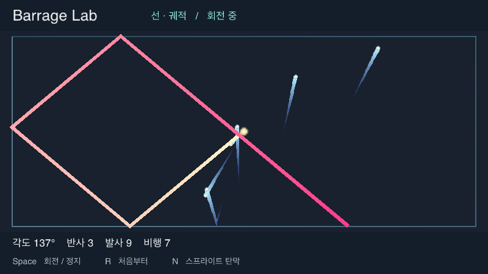
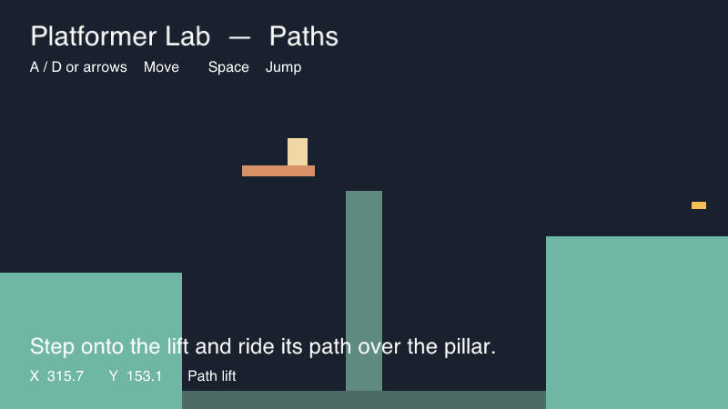

# 선·궤적 그리기와 경로 편집 (로드맵 11.7)

2026-11-23, macOS 27.0.1 / Apple Silicon arm64. Line 2D(점 목록, 두께, 길이를 따라 바뀌는 색), Trail 2D(게임 시간으로 기록하는 사라지는 궤적), Path Follower 2D(Scene에서 편집하는 곡선 경로를 일정 속도로 따라가기)를 추가했다. BarrageLab 레이저 씬과 PlatformerLab Paths 씬에서 같은 입력을 Scene Play·Release·Native AOT로 재생해 위치·점 기록과 화면 캡처가 바이트 단위로 같은지 확인했다. 실패한 최종 실행이 없어 기록할 첫 예외는 없다(중간에 고친 문제는 [아래](#작업-중-발견해-고친-문제)).

## 구현 결정

| 항목 | 결정과 이유 |
| --- | --- |
| BRUTAL | 그리기는 BRUTAL `Brutal.Sdl`의 `SDL_RenderGeometry`를 쓰는 기존 [SdlSpriteBatch](../../../src/Engine.Desktop/SdlSpriteBatch.cs)에 색이 있는 사각형 띠(`Strip`)를 더했다. BRUTAL에 선 두께·그라데이션·곡선 경로 기능은 없어(Numerics는 벡터 타입, Render.Mesh는 3D 메시) 리본 계산과 베지어 경로는 [Lines2D.cs](../../../src/Engine.Core/Lines2D.cs)에 직접 작성했다. 새 패키지나 다운로드는 없다. |
| 캔버스 | `ICanvas2D.FillStrip(edges, colors, matrix)` 하나를 추가했다. 왼쪽·오른쪽 꼭짓점 쌍마다 색이 하나이며 이웃 쌍 사이를 보간한다. SDL 캔버스(배포 게임, Scene Play, Mac Scene 패널)는 꼭짓점 색으로, Avalonia 미리보기 캔버스(Windows·Linux Scene)는 사각형마다 선형 그라데이션으로 그린다. 리본 계산(마이터 연결, 최대 4배)은 Engine.Core에 있어 모든 경로가 같은 꼭짓점을 쓴다. |
| 곡선 | 점마다 In/Out 접선 핸들(점 기준 상대값, 둘 다 0이면 꺾인 점)을 가진 3차 베지어. 구간마다 24개 직선으로 나누고 누적 길이 표를 만든다. 경로 위치는 이 길이로 찾으므로(이진 탐색 + 선형 보간) 매 틱 같은 거리를 이동한다. |
| `MotionPath.cs` | 기존 `MotionPath`는 한 틱 안에서 벽에 부딪힌 뒤 미끄러지는 이동을 시간 0–1로 나타내는 충돌용 구조체로, 저작한 곡선 경로와 개념이 달라 확장하지 않았다. 대신 경로 추종은 Position Tween 2D와 같은 자리(`Body.Displacement`)에 변위를 내므로 그 뒤의 이동 처리(`MoveGroup` → `MotionPath`, 강체는 `MovePlatform`)를 그대로 재사용한다. 평행한 이동 체계는 없다. |
| 이동 발판 | 11.3 결과대로 Character Motor는 키네마틱 컨트롤러이고 Kinematic 강체의 변위를 운반한다. Path Follower 2D는 변환만 있거나 Kinematic 강체인 오브젝트에만 붙일 수 있고 Position Tween 2D와 함께 둘 수 없다(검증 오류). Play on start를 끄면 기존 `PlayTween(id)`로 출발한다(새 API 대신 같은 호출). |
| 궤적 | 고정 틱마다 오브젝트 중심을 기록(Min step 이상 움직였을 때), Time이 지난 점은 버리고 Max points(≤256)를 넘으면 오래된 점을 버린다. 그릴 때는 보간된 현재 위치를 머리로 붙이고, 나이에 따라 색·알파·두께를 줄인다. 비활성화·풀 반환·풀 대여 시 지운다. 고정 틱의 게임 시간만 쓰므로 재생 결과가 프레임 속도와 무관하다. |
| 스크립트 API | `SetLinePoints`(월드 좌표 → 로컬 점), `TryGetLinePoints`(그려지는 점), `TryGetTrailPoints`(기록된 점)를 `IGameObjects`에 추가했다. |
| 경로 편집 | Line 2D 또는 Path Follower 2D가 있는 오브젝트 하나를 선택하면 Scene에 경로·점·선택한 점의 핸들을 그린다([SceneViewport.Paths.cs](../../../src/Engine.Editor/Scene/SceneViewport.Paths.cs)). 점·핸들 끌기(스냅 16px, 반대 핸들 대칭), Inspector의 +(Add point)·×(Delete point)·Smooth/Corner와 Point·X·Y 행. 변경은 기존 장면 스냅숏 실행 취소(`MoveFinished` → `MarkDirty`)로 기록되어 끌기 한 번·버튼 한 번이 한 단계다. 경로 추종의 첫 점은 시작 위치이므로 위치를 고정하고(핸들만 편집) 경로 전체는 오브젝트를 옮겨 이동한다. 편집기 코드는 Engine.Editor에만 있다. |
| 씬 형식 | 세 컴포넌트 중 하나라도 있으면 스키마 30. 템플릿에 `MoNoonLines.version`이 없으면 해당 씬을 내보내지 않는다(옛 플레이어가 조용히 무시하지 않도록). |
| 샘플 위치 | 이동 발판은 PlatformerLab에 두었다. 캐릭터(Character Motor)와 Box2D 키네마틱 운반을 실제로 쓰는 샘플이고, BarrageLab에는 탑승할 캐릭터가 없다. 기존 Platform·Joints 씬의 기록을 바꾸지 않도록 새 Paths 씬을 만들고 Joints 언덕 오른쪽 끝의 트리거(Box2D 월드 밖)로 연결했다. BarrageLab은 PooledBullets → N → 레이저 씬 → N → Barrage 순서로 이어진다. |

## 샘플

| 샘플 | 내용 |
| --- | --- |
| [BarrageLab 레이저](../../../../samples/BarrageLab/Scenes/Laser.scene) | [LaserSweep](../../../../samples/BarrageLab/Scripts/LaserSweep.cs)이 매 틱 경기장 벽 반사(최대 3회, 총 1,400px)를 계산해 Line 2D(두께 6, `#FFF6C8` → `#FF3D8B`)에 넣는다. 24틱마다 [Comet](../../../../samples/BarrageLab/Scripts/Comet.cs) 프리팹(Trail 2D 0.45초, 두께 7, 40점)을 풀에서 빌려 쏜다. 경기장 테두리도 Line 2D(두께 2)다. |
| [PlatformerLab Paths](../../../../samples/PlatformerLab/Scenes/Paths.scene) | Kinematic 발판 + Path Follower 2D(점 3개, 모두 곡선, 90px/s, PingPong). 캐릭터가 처음 디디면 [PathRider](../../../../samples/PlatformerLab/Scripts/PathRider.cs)가 출발시키고, 기둥 위를 지나 건너편 언덕 높이에서 내린다. |

 

## 세 실행 경로 비교

입력과 판정은 [BarrageLab.Lines](../../BarrageLab.Lines/README.md), [PlatformerLab.Paths](../../PlatformerLab.Paths/README.md)에 있다. Release·Native AOT는 배포 플레이어의 헤드리스 리플레이(SDL 소프트웨어 렌더러 캡처), Scene Play는 패키지 에디터의 Play 세션에 같은 기록을 재생하고 프로브가 같은 SDL 캔버스로 캡처했다.

| 검사 | Scene Play | Release | Native AOT | 결과 |
| --- | --- | --- | --- | --- |
| 레이저·혜성 궤적 기록 480행 | 같음 | 같음 | 같음 | 891,921바이트 동일, SHA-256 `6969a524feb5e837…` ([0–59행](osx-arm64/laser-trace-0-59.tsv)) |
| 레이저 캡처 60·200·330·425·470 | 같음 | 같음 | 같음 | 5장 모두 바이트 동일 ([비교](osx-arm64/laser-compare.txt)) |
| 레이저 판정 | 통과 | 통과 | 통과 | 길이 1,399.999–1,400.001px, 반사 최대 3, 정지 중 점 고정, 혜성 최대 7, 궤적 최대 27점(한도 40), R 직후 혜성 1 |
| 발판·캐릭터 기록 400행 | 같음 | 같음 | 같음 | 16,664바이트 동일, SHA-256 `e37de6c0f9c517db…` ([기록](osx-arm64/paths-trace.tsv)). 2026-11-23 `Affine2D` 곱셈·덧셈 분리 후 다시 기록(이전 `1a143d56…`, [x64 결정론 기록](../x64-determinism/README.md#곱셈덧셈-분리-계산으로-변경)) |
| Paths 캡처 40·150·220·300·380 | 같음 | 같음 | 같음 | 5장 모두 바이트 동일 ([비교](osx-arm64/paths-compare.txt)) |
| 일정 속도 | 통과 | 통과 | 통과 | 59–358틱(298틱) 틱당 1.49758–1.50010px, 기대값 1.5px(±0.2%) |
| 발판 운반 | 통과 | 통과 | 통과 | 탑승 중 상대 위치 변화 최대 0.00022px, 최종 위치 (702.47, 230.00) 언덕 위 |

틱당 거리는 4자리로 반올림한 기록의 연속 위치 사이 직선거리다. 경로는 나눈 직선 위에서 정확히 같은 길이를 이동하고, 한 틱이 꺾이는 꼭짓점(곡선을 24개로 나눈 마디)을 지날 때 직선거리가 호 길이보다 조금 짧아져 최소값이 0.16% 작다. 헤드리스 검사(`./monoon test`의 [LinesChecks](../../Engine.Checks/LinesChecks.cs))의 1/4원 + 직선 경로는 1.49914–1.50003px(0.06%)이다.

## 에디터 경로 편집(Scene, Mac)

PlatformerLab 복사본을 패키지 에디터로 열고 [프로브](../../PlatformerLab.Paths/StartupHook.cs)가 Path lift의 이름을 긴 이름으로 바꾼 뒤 Scene 뷰 입력 함수로 편집했다. 각 단계의 점 값을 검사했다.

| 단계 | 결과 |
| --- | --- |
| 두 번째 점을 (+20, −10) 끌기 | 점만 이동, 핸들 유지 |
| + (Add point) | 두 번째와 세 번째 점 가운데에 새 점, 선택 이동 |
| Smooth | 이웃 점 방향(거리 1/6)의 대칭 핸들 |
| 바깥 핸들을 +15px 끌기 | Out +15, In −15(대칭) |
| × (Delete point) | 끌기 직후 상태로 돌아감 |
| 실행 취소 5 → 다시 실행 5 → 실행 취소 5 | 각 단계의 점 목록이 정확히 복원, 마지막에 원래 경로와 원래 이름 |

Inspector의 Path Follower 2D 행은 세 창 너비에서 레이블 열 하나(1280px에서 x=1070), 값 열 하나(x=1130, 버튼 줄 포함), 섹션 밖으로 나간 컨트롤 없음, 긴 이름은 이름 칸 안에서 잘린다. [측정](osx-arm64/editor.txt) · [편집 화면](osx-arm64/path-edit.png) · [Inspector 1280px](osx-arm64/inspector-path-1280.png) · [1920px](osx-arm64/inspector-path-1920.png). 첫 시도에서 버튼 세 개를 같은 너비의 글자 버튼으로 두자 기본 Inspector 너비에서 "Delete"·"Corner"가 잘려(위치 검사는 통과) 추가·삭제를 기존 아이콘 버튼(`IconAdd`, `IconClose`, 툴팁·접근성 이름 포함)으로 바꿨다. 글자 잘림은 자동 검사하지 않고 캡처로 확인했다.

Scene Play 중 에디터 창의 실제 Scene 패널(SDL)도 선·궤적을 같은 모양으로 그렸다. [레이저 Scene Play 창](osx-arm64/laser-scene-play-window.png) · [Paths Scene Play 창](osx-arm64/paths-scene-play-window.png)

## 작업 중 발견해 고친 문제

| 문제 | 첫 증상 | 원인과 조치 |
| --- | --- | --- |
| 스크립트 삼각함수의 JIT/AOT 차이 | Release와 Native AOT 레이저 기록이 72행 한 곳만 다름(`780.000,326.774` vs `326.773`) | 샘플 스크립트가 매 틱 `MathF.SinCos`로 조준 방향을 계산했다. 엔진 코드(곡선·궤적)는 사칙연산과 제곱근만 써서 차이가 없었다. 조준 방향을 고정 상수의 회전으로 바꾸자 기록이 같아졌다. 게임 스크립트에서 배포 경로 간 같은 결과가 필요하면 매 틱 삼각함수 대신 상수 회전을 쓰는 것이 안전하다. |
| 새 SDL 렌더러의 블렌드 모드 | Scene Play 캡처 60프레임만 궤적이 불투명(꼬리 픽셀 (146,194,255) vs (105,140,185)) | 텍스처 없는 지오메트리는 렌더러의 그리기 블렌드 모드를 쓰는데, 새 렌더러는 NONE이고 그동안 `FillRectangle`이 BLEND로 바꿔 왔다. 논리 크기가 없는 캔버스의 첫 프레임에는 그 호출이 없었다. `SdlSpriteBatch.Flush`가 텍스처 없는 묶음 앞에서 BLEND를 지정하도록 고쳤다(회전한 사각형·진단 선도 같은 경로). |
| 보간 중 궤적 머리의 뾰족한 모서리 | 실시간 Scene Play 창에서 혜성 머리에 화살촉 모양 | 보간된 머리가 이번 틱에 기록된 최신 점보다 뒤에 있어 리본이 되접혔다. 그리는 시각보다 늦은 점은 건너뛰게 했다. 보간 1(캡처)에서는 결과가 같다. |

## 기존 회귀(macOS arm64)

| 검사 | Release | Native AOT | Scene Play |
| --- | --- | --- | --- |
| `./monoon test` 전체(PASS 690줄, KeyRoom 세 플랫폼 내보내기 포함) | 통과 | – | – |
| BarrageLab.PrefabPools | 통과(명중 2,338 = Exit, 활성 503, 생성 587, 재사용 6,721 — 11.3 기록과 같음) | 통과(같음) | – |
| PlatformerLab.TileCollision 380틱 | 통과, SHA-256 `f30ed686…`(11.3과 같음) | 통과(같음) | 실행하지 않음 |
| PlatformerLab.Joints 300틱 | 통과, SHA-256 `a00b9e4b00b4599dfc23…`(11.3과 같음, Paths 출구 트리거 추가 후) | 통과(같음) | 실행하지 않음 |
| 새 헤드리스 검사 [LinesChecks](osx-arm64/lines-checks.txt) | 통과(YAML 왕복·스키마 30, 트윈 동시 사용 거부, 리본 폭·그라데이션, 점 API, 일정 속도, 키네마틱 운반 0.0001px, 궤적 한도·감쇠·결정성·비활성화, Paths 완주) | – | – |

TileCollision·Joints의 Scene Play 경로는 이번에 다시 실행하지 않았다. 두 씬의 Release·AOT 기록이 11.3 기준과 바이트 단위로 같고, Scene Play는 같은 Engine.Core로 시뮬레이션한다.

## 금지 파일

| 출력 | SkiaSharp·Avalonia·Engine.Editor·Engine.Authoring |
| --- | --- |
| BarrageLab Release `.app` / Native AOT `.app` | 없음 / 없음 |
| PlatformerLab Release `.app` / Native AOT `.app` | 없음 / 없음 |

[목록](osx-arm64/forbidden-files.txt). 플레이어 템플릿 세 개와 Native AOT 키트에 `MoNoonLines.version`이 들어간다.

## 확인하지 않은 것

- Windows·Linux x64(조정 담당자 몫). Avalonia 미리보기 캔버스의 `FillStrip`(사각형별 선형 그라데이션)은 Mac에서 컴파일만 했고 화면으로 보지 않았다. x64 게스트에서 `BarrageLab.Lines`·`PlatformerLab.Paths`를 실행해 같은 OS 안 세 경로 일치를 확인해 주기 바란다.
- 실제 마우스로 Scene 점을 끄는 조작(프로브는 `BeginDrag`/`DragTo`/`ReleaseAt`을 직접 호출했다)과 Line 2D의 Scene 점 편집(같은 코드 경로, Path Follower 2D로만 검사).
- Loop 반복과 Once 정지는 헤드리스 검사에 포함하지 않았다(PingPong만 샘플·검사).

Linux x64 게스트(2026-11-23): Lines trace는 세 경로와 Mac이 같다. Paths는 Release·Scene Play가 Mac과 같고 Linux Native AOT만 89틱부터 0.0002px 달라 `compare`가 실패했다. [Linux 결과](../chapter11-linux-x64/README.md)
