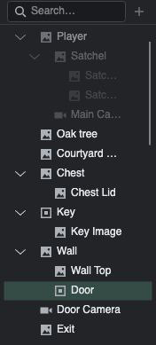

# 에디터 성능: Play Hierarchy 갱신(D-a)과 편집 뷰 그리기 순서(E)

2026-11-23 · macOS 27.0.1 · Apple M4 Max · .NET SDK 10.0.101 · 기준 커밋 `aa3ebc0`(wip/phase1). 측정 내내 QEMU Debian x64 게스트(`qemu-system-x86_64`, TCG 4코어)가 실행 중이었다. 그래서 시간은 기준과 후보를 번갈아 5회씩 재고, 중앙값 차이가 두 범위의 합보다 클 때만 개선으로 적었다. 관리 할당은 실행마다 거의 같아 그대로 비교했다.

에디터만 바꿨다. Engine.Core·Desktop·Player와 배포본은 건드리지 않았다.

## 바꾼 것

| 묶음 | 파일 | 내용 |
| --- | --- | --- |
| D-a | `Shell/MainWindow.PlayState.cs`, `Hierarchy/MainWindow.Hierarchy.cs` | 풀 Rent/Return이나 활성 전환으로 같은 Play 월드의 `HierarchyRevision`만 바뀌면 `RefreshHierarchyRows`가 지난 재구성 때 기록한 (오브젝트, 부모, 이름) 순서와 비교한다. 모두 같으면 행을 그대로 두고 각 행의 `Opacity`(비활성 0.55)만 고친다. 그 뒤 이전과 같이 `Select(selected)`로 Inspector를 갱신한다. 오브젝트가 추가·삭제되거나 순서·부모·이름이 바뀌었으면 전체를 다시 만든다. 편집 모드의 `RebuildHierarchy` 호출은 그대로다. |
| D-a | `Hierarchy/MainWindow.Hierarchy.cs` | 행 아이콘과 눈·자물쇠 아이콘에 행마다 geometry 사본(`Clone()`)을 쓴다. 아래 실험처럼 같은 `StreamGeometry`를 1만 행이 공유하면, 행을 떼어 낼 때마다 그 geometry의 구독자 목록이 복사된다. |
| E | `Scene/SceneViewport.cs`, `Scene/SceneViewport.UiPreview.cs` | 편집 뷰의 `EditItems()`가 `WorldDrawOrder`를 다시 그릴 때마다 만들지 않고 보관한다. 매 프레임 `Sample(1)`만 불러 Sort by Y 항목은 현재 위치로 다시 정렬한다. 보관한 순서는 `InvalidateUi()`(모든 `MarkDirty`·`FinishObjectChange`·실행 취소/다시 실행·기즈모 드래그·경로 편집이 부른다), `RebuildHierarchy`(씬 열기·전환, 실패 복원, 에셋 이동), 오브젝트 목록 참조나 개수 변화에서 버린다. 숨김 표시는 열거할 때 걸러서 보관하지 않는다. |

`RebuildHierarchy`·`Select`·`ShowSelection`·`EditItems` 이름과 인자, `hierarchyRow` 클래스와 `Tag`는 그대로다.

### 무효화가 닿는 편집 경로

| 편집 | 거치는 곳 |
| --- | --- |
| 추가·복제·붙여넣기·삭제·부모 변경 | `FinishObjectChange`/`MarkDirty` → `RebuildHierarchy` + `RecordEdit` → `InvalidateUi` |
| Sprite·Line·Trail·Skeleton·Tilemap·Sorting Group의 Layer·Order·Sort by Y·Foot Offset, 컴포넌트 추가·제거, 크기 | Inspector 값 변경 → `MarkDirty` → `InvalidateUi` |
| 실행 취소·다시 실행 | `RestoreEdit` → `InvalidateUi` + `RebuildHierarchy` |
| 프리팹 적용·되돌리기·Variant·오버라이드 반영 | `FinishObjectChange`, 실패하면 `RebuildHierarchy` |
| 기즈모 이동·회전·크기 드래그 | 이동마다 `InvalidateUi`(기존 코드). 드래그 중 순서는 이전처럼 매번 만든다. |
| 타일 칠하기 | 셀만 바뀌고 그리기 항목은 Tilemap 컴포넌트 단위라 순서가 그대로다. 무효화하지 않으므로 칠하는 동안 다시 만들지 않는다. |

## Clear·생성·추가 시간(수정 전 계측)

수정 전 `RebuildHierarchy`에 임시 계측을 넣어(커밋하지 않음) Field10000 1만 행을 측정했다. 호출 안에서는 `Hierarchy.Items.Clear()`가 거의 전부였고, 호출 뒤 레이아웃(행 템플릿 생성·배치)이 그보다 컸다.

| 단계 | 편집 모드(눈·자물쇠 있음) | Play |
| --- | --- | --- |
| 접힘 상태 수집 | 0.5–1.8 ms | 0.4–0.7 ms |
| `Items.Clear()`(이미 그려진 1만 행) | 2.6–8.6 s, 3.93–3.98 GB | 0.49–0.80 s, 384–394 MB |
| `TreeViewItem` 생성 | 16–21 ms, 26 MB | 17–19 ms, 26 MB |
| `Items.Add` | 0.23–0.37 s, 110 MB | 0.26–0.35 s, 110 MB |
| 필터·선택 | 6–20 ms | 5–8 ms |
| 호출 뒤 `UpdateLayout` | 약 10 s, 7.8 GB | 약 6–8 s, 6.3 GB |

Hierarchy에 행 종류만 바꿔 1만 개를 넣었다 지우는 실험(임시 훅, 편집 모드):

| 머리글 내용 | 레이아웃 할당 | Clear 할당 |
| --- | --- | --- |
| 문자열만 / TextBlock / TextBlock+ToolTip / 배경 Grid | 3.36–3.44 GB | 55–58 MB |
| PathIcon, 공유 geometry | 3.52 GB | 636 MB |
| PathIcon, 행마다 geometry 사본 | 3.52 GB | 66 MB |
| PathIcon, 행마다 brush(geometry 공유) | 3.59 GB | 636 MB |
| `rowToggle` ToggleButton(아이콘은 사본) | 3.99 GB | 689 MB |

- Clear 비용은 공유 geometry 때문이다. brush는 관계없다. 그래서 행 아이콘에 geometry 사본을 쓴다.
- 문자열만 있는 행도 레이아웃에 3.4 GB가 든다(1천 행은 129 MB로 1만 행의 1/26). 비가상화 TreeView가 모든 행을 만들고 배치하는 비용이라 이번 범위(D-a)에서 줄이지 않았다. 가상화 트리(D-b)의 대상이다.
- ToggleButton 자체의 Clear 비용(행당 두 개)은 남았다. 눈·자물쇠를 hover 때만 만들면 행 정렬·키보드 포커스 동작이 바뀌므로 하지 않았다.

## 측정

[CollisionLab.EditorPerf](../../CollisionLab.EditorPerf/README.md) 훅으로 Field10000(10,010 오브젝트)을 기준 에디터(`aa3ebc0`을 따로 풀어 같은 스크립트로 패키징)와 후보 에디터에서 번갈아 5회씩 측정했다. 값은 실행별 중앙값의 중앙값 [최소–최대], 할당은 UI 스레드 관리 할당이다. 원본: [probe-summary.json](probe-summary.json)

| 항목 | 기준 | 후보 | 판정 |
| --- | --- | --- | --- |
| **활성 전환 1회**: `SyncPlayInspector` | 872 ms [841–893], 523 MB | 6.0 ms [5.8–6.7], 0.93 MB | 개선 |
| 활성 전환 뒤 레이아웃 | 5,734 ms [5,675–6,116], 6,315 MB | 21 ms [9–22], 5.6 MB | 개선 |
| 활성 전환 뒤 행 재사용 | 아니오(전부 새로 생성) | 예 | |
| 편집 뷰 그리기 순서(`EditItems()` 열거) | 3.51 ms [2.92–3.75], 1.24 MB | 0.21 ms [0.21–0.21], 0 MB | 개선 |
| 편집 뷰 프레임 전체(`DrawFrame`) | 7.39 ms [5.35–7.55], 1.38 MB | 4.77 ms [4.35–4.89], 0.13 MB | 할당만 개선. 시간 차 2.62 ms가 범위 합 2.74 ms보다 작다 |
| (참고) 새 `WorldItems()` 열거 | 3.51 ms [2.87–3.72], 1.24 MB | 3.15 ms [2.96–3.80], 1.24 MB | 같은 코드 |
| 편집 Hierarchy 재구성 호출 | 4,149 ms [3,889–4,653], 4,072 MB | 3,364 ms [3,180–4,617], 2,626 MB | 할당만 개선(−1.45 GB) |
| 그 뒤 레이아웃 | 8,587 ms [8,147–9,651], 7,844 MB | 8,566 ms [8,356–9,352], 7,856 MB | 차이 없음 |
| Play 진입(버튼 → Hierarchy 재구성) | 14,499 ms [13,814–17,511], 10,611 MB | 12,786 ms [10,673–16,619], 9,168 MB | 할당만 개선 |
| Play 전체 재구성 호출 | 830 ms [797–942], 523 MB | 716 ms [677–761], 215 MB | 할당만 개선 |
| 그 뒤 레이아웃 | 6,948 ms [6,700–8,449], 6,315 MB | 5,887 ms [5,400–6,187], 6,318 MB | 범위 겹침 |

풀을 쓰는 게임은 Rent/Return이 있는 틱마다 `HierarchyRevision`이 올라간다. 1만 오브젝트 씬에서 그때마다 들던 약 6.6초·6.8 GB가 약 27 ms·6.5 MB가 됐다.

### 나눠 읽기 연결 프레임

[CollisionLab.SplitLoading](../../CollisionLab.SplitLoading/README.md) `editor.py`를 예산 0·4 ms로 기준·후보 번갈아 5회씩 실행했다(실행마다 `runs=1`). 연결 프레임은 오브젝트 1만 개가 새로 들어오는 구조 변경이라 후보도 전체를 다시 만든다.

| 예산 | 기준 | 후보 |
| --- | --- | --- |
| 0 ms | 6,736 ms [6,191–6,830], 6,621 MB | 6,860 ms [6,727–6,963], 6,624 MB |
| 4 ms | 6,506 ms [6,418–7,453], 6,621 MB | 6,932 ms [6,469–7,079], 6,624 MB |

차이 없음. 이 프레임 대부분은 1만 행의 레이아웃이다(위 실험의 3.4 GB 이상). 이전 트리가 실험실 방의 작은 트리라 geometry 사본의 Clear 절감도 여기에는 나타나지 않는다. 10회 모두 취소 후 자원이 시작과 같아 `PASS`였다.

## 검사

| 검사 | 기준(`aa3ebc0`) | 후보 |
| --- | --- | --- |
| `engine/scripts/build-editor-mac.sh` | 통과 | 통과 |
| `./monoon test` | — | `All checks passed.` |
| CollisionLab.EditorPerf 동작 검사(활성 전환 6회마다 행 투명도·선택·접힘·다른 행 유지, 전체 재구성 뒤 선택·접힘 유지, 편집 뷰 그리기 순서 9단계가 새로 만든 순서와 같음) | 5/5 통과 | 5/5 통과 |
| CollisionLab.SplitLoading `editor.py` | 5/5 통과 | 5/5 통과 |
| Hierarchy 캡처(KeyRoom, Door 선택, 1280×800·1920×1080 편집 모드 메인 창·Hierarchy, Play에서 Player 비활성 뒤 Hierarchy 1280·1920) | 기준 2회 | 후보 2회, 6장 모두 기준과 PNG 바이트 동일 |

`editor.py`가 있는 하네스 23개를 각 README의 준비 명령과 함께 `gui-lock.sh`로 감싸 후보 에디터로 실행했다. 판정은 `editor.py` 종료 코드다. 기준 열은 같은 23개가 `aa3ebc0`의 구조 정리 뒤 모두 통과한 [기록](../editor-structure/README.md#검사-결과)이다(이번에 기준으로 다시 돌리지 않았다).

| 하네스 `editor.py` | 기준 | 후보 |
| --- | --- | --- |
| AudioLab.Vorbis | 통과 | 통과 |
| BarrageLab.Lines | 통과 | 통과 |
| CollisionLab.FrameProfiler | 통과 | 통과 |
| CollisionLab.SplitLoading | 통과 | 통과 |
| InventoryLab.RichText | 통과 | 통과 |
| KeyRoom.ComponentKeys | 통과 | 통과 |
| KeyRoom.CopyPaste | 통과 | 통과 |
| KeyRoom.EditorDocking | 통과 | 통과 |
| KeyRoom.EditorExtensions | 통과 | 통과 |
| KeyRoom.EditorPanelsDetail | 통과 | 통과 |
| KeyRoom.EditorTheme | 통과 | 통과 |
| KeyRoom.FieldRename | 통과 | 통과 |
| KeyRoom.PrefabStructure | 통과 | 통과 |
| KeyRoom.Rebinding | 통과 | 통과 |
| KeyRoom.ScriptReload | 통과 | 통과 |
| KeyRoom.ScriptWaits | 통과 | 통과 |
| PlatformerLab.Joints | 통과 | 통과 |
| PlatformerLab.Paths | 통과 | 통과 |
| PlatformerLab.TileCollision | 통과 | 통과 |
| Samples.GameText | 통과 | 통과 |
| SeedLab.GridNavigation | 통과 | 통과 |
| SeedLab.TileTerrain | 통과 | 통과 |
| SpriteLab.Aseprite | 통과 | 통과 |

Play 캡처(후보, 1280): Player와 자식이 흐리게, 선택한 Door가 강조된다. 

## 확인하지 않은 것

- Windows·Linux x64 에디터(Windows는 보류, Linux 게스트는 다른 작업이 쓰고 있어 실행하지 않음).
- 가상화 트리(D-b). 구조가 바뀔 때의 레이아웃 비용(1만 행 약 6–9초)은 그대로다.
- BarrageLab Scene Play 같은 실제 풀 게임에서의 프레임 시간. 같은 경로(`SetActive` → `HierarchyRevision`)를 훅으로 직접 재현해 측정했다.
- 게임 스크립트가 Play 중 오브젝트 이름을 바꾸는 경우는 이름 비교로 전체 재구성으로 넘어가도록 했지만, 별도 시나리오로 검사하지 않았다. 컴포넌트만 바뀌어 아이콘이 달라지는 경우는 이전에도 `HierarchyRevision`으로 갱신되지 않았고 이번에도 그대로다.
- 첫 5회 측정 시도는 훅이 장면을 편집한 뒤 씬을 바꿔 저장 확인 창에서 멈췄다. 시간 측정을 먼저 하고 편집 검사를 마지막에 저장과 함께 하도록 훅을 고치고, 메인 창 외의 창이 열리면 바로 실패하게 한 뒤 다시 측정했다. 위 값은 모두 고친 훅의 값이다.
