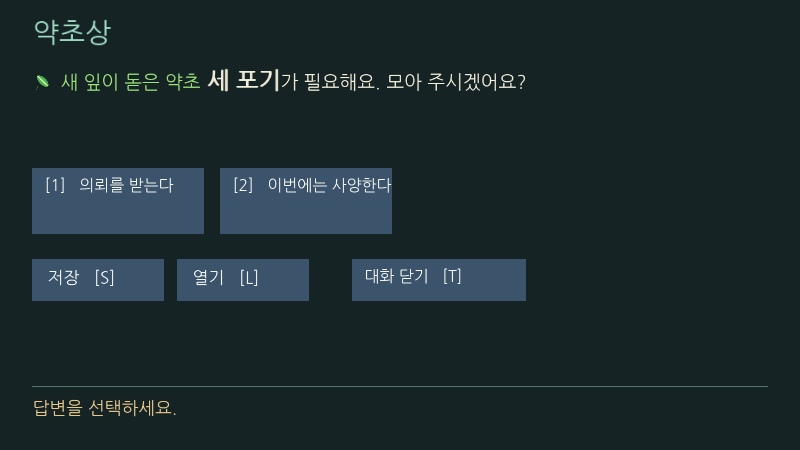
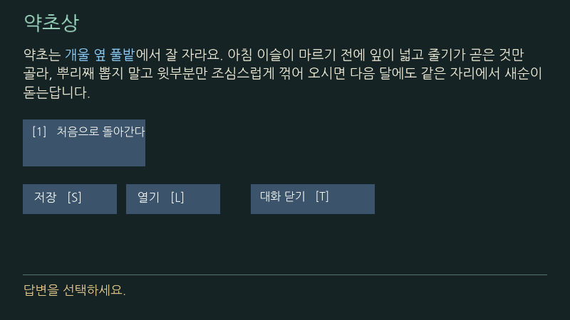

# 서식 있는 텍스트와 글자 단위 표시 (로드맵 11.5) — Mac 검증

> 2026-11-23 갱신(로드맵 11.13): 게임 텍스트를 `Brutal.Sdl.Ttf`로 바꾼 뒤 같은 입력으로 세 경로를 다시 실행했다. `reveal.tsv`(SHA-256 `76118c09…`)는 그대로이고, 캡처는 SDL_ttf 글자로 바뀌어 [release/](release/)를 교체했다. Scene Play·Release·Native AOT 캡처가 7개 프레임 모두 바이트 단위로 같아 Scene Play 캡처 폴더는 지웠고 [comparison.tsv](comparison.tsv)에 해시를 남겼다. 아래 표의 글리프 시트·Skia·stb_truetype 설명은 11.5 당시 기록이다. [11.13 전환 기록](../text-ttf/README.md)

InventoryLab 약초상 대화에서 색·굵기·크기·인라인 아이콘 태그, 번역 테이블의 긴 한국어 대사, 초당 30자 표시와 **Space** 넘기기를 확인했다. [사용법](../../../../docs/manual/game-ui.md#서식-있는-텍스트와-글자-단위-표시) · [약초상 대화](../../../../docs/manual/dialogue.md#서식-있는-대사와-글자-단위-표시) · [검사기](../../InventoryLab.RichText/README.md)

- 환경: macOS 27.0.1, Apple Silicon(arm64), 이 Mac. 2026-11-23.
- 대상: 에디터 안의 Play(Scene Play, 패키지 `editor/MoNoon.app`), 내보낸 게임 Release와 Native AOT(`--profile distribution`).
- 첫 예외: 없음. 아래 Bundles 측정만 키 입력이 창에 전달되지 않아 실패했다(기존 main 빌드도 같은 결과).

## 재현 입력과 결과

[입력 재생](Herbalist-rich.inputreplay)은 60 Hz 360프레임이다. 10 **T** 인사말 → 90 **4** 약초가 자라는 곳(번역 키 `herbalist.meadow`, 세 줄 문장) → 150 **Space** → 170 **1** 처음으로 → 230 **1** 의뢰(아이콘·색·굵기·크기).

| 검사 | Scene Play | Release | Native AOT |
| --- | --- | --- | --- |
| 프레임별 표시 글자 수 360행 ([reveal.tsv](reveal.tsv)) | 통과 | 통과 | 통과 |
| 세 실행의 `reveal.tsv` SHA-256 ([reveal.sha256](reveal.sha256)) | `76118c09…` | `76118c09…` | `76118c09…` |
| 표시 중 **Space**(150프레임): 150프레임 30/108, 151프레임 108/108 | 통과 | 통과 | 통과 |
| 같은 7개 프레임 캡처 | Release와 바이트 동일(11.13) | [release/](release/) | Release와 바이트 동일 |
| Release·Native AOT 캡처 동일 ([comparison.tsv](comparison.tsv)) | — | 7/7 | 7/7 |
| Scene Play와 Release 캡처 차이 | 0(11.13, 11.5 당시 0.025%) | 기준 | — |
| 배포본 금지 파일(Skia·Avalonia·Engine.Editor·Engine.Authoring·HarfBuzz) | — | 0개 | 0개 |

캡처 프레임의 진행: 30 → 10/27, 85 → 27/27, 120 → 15/108, 152 → 108/108(넘긴 직후), 175 → 2/27(인사말 다시 시작), 262 → 16/34, 345 → 34/34. Scene Play와 Release의 차이는 화면 아래 상태 메시지 `답변을 선택하세요.`의 90픽셀이다. 이 문구는 스크립트 문자열이라 글리프 시트에 없고 플레이어는 TTF를 stb_truetype로, 에디터는 Skia로 그린다. 약초상 대사 영역은 두 경로가 같다.

- Scene Play 캡처는 에디터 Play의 `GameSession`(에디터 스크립트 컴파일)을 Scene 패널과 같은 `SdlCanvas` + `GameTextRasterizer`로 오프스크린 SDL 소프트웨어 렌더러에 그렸다. 재생이 끝난 뒤 실제 Scene 패널 창도 캡처했다: [scene-play-window.png](scene-play-window.png).
- Release·Native AOT는 헤드리스 재생에 `MONOON_REPLAY_SNAPSHOTS`를 주어 플레이어의 SDL 캔버스(소프트웨어 렌더러, 배포 글리프 시트)로 저장했다.
- Inspector의 **Rich text tags**, **Reveal /s**, **Icons** 행은 기존 레이블 열과 입력 열에 맞는다: [1280 px](inspector-1280.png) · [1920 px](inspector-1920.png). 1600 px도 같은 실행에서 확인했다.

## 굵기·크기 글리프와 빌드 크기

굵기·크기 변형 시트를 굽지 않았다. 굵은 글자는 같은 글자 텍스처를 글자 크기의 1/20만큼 옮겨 두 번 그리고, `<size>`는 기존 32 px 글리프를 늘이거나 줄인다. 이 방식은 구운 글리프, 시트에 없는 글자를 런타임에 그리는 stb_truetype 경로, 에디터의 Skia 경로에서 같은 규칙으로 동작한다. 나눔고딕에는 Bold 파일이 없어 변형 시트도 Skia의 합성 굵기가 되므로, 시트를 늘려도 얻는 것이 적다고 판단했다. 32 px보다 큰 크기는 확대되어 흐려질 수 있다.

| InventoryLab 배포본에 추가된 파일 | 바이트 |
| --- | --- |
| `Assets/Fonts/NanumGothic-Regular.ttf` (KeyRoom과 같은 OFL 글꼴) | 2,054,744 |
| `NanumGothic-Regular.ttf.glyphs` (245자, 압축 전 207,438) | 41,544 |
| `NanumGothic-Regular.ttf.license` | 4,534 |
| `Assets/Text/Herbalist.table`, `Assets/Icons/Herb.png` | 643 + 486 |
| 합계 | 2,101,951 |

앱 전체는 Release 143,512 KB, Native AOT 66,164 KB다. 굵게 변형 시트를 같은 글자 범위로 구웠다면 약 40 KB, 크기마다 한 장씩 더 늘었을 것으로 추정한다(측정하지 않음). 이전에는 InventoryLab이 OS 글꼴을 썼기 때문에 Windows·Linux 게스트에서 글꼴이 달랐다. 이제 세 OS가 같은 글꼴과 시트를 쓴다.

## 기존 InventoryLab 회귀

| 검사 | 결과 |
| --- | --- |
| `./monoon test` | 통과(650개 PASS, `All checks passed.`). 새 [RichTextChecks](../../Engine.Checks/RichTextChecks.cs) 25개 포함 |
| `./monoon test inventorylab <builds> --profile distribution` | 통과. 대화 패키지 동일성, 체크포인트 3개 Release·Native AOT 바이트 동일 |
| `./monoon test replay <builds>` | 통과. 저장 SHA-256 `EED41DEF…`, 기준 저장과 동일 |
| [InventoryLab.Incremental](../../InventoryLab.Incremental/README.md) `--dependencies` | 통과(cold 8, 재빌드 1, 재사용 7, 의존성 재빌드 5, 캐시 복구 1) |
| [InventoryLab.DataList](../../InventoryLab.DataList/README.md) Release·Native AOT | 통과(`item-0042`, 정렬 후 651, 행 11) |
| [InventoryLab.Crashes](../../InventoryLab.Crashes/check.py) | 통과(`QuestJournal.cs:35`, 잘못된 기호 묶음 거부) |
| [InventoryLab.Bundles](../../InventoryLab.Bundles/measure_mac.py) `--repeats 1` | 실패: 첫 조작(`1` 키) 대기 시간 초과. 2026-11-17의 기존 `game-builds/InventoryLab-Bundles`에서도 같은 위치에서 실패해 이 환경에서 키 이벤트가 SDL 창에 전달되지 않는 문제로 본다 |
| InventoryLab.Replay (x64 게스트) | 실행하지 않음(코디네이터 담당) |

기준 파일은 바꾸지 않았다. 기존 입력 재생은 **Space**를 쓰지 않고 선택지는 표시 중에도 동작해 저장 결과가 같다. 다음은 약초상 변경 때문에 함께 바꿨다.

- `packages/Dialogue.monopackage`: 대화 패키지 검사가 샘플의 `Assets/Dialogue`와 같은 바이트를 요구해 새 `Herbalist.data`로 교체했다.
- `InventoryLab.Incremental/prepare.py`: InventoryLab에 `localization:`이 생겨 같은 키를 덧붙이지 않도록 했다. 인사말 원문 `어서 오세요. 무슨 일로 오셨나요?`는 그대로 남겨 증분 빌드 검사의 대사 교체가 동작한다.

## Brutal.Sdl.Ttf로 바꿀 때

이번 항목은 기존 글리프 시트 경로를 유지했다. 판단 자료로 승인된 `Ahwoo.BRUTAL.Sdl.Ttf` 2026.10.3을 임시 폴더에 복원해 살폈다(저장소에는 추가하지 않음).

- 배포 글꼴: 지금도 TTF를 함께 배포한다(시트 검증과 시트에 없는 글자용). SDL_ttf는 같은 TTF를 읽으므로 글꼴 파일은 늘지 않고 `.glyphs` 시트와 빌드 단계의 Skia 굽기를 없앨 수 있다. 프로젝트 글꼴이 없는 게임은 지금처럼 OS 글꼴 경로를 찾아 `TTF_AddFallbackFont`로 이어야 한다.
- 라이선스: SDL_ttf는 zlib, 내장 FreeType(FreeType License), HarfBuzz(Old MIT), zlib 고지가 패키지 `LICENSES`에 23 KB로 들어 있다. BRUTAL 고지와 함께 배포본 `Licenses`에 넣어야 한다.
- 크기: 네이티브 라이브러리 osx-arm64 2.06 MB, linux-x64 2.37 MB, win-x64 1.59 MB와 관리 어셈블리 65 KB가 플레이어마다 늘어난다. 시트(이번 샘플 41 KB)보다 크다. 이 패키지는 `Ahwoo.BRUTAL.Sdl` 2026.10.3을 요구해 현재 2026.10.2 참조와 Windows `SDL3.dll` 교체도 함께 올려야 한다.
- Native AOT: P/Invoke 바인딩이라 지금의 `Brutal.Sdl`처럼 동작할 것으로 보지만, 네이티브 파일 복사(`PlayerDistribution.targets`)와 세 OS AOT 빌드를 새로 검증해야 한다.
- 한글 조합: HarfBuzz가 포함되어 결합 문자·자모 조합과 커닝을 처리한다(`TTF_SetFontScript`, `TTF_SetFontDirection` 노출). 지금 경로는 글자별 advance를 더하므로 한글 완성형에는 충분하지만 옛한글·결합 자모의 배치는 HarfBuzz가 낫다. 다만 서식 텍스트의 글자 단위 표시·줄바꿈은 지금처럼 엔진이 글자 위치를 알아야 하므로 `TTF_Text`의 글리프 위치를 읽는 쪽으로 다시 짜야 한다.
- 결과 차이: 모든 샘플의 글자 모양과 폭이 바뀌어 캡처·레이아웃 기준을 다시 만들어야 한다.

## 확인하지 못한 것

- Windows·Linux x64 게스트 실행(코디네이터 담당), 물리 GPU 창에서의 Release·Native AOT 화면(캡처는 SDL 소프트웨어 렌더러).
- 컷신 대사(`.cutscene`)에는 서식 태그와 글자 단위 표시를 넣지 않았다. UI Text를 쓰는 대화(InventoryLab 약초상)만 대상이다.
- 오래된 플레이어 템플릿에 대한 버전 표식은 추가하지 않았다. 새 필드를 쓰는 씬은 갱신한 템플릿으로 내보내야 한다.

Linux x64 게스트(2026-11-23): 세 경로의 `reveal.tsv`가 Mac과 같고 `compare`를 통과했다. 캡처는 Mac과 0.22–0.72% 다르다. [Linux 결과](../chapter11-linux-x64/README.md)
