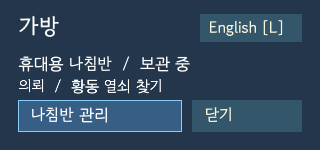
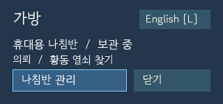

# Windows·Linux x64 SDL3 배포 검증

2026-11-17에 보존한 QEMU Windows 11 Enterprise LTSC x64(26100.1742)와 Debian 12 amd64에서 KeyRoom의 Release와 Native AOT를 각각 실행했다. Windows는 게스트 데스크톱, Linux는 Xvfb의 X11 창에서 실제 키보드 입력과 화면 캡처를 사용했다. 게임과 마스크 확인용 복사본은 각각 별도 저장 프로필을 사용했다.

## 배포 크기

모두 바이트 단위다. 배포 폴더의 일반 파일 길이를 합산했고 ZIP은 같은 이름의 최상위 게임 폴더와 전체 파일을 DEFLATE 레벨 6, 고정 타임스탬프로 압축했다. 배포 심볼은 폴더와 ZIP에서 분리했다. 최종 ZIP은 각 게스트에서 생성했고 Mac에서 SHA-256, 모든 항목의 CRC와 압축 해제 후 논리 용량을 확인했다.

| 환경 | 빌드 | 이전 폴더 | 현재 폴더 | 감소율 | 이전 ZIP | 현재 ZIP | 감소율 |
| --- | --- | ---: | ---: | ---: | ---: | ---: | ---: |
| Windows 11 x64 | Release | 98,810,733 | 89,024,459 | 9.9% | 43,048,513 | 39,075,443 | 9.2% |
| Windows 11 x64 | Native AOT | 26,722,587 | 17,250,276 | 35.4% | 10,513,296 | 6,660,281 | 36.6% |
| Debian 12 x64 | Release | 110,276,583 | 100,669,693 | 8.7% | 46,853,311 | 42,796,092 | 8.7% |
| Debian 12 x64 | Native AOT | 35,796,869 | 26,457,656 | 26.1% | 14,626,745 | 10,670,056 | 27.1% |

예전 x64 폴더에는 다른 버전의 게임도 들어 있어, 바로 전 Mac Release의 휴대용 PDB(빌드 `b750cbae736c47c986c2b31302decc80`)와 보관된 소스에서 SkiaSharp 2.88.9 기준 플레이어를 재구성했다. 게임 콘텐츠와 스크립트 소스, .NET 10 Release 설정, Distribution 프로필을 맞췄다. 에디터 분리 이전의 큰 배포본은 비교에서 제외했다. Release는 같은 RID용 자체 포함 템플릿의 모든 파일 해시를 확인한 뒤 게스트의 CLI로 내보냈고, Native AOT는 같은 게스트의 .NET 10.0.101과 네이티브 링커로 컴파일했다. 표에는 각 OS에서 내보낸 배포본을 기록했다. 이전 패키지에서는 SkiaSharp 네이티브 파일을 확인했고, 현재 패키지의 전체 파일·Release 의존성·실행 중 모듈에서 SkiaSharp가 발견되지 않았다. [이전 런타임 소스 108개의 SHA-256](baseline-sources.sha256) · [Windows Release](win-x64/release-build.log) · [Windows AOT](win-x64/build.log) · [Debian Release](linux-x64/release-build.log) · [Debian AOT](linux-x64/build.log)

## 한글과 마스크

같은 800 × 450 게임 화면에서 I로 가방을 열고 L로 한국어를 선택했다. 가방 제목, ‘휴대용 나침반 / 보관 중’, ‘의뢰 / 황동 열쇠 찾기’를 OCR로 읽고 기본 고운돋움과 대체 나눔고딕을 선택한 음절을 실행 로그와 대조했다. 표의 상관계수는 제목·아이템·의뢰 세 줄 중 최솟값이다(1이면 명암 형태가 일치). 평균 차이는 0~255 RGB 채널값의 평균 절대 오차다. 가방은 320 × 150, 참나무는 102 × 98 실제 픽셀을 비교했다. [같은 밀도의 Mac 가방](mac-ko.png) · [Mac 마스크](mac-masked.png)

| 환경 | 빌드 | 한글 캡처 | 글자 상관계수 | 가방 평균 차이 | 마스크 캡처 | 참나무 평균 차이 | SDL3 모듈 |
| --- | --- | --- | ---: | ---: | --- | ---: | --- |
| Windows 11 x64 | Release | [가방](win-x64/release/ko.png) | 0.9590 | 1.458 | [참나무](win-x64/release/masked.png) | 0.103 | [로드 목록](win-x64/release/stock-modules.json) |
| Windows 11 x64 | Native AOT | [가방](win-x64/native-aot/ko.png) | 0.9590 | 1.458 | [참나무](win-x64/native-aot/masked.png) | 0.103 | [로드 목록](win-x64/native-aot/stock-modules.json) |
| Debian 12 x64 | Release | [가방](linux-x64/release/ko.png) | 0.9439 | 1.743 | [참나무](linux-x64/release/masked.png) | 0.179 | [로드 목록](linux-x64/release/stock-modules.json) |
| Debian 12 x64 | Native AOT | [가방](linux-x64/native-aot/ko.png) | 0.9439 | 1.743 | [참나무](linux-x64/native-aot/masked.png) | 0.179 | [로드 목록](linux-x64/native-aot/stock-modules.json) |

원본 KeyRoom에는 스프라이트 마스크를 사용하는 참나무가 없어, Mac 검증과 동일하게 게임을 복사하고 첫 참나무의 PNG에 알파 255·128·0인 세 구간의 마스크를 연결했다. 같은 위치에서 원본과 마스크 적용 화면을 각각 캡처해 왼쪽 색 보존, 가운데 배경과의 절반 혼합, 오른쪽 배경색 노출을 검증했다. 용량은 원본 게임에서 측정했다. 네 실행의 별도 빌드 영수증, 폰트 선택 로그, JSON 비교값과 캡처는 위 표의 환경별 폴더에 있다. [빌드·ZIP 해시 및 글꼴 데이터 비교](build-comparison.json)

## 빌드한 OS에 따른 글자 가장자리

- Windows 11 x64에서 내보낸 Release와 Native AOT 간 다른 픽셀은 가방 0/48,000개, 참나무 0/9,996개였다. 같은 AOT 복사본에 Mac에서 만든 두 글꼴의 `.glyphs`만 적용하면, 같은 VM에서 실행한 Mac 교차 배포 Release와 가방의 다른 픽셀은 0/48,000개였다. 교체 전후 AOT끼리는 3,276개가 달랐다. [대조 수치](win-x64/cross-release/control.json)
- Debian 12 x64에서 내보낸 Release와 Native AOT 간 다른 픽셀은 가방 0/48,000개, 참나무 0/9,996개였다. 같은 AOT 복사본에 Mac에서 만든 두 글꼴의 `.glyphs`만 적용하면, 같은 VM에서 실행한 Mac 교차 배포 Release와 가방의 다른 픽셀은 0/48,000개였다. 교체 전후 AOT끼리는 3,329개가 달랐다. [대조 수치](linux-x64/cross-release/control.json)

실제 배포 ZIP에는 각 OS의 빌드 도구가 기본·대체 TTF에서 생성한 글리프가 들어 있다. 위 대조 실험에서는 불변인 실행 파일·원본 폰트·창 크기를 유지하고 복사본의 글리프 파일만 바꿨다. SDL3가 그린 최종 색과 경계의 미세한 차이는 실제 캡처 비교값에 포함된다.

Windows의 언어 전환 도중에는 가방 제목이 먼저 한국어가 되고 아이템·의뢰가 직전 프레임의 영어를 표시하는 화면도 관찰됐다. 최종 캡처는 같은 배포본을 다시 실행해 세 줄이 모두 바뀐 뒤 촬영했다. [전환 도중의 Windows AOT 가방](win-x64/transitional-bag.png)

후속 수정에서 세 줄이 같은 프레임의 언어를 사용하도록 변경했다. [수정 후 세 OS의 양방향 첫 프레임 비교](../../bag-locale-frame/README.md)

### 같은 배율의 실제 화면

| 배포 환경 | 가방 패널 | 마스크 적용 참나무 |
| --- | --- | --- |
| macOS arm64 |  |  |
| Windows x64 Native AOT |  |  |
| Linux x64 Native AOT |  |  |
