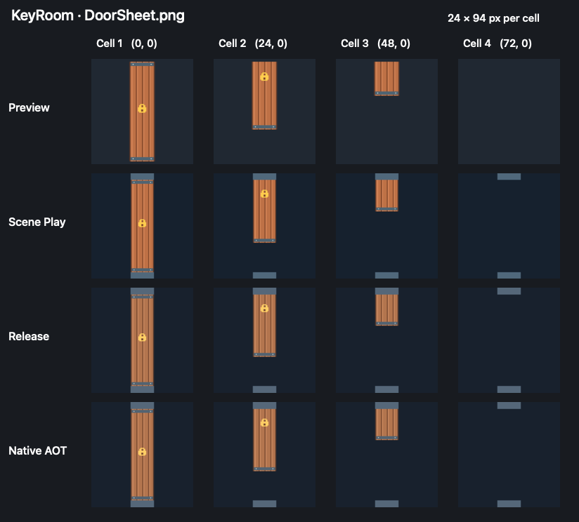

# KeyRoom 문 시트 검증

2026-11-13, macOS 27.0.1 arm64. KeyRoom 문 원본 4장의 RGBA 픽셀을 왼쪽부터 24 × 94씩 배치했다. 시트를 다시 읽어 원본과 비교한 9,024개 픽셀이 모두 일치했다. 클립은 셀마다 0.09초, 총 0.36초이고 반복은 꺼져 있다.



- **작성과 재열기**. KeyRoom 복사본에 첫 셀을 남기고 셀 선택 창에서 4번, 2번, 3번을 차례로 클릭했다. Insert cells로 2·3·4번이 행 우선으로 들어왔다. 세 프레임의 시간을 0.09초로 고치고 ⌘S로 저장한 뒤 앱을 종료하고 다시 열었다. 셀의 X 좌표는 0·24·48·72, Y는 모두 0이고, 저장한 파일은 샘플 및 두 빌드의 클립과 바이트 단위로 일치한다. 클립 .meta도 원본과 비교했다. [셀 선택](01-pick-cells.png) · [재열기](02-reopened.png) · [저장한 YAML](saved-clip.yaml)
- **여백과 간격**. 폭 409pt 창에서 셀 크기 20×40, 여백 4×5, 간격 2×4로 바꿨다. 아래쪽 셀을 먼저 클릭한 뒤 위쪽 셀과 사이의 빈 간격을 클릭했다. 두 프레임만 들어왔고 저장한 원점은 순서대로 (48, 5), (4, 49)였다. [4열 2행 선택 화면](04-narrow-grid.png)
- **실제 재생**. 클립 창에서 Play를 눌렀다. Scene Play와 두 독립 게임에서는 각각 새 세션에서 왼쪽 방향키로 열쇠를 먹었다. 각 창을 60Hz로 캡처해 문 영역에서 24×94개 텍셀 중심을 원본 PNG들과 비교했다. 네 경로 모두 1 → 2 → 3 → 4로 판정됐고, 마지막 셀은 투명했다. 각 대표 화면에서 2,256개 위치의 문 실루엣이 해당 PNG와 일치했다. 창 배율과 디스플레이 색 변환을 고려해 RGB 일치 개수는 채널당 허용차 30으로 별도 기록했다. 기록의 시각은 창 캡처 시작 기준이며, 미리보기 재생을 누르기 전과 마지막 셀을 유지하는 구간도 포함한다. [캡처 판정표](capture.tsv)
- **게임 빌드**. osx-arm64 Release 플레이어와 같은 호스트에서 컴파일한 Native AOT 플레이어를 각각 실행했다. 두 빌드 모두 애니메이션용 시트 한 장과 대기 상태의 스프라이트 Door.png를 포함한다. 열쇠 효과음에 쓸 오디오 스트림은 씬 로딩 중에 준비한다. [Scene Play](03-scene-end.png) · [Release](release-end.png) · [Native AOT](aot-end.png)
- **회귀 검사**. Engine.Checks에서 열쇠 획득 후 60틱 동안 그려진 시트 좌표, 기존 전체 PNG 클립, 범위 밖 셀, 구버전 템플릿을 검사했다. SDL Metal에서 3열 2행의 색상 시트를 확대해 즉시 그리기와 배치 그리기의 모든 출력 픽셀을 검사했다. 여섯 셀 모두 가장자리까지 지정한 색으로 그려졌다.

저장소 루트에서 회귀 검사를 실행할 수 있다.

```sh
dotnet run --project engine/tests/Engine.Checks -c Release -p:NuGetAudit=false -- "$PWD"
dotnet run --project engine/benchmarks/Sprites2D/Brutal -c Release -p:NuGetAudit=false -- metal --verify-batching
```
