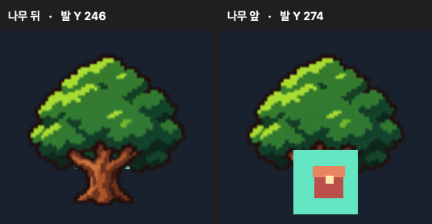

# KeyRoom의 발 위치 정렬

2026-11-16, macOS 27.0.1 arm64에서 MoNoon의 Scene Play와 KeyRoom Release·Native AOT 앱을 각각 열었다. 첫 방의 시작점에서 아래 방향키로 나무를 지나고 위 방향키로 되돌아갔다. 나무의 기준은 월드 Y=268이다. 플레이어는 몸, 가방, 덮개, 버클을 한 그룹으로 그린다.

| 실행 | 나무 뒤에서 멈춤 | 앞으로 걸어 나옴 | 뒤로 되돌아감 |
| --- | --- | --- | --- |
| Scene Play | [발 Y ≈ 246.7](editor-behind.png) | [275.0](editor-front.png) | [246.7](editor-behind-again.png) |
| Release | [발 Y ≈ 246](release-behind.png) | [274](release-front.png) | [246](release-behind-again.png) |
| Native AOT | [발 Y ≈ 246](aot-behind.png) | [274](aot-front.png) | [246](aot-behind-again.png) |

## 겹친 픽셀 비교

이동 전 화면에 나무와 플레이어가 떨어져 있어 양쪽의 원래 색을 읽을 수 있다. 플레이어를 따라가는 카메라의 이동량은 고정 벽의 위쪽 가장자리로 계산했다. 그만큼 나무의 좌표를 맞춘 뒤, 몸·가방·덮개·버클이 불투명한 나무와 겹치는 부분을 각각 비교했다. 플레이어가 뒤에 있을 때는 나무 색, 앞에 있을 때는 해당 부위의 색을 기대했다. 투명 영역과 색 경계는 표본에서 제외했다.

| 실행 | 뒤에서 나무색 일치 | 앞에서 플레이어색 일치 | 복귀 후 나무색 일치 |
| --- | ---: | ---: | ---: |
| Scene Play | 2,066 / 2,066 | 196 / 196 | 2,066 / 2,066 |
| Release | 1,940 / 1,940 | 178 / 178 | 1,940 / 1,940 |
| Native AOT | 1,940 / 1,940 | 178 / 178 | 1,940 / 1,940 |

두 배포 앱의 프로필은 `distribution`이다. Release 빌드 ID는 `fb62beb9cc414a779b8415f4e8d97f85`, Native AOT 빌드 ID는 `c371f581c2b9495999ad78cbdf51971a`다.

엔진 전체 회귀 검사도 통과했다. 정렬 검사는 한 물리 틱 안의 발 Y=267, 268, 269를 따로 그려 보간 중의 경계와 동률 순서를 확인한다. 회전·스케일이 있는 부모, 중첩 그룹, 그룹 안팎의 레이어와 저장·재열기도 검사한다. 에디터 창을 1220×768과 1040×700으로 바꿔 Player와 Oak tree Inspector의 **Layer**, **Order**, **Use foot Y**, **Foot ΔY** 행 정렬을 확인했다. [회귀 검사 코드](../../Engine.Checks/SpriteSortingChecks.cs) · [설정 방법](../../../../docs/manual/sprites.md#발-위치로-앞뒤-정렬하기)

나무 스프라이트 제작 정보

내장 ImageGen으로 투명 배경 이미지를 생성하고 비율을 유지한 128×123 PNG로 가져왔다. [KeyRoom의 Oak.png](../../../../samples/KeyRoom/Assets/Oak.png)

생성 프롬프트

> A single compact oak tree sprite for a top-down 2D pixel-art game. Broad solid leafy green crown, short wide brown trunk with a clearly visible centered foot, front three-quarter view. Crisp chunky pixel steps, restrained 5-color palette, dark outline and simple asymmetrical highlights. Center the whole tree with minimal transparent margins. True transparent background. No ground, shadow, labels or other objects.

